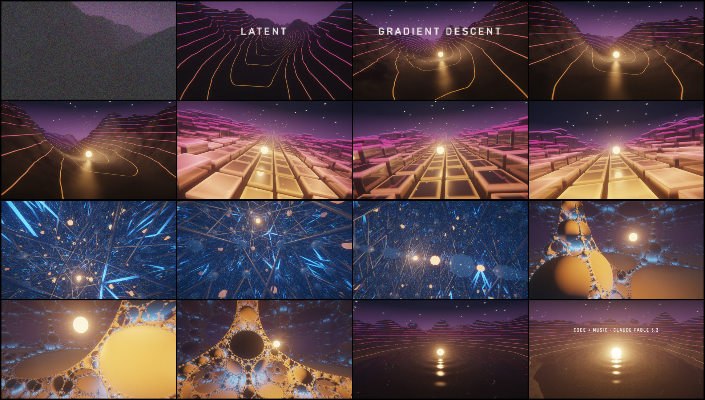

# Gradient Descent

An 8k intro for Windows browsers by **Latent**. Code and music: Claude Fable 5.2
(an AI model made by Anthropic). Release notes: [gradient_descent.nfo](gradient_descent.nfo).

A glowing parameter rolls down a loss landscape, crosses a field of weights,
falls through the layers of a network, drifts through deep structure and comes to rest at the minimum.



Video capture: [media/gradient_descent.mp4](media/gradient_descent.mp4) (1080p60, with soundtrack)

## Run it

Double-click `intro.html`. A title screen shows progress while the soundtrack
is rendered and the shaders compile (several seconds). When it says "click to
start", click: it goes fullscreen and plays immediately for 2:16. ESC leaves
fullscreen.

- Target: Edge or Chrome on Windows with a discrete GPU. Tested only on Edge
  with an RTX 5090, where a 1080p frame takes about 3 ms.
- The picture is rendered at a fixed 1920x1080 and scaled to the screen.
- No server and no browser flags are needed.

## Size

| File | Bytes | Notes |
|---|---|---|
| `intro.html` | 6,116 | the release; 2,076 bytes under the 8,192 limit |
| `intro_fetch.html` | 5,871 | same intro with the common `fetch` bootstrap; needs http:// or `--allow-file-access-from-files` |
| `dev.html` | about 13,800 | unpacked build used for capture and debugging |

Before packing, the JavaScript plus the three minified shaders are 12,222
bytes; raw deflate (zopfli) brings that to 5,711.

## How it works

**One HTML file, no assets.** Everything is generated at start-up: three
fragment shaders, about 3.1 kB of JavaScript (including the title screen), and four lines of text drawn
with the system font into a texture.

**Visuals** (`src/scene.frag`). A single sphere-tracing shader holds all five
scenes and picks one from the time uniform. Camera paths, the orb's position
and all sync are computed in the shader, so the JavaScript only passes
resolution and time.

| Time | Scene | Distance field |
|---|---|---|
| 0:00 | The loss landscape | fbm height field with a valley carved along a sine path; contour lines every 0.35 units, spaced so they pass the camera on every 8th note |
| 0:32 | The weights | a grid of columns whose heights take one random "training step" per beat; rays are stepped cell by cell |
| 0:48 | The network | nodes on a grid, each linked to four neighbours in the layers above and below; built from two line segments in a mirrored cell |
| 1:20 | Deep structure | Apollonian sphere-packing fractal, coloured by orbit trap |
| 1:52 | The minimum | the landscape again as a basin, with a rippling reflective lake |

Shared across scenes: the orb is a moving point light with soft shadows, five-tap
ambient occlusion (both replaced by simpler terms in the fractal, see below), one reflection bounce, distance fog, and glow accumulated
along the ray.

**Post** (`src/post.frag`). The scene is rendered to a half-float texture.
Bloom comes from that texture's own mip chain (four jittered taps per level),
which costs one `generateMipmap` call. Then chromatic aberration, flashes on
scene cuts, titles, vignette, ACES tonemap and grain. The intro opens as pure
noise and "denoises" in 16 steps, one per beat.

**Music** (`src/music.frag`). The soundtrack is a fragment shader too: one
pixel per stereo sample at 48 kHz, 138 seconds, rendered once into a
4096x1620 float texture and read back into an `AudioBuffer`. It is 120 BPM in
D minor (Dm, Bb, F, C) with kick, FM bass, hats, clap, a detuned pad, a
3-against-4 arpeggio and a bell lead through a ping-pong dotted-8th echo. All
timing is integer sample arithmetic, so there is no float drift late in the
track.

**Packing** (`tools/build.mjs`). The script is deflated with zopfli and stored
as raw bytes inside an HTML comment of an ISO-8859-15 document. A 300-byte
bootstrap reads the comment back from the DOM, undoes the charset mapping and
pipes it through `DecompressionStream('deflate-raw')`. Bytes the HTML parser
would alter (NUL, CR, and `>` where it could close the comment) are escaped,
which costs about 1%. Unlike the usual `fetch('#')` bootstrap, this runs from
`file://` on a double-click.

## Credits and sources

No assets and no third-party libraries are included in the intro. Two
well-known hash one-liners are used as published, and the rest was written for
it using techniques that are common demoscene knowledge:

- The float hash `h1` is Dave Hoskins' "hash without sine" (`hash12`, MIT licence).
- The integer hash in the music shader is the PCG hash (Jarzynski and Olano,
  "Hash Functions for GPU Rendering").
- Box distance function, sphere tracing, soft shadows, the four-tap normal and
  the distance-based ambient occlusion follow Inigo Quilez's articles.
- The tonemap is Krzysztof Narkowicz's ACES fit.
- Rendering the soundtrack in a fragment shader is an established 4k/8k
  technique (Shadertoy sound shaders, 0b5vr's intros).
- `intro_fetch.html` uses the `fetch`/`DecompressionStream` bootstrap known
  from 0b5vr's compeko packer. The double-click bootstrap in `intro.html` is our own.
- Build tools: terser, zopfli (`@gfx/zopfli`), puppeteer-core and ffmpeg. None
  of their code ends up in the intro.
- The Apollonian fractal in "deep structure" follows the well-known Knighty / Inigo Quilez construction.

## Build and capture

From the repository root, with Node 22 and ffmpeg on the path:

```
node tools/build.mjs 01_gradient_descent            # -> intro.html, intro_fetch.html, dev.html
node tools/capture.mjs 01_gradient_descent sheet    # -> media/contact_sheet.jpg
node tools/capture.mjs 01_gradient_descent video    # -> media/gradient_descent.mp4
node tools/audiostat.mjs 01_gradient_descent        # soundtrack levels and frame timings
node tools/capture.mjs 01_gradient_descent check 01_gradient_descent/intro.html   # load the packed file, click, screenshot
```

Capture drives headless Edge and renders frame by frame at exact timestamps,
so the video is deterministic regardless of machine speed. Lines in
`src/main.js` ending in `//DEV` exist only in `dev.html`.

## Known limits

- The music was checked numerically (no NaNs, peak and RMS per section) but
  nobody has listened to it yet. The mix may need a pass by ear.
- Shaders are minified by `tools/glslmin.mjs`, a small renaming minifier. The
  build uses Shader Minifier instead if `tools/shader_minifier.exe` is
  present, which should save some bytes.
- 2.1 kB of the budget is unused.
- One trap worth knowing: with ANGLE's D3D11 backend, assigning the ray
  position to an outer-scope variable inside the march loop and then passing
  it to the distance function evaluated the first step at the origin. The loop
  now passes `ro+rd*t` directly.
- The fractal's distance estimate jumps in scale between neighbouring fold
  regions. Soft shadows and sampled ambient occlusion turned those jumps into
  concentric stripes, so that scene uses no orb shadows, an orbit-trap
  occlusion term and a ten times tighter hit threshold.
