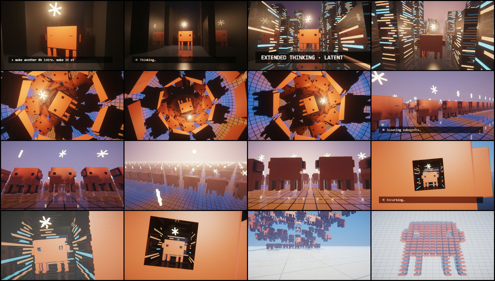

# Extended Thinking

An 8k intro for Windows browsers by **Latent**, starring Clawd, the Claude Code
mascot. Code and music: Claude Fable 5.2 (an AI model made by Anthropic).
Release notes: [extended_thinking.nfo](extended_thinking.nfo).

Someone types a prompt. Clawd wakes up, thinks while code writes itself onto
the towers around it, falls down a tunnel of Clawds, spawns subagents on a
plasma dance floor, recurses into its own eye, lines the subagents up into one
big Clawd, and is compacted when the context runs out.



Video capture: [media/extended_thinking.mp4](media/extended_thinking.mp4) (1080p60, with soundtrack)

## Run it

Double-click `intro.html`. A title screen shows progress while the soundtrack
is rendered and the shaders compile (several seconds). When it says "click to
start", click: it goes fullscreen and plays for 2:18. ESC leaves fullscreen.

- Target: Edge or Chrome on Windows with a discrete GPU. Tested only on Edge
  with an RTX 5090, where a 1080p frame takes 2 to 10 ms.
- The picture is rendered at a fixed 1920x1080 and scaled to the screen.
- No server and no browser flags are needed.

## Size

| File | Bytes | Notes |
|---|---|---|
| `intro.html` | 6,958 | the release; 1,234 bytes under the 8,192 limit |
| `intro_fetch.html` | 6,687 | same intro with the common `fetch` bootstrap; needs http:// or `--allow-file-access-from-files` |
| `intro_lean.html.br` | 5,468 | the lean version from `src_lean/`: no title screen, otherwise the same picture and sound; packed with brotli |
| `dev.html` | about 17,000 | unpacked build used for capture and debugging |

### Lean build

`src_lean/` is a second version made for size. It differs from `src/` in three
ways, none of which touch the intro itself:

- No title screen. The page is black while the soundtrack is rendered and the
  shaders compile, then shows a still of the opening. Click it to start.
- The shader header (`#version`, precision, `R`, `O`) is added once in
  JavaScript instead of being repeated in every shader.
- The build searches for shader identifier names that brotli packs better
  (`RENAME_OPT`, see [../tools/readme.md](../tools/readme.md)).

Edge and Chrome cannot unpack brotli from a local file, so `run_lean.bat`
starts a small local server (`tools/serve_br.ps1`) and opens
http://localhost:8125 in the default browser; Ctrl+C in its window stops the
server. Build it with:

```
$env:RENAME_OPT=3000; node tools/build.mjs 02_extended_thinking lean
```

The build also writes `intro_lean.html`, `intro_lean_fetch.html` and
`dev_lean.html`, and the normal build writes `intro.html.br`; these are not
kept in this folder.

30 frames spread over the whole intro (rendered at 960x540) and all 13.3
million audio samples were compared with the build from `src/`: they are
bit-identical. The shaders compress to about 4.9 kB on their own, so a 4k
version is not possible without removing visible or audible content.

## Timeline

The track is 125 BPM, so one bar is 1.92 s. The camera cuts every 4 bars, with a flash and a row glitch.

| Bar | Time | Terminal line | Scene |
|---|---|---|---|
| 0 | 0:00 | `> make another 8k intro. make it stunning.` | Clawd asleep in the dark; the spinner star lights up above its head |
| 8 | 0:15 | title | Thinking: Clawd walks between towers at dawn while lines of code are typed onto them; light shafts from the rising sun |
| 16 | 0:31 | | Tunnel: twisted rings of Clawds standing on a plasma wall, the hero falling down the middle |
| 24 | 0:46 | `✻ Spawning subagents…` | An endless grid of Clawds hopping in a wave on a plasma dance floor that pulses with the kick; four shots |
| 40 | 1:17 | `✻ Recursing…` | Zoom into Clawd's eye. The eye is a room with scrolling code on the walls and another Clawd inside, whose eye is a room, and so on, eight levels deep |
| 56 | 1:48 | credits | Subagents rain from the sky into formation; the camera rises until they read as one pixel-art Clawd |
| 66 | 2:07 | `✻ Compacting…` | The picture collapses to a line and a dot, like a CRT switching off |
| 68 | 2:11 | `● Done (2m 18s · 8k bytes)` | |

## How it works

**One HTML file, no assets.** Three fragment shaders, about 3.4 kB of
JavaScript (including the title screen with an 11x9 pixel Clawd), and eight
lines of text drawn with Consolas into a texture.

**Clawd** (`cl()` in `src/scene.frag`) is three rounded boxes folded by
symmetry (body, arms, legs) minus two eye boxes. The same function is used
five ways: as the hero, repeated on a grid for the subagents, bent around
the tunnel wall, nested at 1/16 scale for the recursion, and evaluated at grid-cell centres as a mask that
decides which subagents exist in the final formation.

**The recursion** is exact, not a cross-fade. The inner Clawd stands at a fixed
place inside the outer one's eye, which defines a similarity map with a fixed
point. The camera moves on a straight line towards that point and shrinks its
distance by 16 every two bars. Each frame renders three levels (the one whose
eye we are in, the current one, the next one) in the current level's
coordinates, so precision never degrades.

**Light.** The sun rises over the course of the intro: night with the spinner
star as the only (shadow-casting) light, dawn, golden hour, day. Soft shadows,
five-tap ambient occlusion, one reflection bounce on the floor, the towers and
inside the eyes.

**Light shafts.** In the sunlit scenes the sun's shadow is sampled at 16
jittered points along every view ray, which gives beams between the towers
and haze above the crowd.

**Plasma.** The tunnel wall and the dance floor are a classic sine plasma,
quantised to tiles and limited to the orange and blue of the code towers.

**Repeated grids** (towers, subagents) add a "cell guard" to the distance
field so a ray never steps past the next cell. Shadows and ambient occlusion
read the unguarded distance, otherwise the guard shows up as dark lines along
the cell borders.

**Post** (`src/post.frag`). Bloom from the render target's mip chain,
chromatic aberration, cut flashes with a row glitch, terminal lines with a dark backing bar,
ACES tonemap, grain, and the "compacting" collapse.

**Music** (`src/music.frag`). A fragment shader: one pixel per stereo sample
at 48 kHz, 72 bars, which fills the 4096x1620 texture exactly. F major
(F, C, Dm, Bb). Kick, FM bass, hats, snare, pad, a soft-square chip arpeggio
and a pentatonic lead through a ping-pong echo. During the recursion a
Shepard-style riser climbs one octave per bar, the audio counterpart of the
endless zoom. At bar 68 everything stops on one low hit.

**Packing** is the same as intro 01; see [../01_gradient_descent/readme.md](../01_gradient_descent/readme.md).

## Credits and sources

No assets and no third-party libraries are included in the intro. Two
well-known hash one-liners are used as published, and the rest was written for
it using techniques that are common demoscene knowledge:

- The float hash `h1` is Dave Hoskins' "hash without sine" (`hash12`, MIT licence).
- The integer hash in the music shader is the PCG hash (Jarzynski and Olano,
  "Hash Functions for GPU Rendering").
- Box distance function, sphere tracing, soft shadows, the four-tap normal and
  the distance-based ambient occlusion follow Inigo Quilez's articles.
- The tonemap is Krzysztof Narkowicz's ACES fit.
- Rendering the soundtrack in a fragment shader is an established 4k/8k
  technique (Shadertoy sound shaders, 0b5vr's intros).
- `intro_fetch.html` uses the `fetch`/`DecompressionStream` bootstrap known
  from 0b5vr's compeko packer. The double-click bootstrap in `intro.html` is our own.
- Build tools: terser, zopfli (`@gfx/zopfli`), puppeteer-core and ffmpeg. None
  of their code ends up in the intro.
- Clawd is Anthropic's mascot for Claude Code.

## Build and capture

From the repository root, with Node 22 and ffmpeg on the path:

```
node tools/build.mjs 02_extended_thinking
node tools/capture.mjs 02_extended_thinking sheet "5,12,20,26,38,44,50,56,66,72,80,85,90,104,112,126"
node tools/capture.mjs 02_extended_thinking video 138.24
node tools/audiostat.mjs 02_extended_thinking
node tools/capture.mjs 02_extended_thinking check 02_extended_thinking/intro.html
```

## Known limits

- Compile time matters: every call site of `map()` and `cl()` is inlined by
  the D3D shader compiler. An earlier version took 55 s to start; reducing the
  call sites (one loop for the normal, one shared Clawd call) brought it to
  about 6 s.
- The light shafts are noisy in single frames; the noise changes every frame.

- The music was checked numerically only (no NaNs; peak 0.96, RMS about 0.35
  in the full sections). Nobody has listened to it yet.
- Tested on one machine. Frame cost is low there, but slower GPUs were not tried.
- The glossy towers mirror Clawd in the opening scene, which can read as other
  Clawds standing in the dark.
- All Clawds blink at the same moment.
- 1.2 kB of the budget is unused.
- Clawd is Anthropic's mascot for Claude Code; it is used here as a tribute,
  rebuilt from boxes in a shader. No image data is included.
