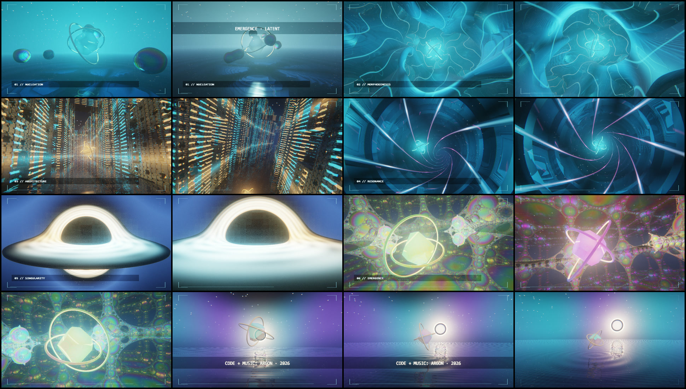

# Emergence

An 8k intro for Windows browsers by **Latent** (`03_emergence`), fitting seven raymarched 3D scenes and a 2:18 procedural GPU soundtrack into a single **8,174-byte** standalone HTML file.

Release notes: [emergence.nfo](emergence.nfo).

Video capture: [media/emergence.mp4](media/emergence.mp4) (1080p60, with GPU-rendered soundtrack)

## Run it

Double-click [`intro.html`](intro.html) in Chrome or Edge. Wait a few seconds on the title screen while the GPU renders the 48 kHz soundtrack and compiles the shaders, then click to enter fullscreen and begin playback (`ESC` exits fullscreen).

- No web server or special browser flags required.
- Tested on Edge (ANGLE D3D11) with an NVIDIA GeForce RTX 5090 (`0.9–5.4 ms/frame` at `1920x1080`).

## Size Breakdown

| File | Bytes | Notes |
|---|---:|---|
| [`intro.html`](intro.html) | 8,174 | Standalone double-click release (**18 bytes free** under `8,192`) |
| [`intro_fetch.html`](intro_fetch.html) | 7,919 | `fetch` bootstrap variant (273 bytes free; needs HTTP or `--allow-file-access-from-files`) |
| [`dev.html`](dev.html) | 17,226 | Unpacked development & capture build |
| `SCENE_SRC` (minified) | 7,091 | Raymarching & 7 scenes (`src/scene.frag`) |
| `POST_SRC` (minified) | 1,729 | Bloom, anamorphic streaks, glitch & tonemap (`src/post.frag`) |
| `MUSIC_SRC` (minified) | 4,056 | Procedural GPU synth (`src/music.frag`) |
| Combined JS + GLSL -> Zopfli | 16,095 -> 7,756 | Zopfli `deflate-raw` payload before HTML comment bootstrap |

## Timeline (128 BPM)

One beat = `0.46875s` (`22,500` samples at 48 kHz); one bar = `1.875s` (`90,000` samples).

| Bar | Time | Scene | Visuals & Music |
|---:|---:|---|---|
| 0 | 0:00 | **01 // NUCLEATION** | Thin-film ferrofluid droplets coalesce around the gimbal Hyper-Core over rippled water; glassy FM harp & swelling Reese sub bass |
| 8 | 0:15 | **02 // MORPHOGENESIS** | Infinite Gyroid minimal cathedral carved along a curved nave with glowing circuit veins; breakbeat kick, snare, hats, and C-minor vibrato lead enter |
| 18 | 0:33 | **03 // ARCHITECTURE** | 4-octave Menger megacity canyon, skybridges, emissive windows, and wet-floor reflections; four-on-floor drive with chord-diatonic Acid 303 bassline |
| 28 | 0:52 | **04 // RESONANCE** | High-speed curved toroidal accelerator with helical plasma conduits; modulation to bright Eb-major progression (`Prog B`) |
| 38 | 1:11 | **05 // SINGULARITY** | Relativistic black hole bending view rays (`rd` deflection) around a dark event horizon and Doppler-shifted spiral accretion disk; gravitational Shepard glissando |
| 48 | 1:30 | **06 // EMERGENCE** | Iridescent 9-iteration Apollonian sphere-fold cathedral surrounding the floating Hyper-Core; octave-doubled climax lead + Acid 303 + full drums |
| 62 | 1:56 | **HORIZON / ECLIPSE** | Calm dark ocean, auroras, total solar eclipse diamond-ring corona, and final Picardy-third `Cmaj9` resolution fading out at 2:18 (`73.6` bars) |

## Technical Architecture

- **Graphics (`src/scene.frag`)**: Unified signed-distance-field raymarcher with analytical normals, 36-step soft shadows, 5-tap AO, single-bounce reflections, thin-film spectral iridescence (`film()`), and real-time spacetime ray deflection around the Schwarzschild-like singularity in Scene 5.
- **Post-Processing (`src/post.frag`)**: Slit-scan horizontal glitch & chromatic split on scene cuts, barrel warp, radial mip-chain bloom + horizontal cyan anamorphic streaks, hairline HUD corner brackets & progress bar, 8-row mipmapped text overlays (`2048x1024`), Narkowicz ACES tonemapping, and opening quantum noise fade-in.
- **GPU Audio (`src/music.frag`)**: Single draw pass into a `4096x1620` `RGBA32F` texture (`6,635,520` stereo samples @ 48 kHz) read back via `readPixels`. Features chord-locked 32-beat C-minor theme (`ML[32]`), zero-overshoot vibrato, tempo-locked 4-tap dotted-8th (`16,875` sample) stereo ping-pong echo, 100% diatonic 303 acid lines (`ch(n, v)`), dry breakbeat drums, 5-partial metallic hi-hats, formant pads, and continuous Shepard tone.
- **Bootstrap (`src/main.js`)**: Custom SVG Hyper-Core title screen emblem, procedural text atlas, GPU audio pre-render + warmup pass, bundled cleanly with `tools/build.mjs`.
