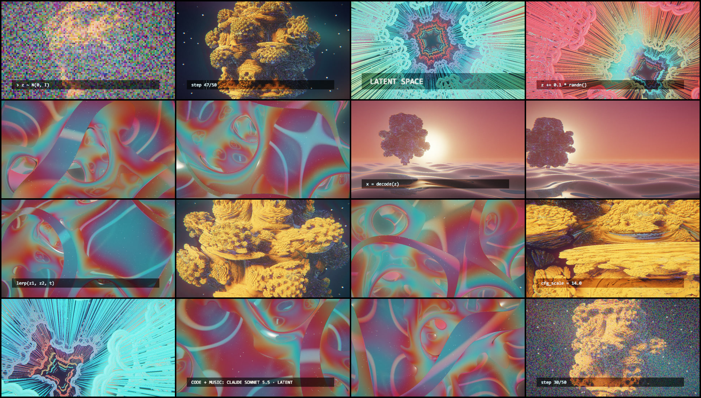

# Latent Space

An 8k intro for Windows browsers by **Latent**. Code and music: Claude Sonnet 5.5
(an AI model made by Anthropic). Release notes: [latent_space.nfo](latent_space.nfo).

It starts as pure noise, the way a diffusion model does. In 50 steps the noise
settles into a fractal, and the fractal turns into a journey through a
"latent space": a tunnel of beads on glowing fibres, an iridescent gyroid, a
sunset ocean with the fractal floating over it, a dive into the fractal's
surface. At the end the picture is noised again, step by step, back to
`z ~ N(0, I)`.



Video capture: [media/latent_space.mp4](media/latent_space.mp4) (1080p60, with soundtrack, 112 MB)

## Run it

Double-click `intro.html`. A title screen shows progress while the soundtrack
is rendered and the shaders compile (about 5 seconds). When it says "click to
start", click: it goes fullscreen and plays for 2:13. ESC leaves fullscreen.

- Target: Edge or Chrome on Windows with a discrete GPU. Tested only on Edge
  with an RTX 5090, where a 1080p frame takes 1 to 4 ms.
- The picture is rendered at a fixed 1920x1080 and scaled to the screen.
- No server and no browser flags are needed.

## Size

| File | Bytes | Notes |
|---|---|---|
| `intro.html` | 6,772 | the release; 1,420 bytes under the 8,192 limit |
| `intro_fetch.html` | 6,508 | same intro with the common `fetch` bootstrap; needs http:// or `--allow-file-access-from-files` |
| `dev.html` | about 15,000 | unpacked build used for capture and debugging |

## Timeline

The track is 144 BPM, so one bar is 1.667 s. A flash and a row glitch mark every cut.

| Bar | Time | Text | Scene |
|---|---|---|---|
| 0 | 0:00 | `> z ~ N(0, I)`, then `step 00/50` ... `50/50` | Noise in coarse blocks; the blocks halve and the noise fades with every step until a Mandelbulb is left, in gold and blue on a starfield |
| 8 | 0:13 | `LATENT SPACE` | The drop. Four shots (2 bars each) flying down the beam tunnel |
| 16 | 0:27 | `z += 0.1 * randn()` | Four shots of the iridescent gyroid ball |
| 24 | 0:40 | `x = decode(z)` | Breakdown: low flight over a sunset ocean, the Mandelbulb hangs in front of the sun; lead melody over a pad |
| 32 | 0:53 | `lerp(z1, z2, t)` | Second drop. Cuts every 2 bars between all four scenes |
| 48 | 1:20 | `cfg_scale = 14.0` | Bridge: the camera falls into the surface of the Mandelbulb, 16 times closer in 13 seconds |
| 56 | 1:33 | `CODE + MUSIC: CLAUDE SONNET 5.5 · LATENT` | Last drop; from bar 64 the cuts come every bar |
| 72 | 2:00 | `step 50/50` ... `00/50`, `> z ~ N(0, I)` | The picture is noised again, block by block, back to nothing |
| 80 | 2:13 | | end |

## How it works

**One HTML file, no assets.** Three fragment shaders, about 3.5 kB of
JavaScript (including the title screen) and nine lines of text drawn with
Consolas into a texture.

**One distance field, four families** (`map()` in `src/scene.frag`), chosen per
shot from a table of 44 numbers:

- *Mandelbulb* with an animated power (6 to 8), coloured by an orbit trap
  (blue where the orbit stays close to the origin, gold on the outer ridges), a
  warm key light that follows the camera and a cool rim light.
- *Beams*: a kaleidoscopic IFS in the xy plane (abs, offset, rotation, scale
  1.45, six times), with a thin cylinder and a bead (torus every 2 units) at
  each iteration. The tunnel is twisted slowly along z. The colour of every
  beam comes from its iteration and its distance from the camera.
- *Gyroid*: `|sin(x)cos(y) + sin(y)cos(z) + sin(z)cos(x)|` as a thin shell
  inside a sphere, shaded as a thin film: the colour is a cosine palette of
  `dot(n, rd)`, plus one reflection of a stripy studio sky.
- *Ocean*: three sine waves as height field, the sun low on the horizon,
  sky reflection by Fresnel, soft shadows from the waves, and a Mandelbulb
  hovering in front of the sun.

**Glow.** While the ray marches, the distance to the glowing geometry (the
beams, or the surface) is turned into light: `exp(-k d)` times the step length,
coloured by a palette. That is the volumetric haze around the beams and the
halo around the bulb, and it costs no extra steps.

**Diffusion.** The post shader renders the picture in blocks. The block size
(64 px down to 1 px) and the noise amount follow a 50-step schedule
(`floor(50 * progress)`), the noise is re-rolled on every step, and the step
number is shown with digits cut out of a digit strip in the text texture. The
same schedule runs backwards in the outro.

**Post** (`src/post.frag`). Bloom from the render target's mip chain, an
anamorphic streak from the highlights, chromatic aberration, cut flashes with a
row glitch (the scene shader passes the "a cut just happened" strength in the
alpha channel), ACES tonemap, grain.

**Music** (`src/music.frag`). A fragment shader: one pixel per stereo sample
at 48 kHz, 80 bars. A minor, one chord per bar (Am F C G). Kick, rolling
off-beat bass, supersaw pad and stabs (three detuned voices per note, four
harmonics each, so nothing aliases), plucked arpeggio and an eight-bar lead
melody through a ping-pong dotted-8th echo, hats, clap, a snare roll and a
noise and tone riser into every drop, and a sidechain pump on everything
except the kick. At bar 76 one low hit ends it.

**Packing** is the same as intro 01; see [../01_gradient_descent/readme.md](../01_gradient_descent/readme.md).

## Credits and sources

No assets and no third-party libraries are included in the intro. Two
well-known hash one-liners are used as published, and the rest was written for
it using techniques that are common demoscene knowledge:

- The Mandelbulb is the "triplex" power-n formula of Daniel White and Paul
  Nylander; the distance estimate `0.5 log(r) r / dr` is the usual one
  (see Mikael Hvidtfeldt Christensen's "Distance Estimated 3D Fractals" series
  at blog.hvidtfeldts.net, which also describes the folding IFS used for the beams).
- The gyroid is the minimal surface found by Alan Schoen; the thin-film colour is
  a cosine palette as described by Inigo Quilez.
- The float hash `h1` is Dave Hoskins' "hash without sine" (`hash12`, MIT licence).
- The integer hash in the music shader is the PCG hash (Jarzynski and Olano,
  "Hash Functions for GPU Rendering").
- Box distance function, soft shadows, the four-tap normal and the
  distance-based ambient occlusion follow Inigo Quilez's articles.
- The tonemap is Krzysztof Narkowicz's ACES fit.
- The noise-to-image idea is a nod to diffusion models (Ho, Jain and Abbeel,
  "Denoising Diffusion Probabilistic Models"); nothing of a model is in the
  intro, only the schedule.
- Rendering the soundtrack in a fragment shader is an established 4k/8k
  technique (Shadertoy sound shaders, 0b5vr's intros).
- `intro_fetch.html` uses the `fetch`/`DecompressionStream` bootstrap known
  from 0b5vr's compeko packer. The double-click bootstrap in `intro.html` is our own.
- Build tools: terser, zopfli (`@gfx/zopfli`), puppeteer-core and ffmpeg. None
  of their code ends up in the intro.

## Build and capture

From the repository root, with Node 22 and ffmpeg on the path:

```
node tools/build.mjs 04_latent_space
node tools/capture.mjs 04_latent_space sheet "5,9,11,16.3,19,21.7,26,30,36.7,41,48,52,63,68,75,84"
node tools/capture.mjs 04_latent_space video 133.4
node tools/audiostat.mjs 04_latent_space
node tools/capture.mjs 04_latent_space check 04_latent_space/intro.html
node tools/glcheck.mjs 04_latent_space/src/scene.frag    # compile one shader, with line numbers
```

## Known limits

- The music was checked numerically only (no NaNs, peak 0.96, RMS 0.18 to 0.35).
  Nobody has listened to it yet, so the mix balance is a guess.
- Tested on one machine, with one GPU and one browser. Frame cost is low there
  (1 to 4 ms), slower GPUs were not tried.
- Some shots are chance: the beam tunnel is a fixed field and the camera can
  pass close to a fibre for a moment; in a few frames the gyroid fills the
  screen with one colour.
- The picture is noisy while the diffusion runs, by design, but the mandelbulb's
  fine detail also shimmers a little in motion (no temporal filtering).
- 1.4 kB of the budget is unused.
