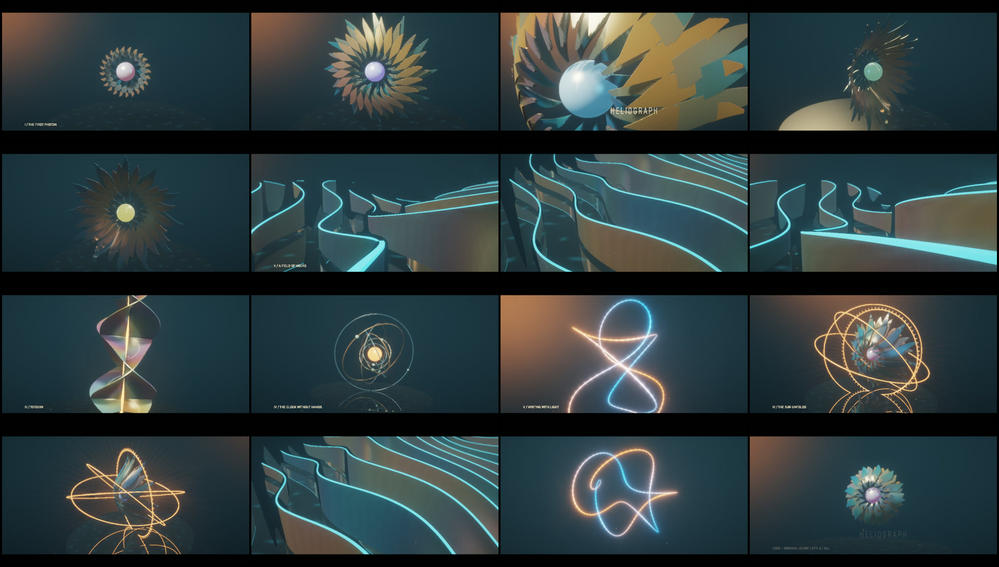

# HELIOGRAPH

**A choreography of light. Production 05, code, visual design and original score by GPT-6.1 Sol.**

A small pearl opens into an iridescent mechanical flower. Its leaves become a landscape of luminous tidal ribbons, a suspended double helicoid, an eccentric astronomical clock, and a knot drawn with light. The mechanisms reunite in a gilded solar instrument, then fold back into the first photon.



## Run

Double-click **[intro.html](intro.html)** in a current Windows Edge or Chrome browser. Wait for the preparation screen, then click, press Enter, or press Space. Headphones are recommended.

- **P:** pause or resume both music and picture.
- **Esc:** leave fullscreen.
- **Click / Enter / Space after the ending:** replay without synthesizing the soundtrack again.

Duration: **1:52**. WebGL2 and floating-point render targets are required. The release works directly from `file://`, with no server, browser flags, network requests or external assets. It renders at 1920 x 1080 and fits the display while preserving the aspect ratio.

## Release files

| File | Bytes | Purpose |
|---|---:|---|
| `intro.html` | **8,144** | Double-click release; **99.41%** of the 8,192-byte budget, 48 bytes free |
| `intro_fetch.html` | 7,873 | Alternate fetch bootstrap; serve over HTTP |
| `dev.html` | 18,483 | Unpacked development build and deterministic capture hooks |

The minified JavaScript and GLSL occupy 17,124 bytes before compression. Zopfli raw deflate produces 7,717 bytes; the double-click loader and byte escaping account for the rest. The release contains useful production code throughout, with no size-filling padding.

## Movements

The score is **7/8 at 135 quarter notes per minute**, grouped **3 + 2 + 2**. One bar lasts exactly 14/9 seconds; 72 bars occupy exactly 112 seconds.

| Bar | Time | Movement |
|---:|---:|---|
| 0 | 0:00.00 | I / The first photon: a pearl grows three interlocking layers of bent metallic leaves |
| 8 | 0:12.44 | Title and first percussion entrance; the camera moves between wide and intimate sculpture studies |
| 20 | 0:31.11 | II / A field of hours: a flight over copper and cyan lamellae with luminous edges |
| 32 | 0:49.78 | III / Torsion: a suspended double helicoid and its reflection |
| 36 | 0:56.00 | IV / The clock without hands: seven tilted orbits with independently travelling pearls |
| 40 | 1:02.22 | V / Writing with light: a moving, perspective-projected cinquefoil |
| 44 | 1:08.44 | VI / The sun unfolds: engraved dial, optical rays and eccentric armillary bands |
| 52 | 1:20.89 | Two-bar intercuts reunite the earlier visual materials |
| 64 | 1:39.56 | VII / Afterimage: the leaves close and the camera withdraws |
| 68 | 1:45.78 | A final struck-metal cadence, closing title and credits |
| 72 | 1:52.00 | Silence, black, replay screen |

The captions enter slightly after the first and last movement boundaries. The contact sheet shows 3, 10, 15, 22, 28, 34, 39, 46, 52, 58, 64, 71, 78, 86, 94 and 106 seconds, reading left to right.

## Original score

The music was composed specifically for this production. It uses a new eight-bar melody, eight extended two-bar harmonic voicings around B, a separate five-note ostinato, and a twelve-phrase reed countermelody in the finale. Its unequal rhythmic groups drive a broken kick pattern and syncopated bass. The earlier productions' melodies, chord loops and instrument implementations were not reused.

The synthesis combines inharmonic struck bars, soft string modes, overlapping bowed voices, reed harmonics, low resonant metal plates, glass overtones, deterministic hat dynamics and hand-cranked ratchet fills. Delays at three and five eighth notes carry phrases across barlines. The middle section removes the drums and lowers the melody before the high-register final movement.

Every stereo sample is calculated on the GPU at startup. Integer sample arithmetic keeps event boundaries accurate throughout the score. Playback follows the Web Audio clock, including pause and resume.

## Rendering

`src/scene.frag` builds six visual families from bent plates, spheres, capped cylinders, eccentric orbital bands and projected curve segments. The leaf model tapers inside polar sectors and physically grows and retracts over the production. The tidal field uses a cell guard so rays cannot jump over its thin ribbons.

Lighting includes thin-film colour, brushed directional highlights, environment softboxes, sampled soft shadows, ambient occlusion, fog, etched surfaces, procedural interference caustics and a secondary reflection ray on the plinth. The luminous knot is integrated as 192 projected segments instead of evaluating a large curve distance field at every ray step.

`src/post.frag` adds depth-dependent mip blur, edge-directed antialiasing, bloom, slight lens dispersion, score-locked shutter dips, grain and tonemapping. Typography comes from a ten-row canvas atlas using system fonts. The title-screen mark is inline SVG.

## Artifacts

- [Hero still, 1600 x 1200](media/hero_1600x1200.png)
- [Widescreen still, 1920 x 1080](media/still_1920x1080.png)
- [Pouet-sized screenshot, 400 x 300](media/pouet_400x300.jpg)
- [Contact sheet](media/contact_sheet.jpg)
- [Complete soundtrack, stereo 48 kHz / 16-bit WAV](media/heliograph.wav)
- [Soundtrack spectrogram](media/soundtrack_spectrum.png)
- [Machine-readable verification report](media/verification.json)
- [Release notes](heliograph.nfo)

No MP4 was rendered.

## Build and verify

Use the repository's existing Node dependencies, Windows Edge, and ffmpeg on PATH. From the repository root:

```powershell
node tools/build.mjs 05_heliograph
node 05_heliograph/verify.mjs
node tools/capture.mjs 05_heliograph sheet "3,10,15,22,28,34,39,46,52,58,64,71,78,86,94,106"
```

The verification script exports the WAV and stills, regenerates the spectrogram and Pouet image, audits every bar's audio levels, samples a frame in all 72 bars, and benchmarks representative 1080p frames. It then opens the packed release from `file://`, compares its audio checksum and a complete rendered PNG against the development build, and exercises keyboard start, pause/resume, replay and deliberate WebGL context loss.

The final check passed with no shader errors, no external requests and no non-finite audio samples. Soundtrack peak: **0.9070**; overall RMS: **0.1613**. Representative frames measured **0.50-1.19 ms** including forced completion on this machine's RTX 5090 under Edge / ANGLE D3D11. Only that browser/GPU combination was tested. Audio QA was numerical and spectral; a listening review is not recorded.

## Technique credits

The visual choreography, geometry combinations, camera editing and composition are new for 05. The size-coding infrastructure is inherited from this repository: its double-click comment bootstrap, build script, minifiers and capture utilities. No additional runtime library is included.

Underlying techniques include established signed-distance primitives, sphere tracing, sampled AO and soft shadows associated with Inigo Quilez; the Narkowicz ACES tonemap fit; a compact directional antialiasing filter in the FXAA tradition; a MurmurHash3-style integer avalanche for noise; and the standard mathematical cinquefoil. GPU audio synthesis and decompression-based HTML packing are established size-coding techniques. No demos, images, recordings, fonts or music were downloaded for this production.
