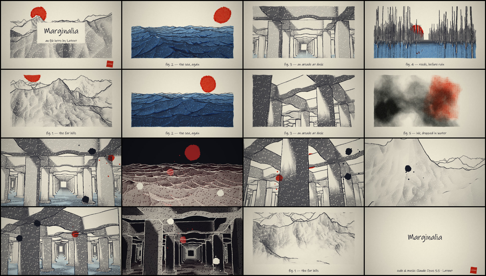

# Marginalia

An 8k intro for Windows browsers by **Latent**. Code and music: Claude Opus 5.5
(an AI model made by Anthropic). Release notes: [marginalia.nfo](marginalia.nfo).

A sketchbook draws itself. Every shot starts as an empty page: the pen puts down
the outlines, then the cross-hatching, then the watercolour washes bleed in. The
drawings are hills in mist, a sea under a vermilion sun, an arcade of arches,
reeds in still water and ink dropped into water, each with a handwritten caption
in the margin. Halfway through, the lo-fi beat doubles into drum'n'bass, the
frame falls away, every second page is drawn white on black, and the snares
splash ink across the paper. At the end the drawing is erased and only the title,
the credits and a red seal are left.



No video capture was made for this one.

## Run it

Double-click `intro.html`. A paper title screen shows progress while the
soundtrack is rendered and the shaders compile (about 6 seconds). When it says
"click to turn the page", click: it goes fullscreen and plays for 2:13. ESC
leaves fullscreen.

- Target: Edge or Chrome on Windows 10 or 11 with a discrete GPU. Tested only on
  Edge with an RTX 5090, where a 1080p frame takes 1 to 4 ms.
- The handwriting uses the *Ink Free* font that ships with Windows 10 and 11.
  Elsewhere the browser's cursive font is used.
- The picture is rendered at a fixed 1920x1080 and scaled to the screen.
- No server and no browser flags are needed.

## Size

| File | Bytes | Notes |
|---|---|---|
| `intro.html` | 7,369 | the release; 823 bytes under the 8,192 limit |
| `intro_fetch.html` | 7,081 | same intro with the common `fetch` bootstrap; needs http:// or `--allow-file-access-from-files` |
| `dev.html` | 16,925 | unpacked build used for capture and debugging |

## Timeline

The track is 90 BPM, so one bar is 2.667 s.

| Bar | Time | Music | Pictures |
|---|---|---|---|
| 0 | 0:00 | vinyl crackle, electric piano chords | the frame is inked in, hills and the sun appear, title "Marginalia" and the seal |
| 4 | 0:11 | boom-bap drums and bass | fig. 1 to fig. 4: sea, arcade, reeds, hills, two bars per page |
| 12 | 0:32 | the breathy lead melody comes in | more pages of the same four subjects |
| 20 | 0:53 | breakdown, snare roll and noise riser | fig. 5: ink dropped into water |
| 22 | 0:59 | drum'n'bass at 180 BPM, reese bass | full-bleed pages, a cut every bar, every second page white on black, ink splatters on the snares |
| 30 | 1:20 | lead melody over the drum'n'bass | |
| 38 | 1:41 | back to half time | captioned pages again |
| 46 | 2:03 | drums stop, last chord | the drawing is erased, title and credits are written, the seal is stamped |
| 50 | 2:13 | | end |

## How it works

**One HTML file, no assets.** Three fragment shaders, about 3.5 kB of
JavaScript including the title screen, and nine lines of text drawn into a
texture with the system's Ink Free font.

**The scene shader does not output colour** (`src/scene.frag`). It raymarches
one of four distance fields and writes what an illustrator needs to know about
each pixel: tone (0 black to 1 paper), depth, the amount of indigo, and the
amount of vermilion. The light that sets the tone comes from over the viewer's
shoulder, so the forms read clearly. The low sun is only drawn, as a vermilion
disc with a rough edge. Distance and low mist fade everything to paper.

- *Hills*: ridged value-noise terrain (six octaves, `1 - |2n - 1|`), squared to
  make peaks, with a mist layer in the valleys.
- *Sea*: four cusped swells `(1 - |sin|)^2` in different directions. The crests
  turn to foam (paper), the troughs take indigo, and the reflection of the sky
  comes from a second ray.
- *Arcade*: domain-repeated square pillars and groin-vault arches (a slab, kept
  only along the pillar lines, minus two cylinders), on a chequered floor.
- *Reeds*: one tapered, leaning stem per grid cell with random height and
  joints, swaying in the wind, with a clear lane for the camera. They stand in
  still water that mirrors them.
- *Ink in water* is 2D: four drops per page, each a disc pushed around by
  domain-warped noise. The third drop is vermilion.

**The post shader draws** (`src/post.frag`):

- *Outlines* where the depth jumps (and, more weakly, where the tone jumps),
  sampled at a distance that varies like pen pressure. Far lines are fainter.
- *Cross-hatching*: four layers of strokes at different angles. Each one starts
  below its own tone threshold and gets thicker as the tone gets darker, and the
  strokes are broken into dashes. The darkest areas are filled solid.
- *Boiling*: all the sample positions wobble by a few pixels and jump to a new
  wobble 12 times a second, like a hand-drawn animation.
- *Watercolour*: the pigments are sampled through a warped position so they
  bleed past the lines. They granulate with the paper and darken at their edges
  (the pigment minus a blurred copy from the mip chain). Colours mix
  subtractively: `paper * exp(-absorption)`.
- *Drawing in*: outlines, hatching and washes appear in that order behind a
  noisy front that sweeps over the page at the start of every shot.
- *The page*: cream paper with fibre noise, a ragged frame with the caption in
  the margin, splatters (a blob and satellite drops) on every drum'n'bass snare,
  the scratchboard inversion, handwriting that writes itself left to right, and a
  stamped seal with LATENT knocked out.

**Music** (`src/music.frag`). A fragment shader: one pixel per stereo sample at
48 kHz, 50 bars at 90 BPM. D minor, one chord per bar (Dm9, Bbmaj9, Gm9,
A7b9). Electric piano from two-operator FM with a short metallic tine and a
stereo tremolo, a plucked bass, boom-bap drums with swung hats, a breathy lead
with vibrato and a ping-pong echo, and vinyl crackle and hiss. The tape wow
(a slow wobble in time) applies to every tonal part. Bars 22 to 38 run as
drum'n'bass on the same grid: two-step breaks at 180 BPM, straight 16th and 32nd
hats, and a reese bass (two detuned band-limited saws with a moving filter) over
a sub.

**Packing** is the same as intro 01; see [../01_gradient_descent/readme.md](../01_gradient_descent/readme.md).

## Credits and sources

No assets and no third-party libraries are included in the intro. The rest was
written for it, using techniques that are common knowledge in demoscene and
non-photorealistic rendering:

- Hatching driven by tone thresholds follows the idea of tonal art maps (Praun,
  Hoppe, Webb and Finkelstein, "Real-Time Hatching", SIGGRAPH 2001), done here
  procedurally in screen space.
- Edge darkening, pigment granulation and bleeding are the watercolour effects
  described by Curtis, Anderson, Seims, Fleischer and Salesin ("Computer-Generated
  Watercolor", SIGGRAPH 1997), much simplified.
- Line boil is a hand-drawn animation convention.
- The float hash `h1` is Dave Hoskins' "hash without sine" (`hash12`, MIT licence);
  the integer hash in the music is the PCG hash (Jarzynski and Olano,
  "Hash Functions for GPU Rendering").
- Value noise, fbm, domain warping, the box distance, soft shadows, the
  four-tap normal and distance-based AO follow Inigo Quilez's articles.
- The electric piano is FM synthesis (John Chowning). The reese bass is the
  classic detuned-saw bass of drum'n'bass, named after Kevin Saunderson's
  "Reese" record.
- Rendering the soundtrack in a fragment shader is an established 4k/8k
  technique (Shadertoy sound shaders, 0b5vr's intros).
- `intro_fetch.html` uses the `fetch`/`DecompressionStream` bootstrap known from
  0b5vr's compeko packer. The double-click bootstrap in `intro.html` is our own.
- The Ink Free font is Microsoft's and is used from the system, not embedded.
- Build tools: terser, zopfli (`@gfx/zopfli`), puppeteer-core and ffmpeg. None of
  their code ends up in the intro.

## Build and capture

From the repository root, with Node 22 and ffmpeg on the path:

```
node tools/build.mjs 06_marginalia
node tools/capture.mjs 06_marginalia sheet "9.8,14.7,20,25.3,30.7,36,41.3,57.3,60.5,63.2,66,70,76.5,84.5,105.3,130"
node tools/capture.mjs 06_marginalia still 9.8 06_marginalia/media/hero_1920x1080.png
node tools/audiostat.mjs 06_marginalia
node tools/capture.mjs 06_marginalia check 06_marginalia/intro.html
```

`media/` holds the contact sheet, a 1920x1080 hero frame (the title page) and a
400x300 crop of it for Pouët.

## Known limits

- The music was checked by numbers only (no NaNs, peak 0.84, RMS 0.16 in the
  intro and 0.23 to 0.29 elsewhere, quiet tail). Nobody has listened to it yet,
  so the mix balance is a guess.
- Tested on one machine, with one GPU and one browser.
- Without the Ink Free font (not on Windows), the captions fall back to whatever
  cursive font the browser has, which may look worse.
- The reed pages are the weakest drawings: far away the stems crowd into a
  barcode. The high hill shots are mostly mist.
- There is no transition between pages: each shot starts from blank paper.
