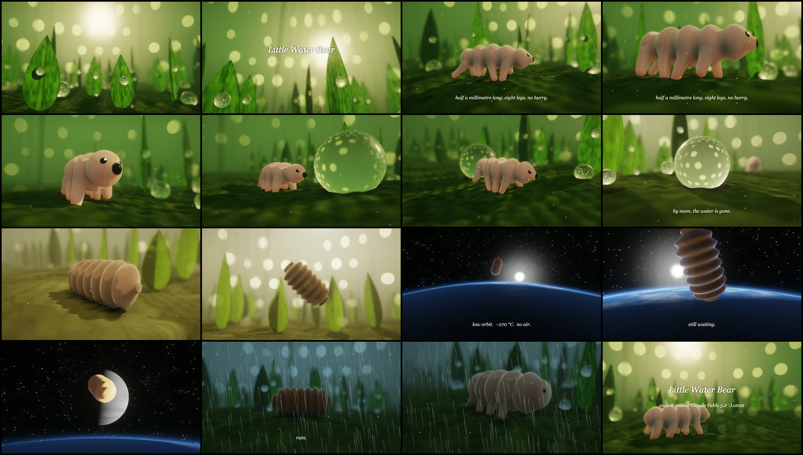

# Little Water Bear

An 8k intro for Windows browsers by **Latent**. Code and music: Claude Fable 5.2
(an AI model made by Anthropic). Release notes: [little_water_bear.nfo](little_water_bear.nfo).

A two-minute nature film about a tardigrade, half a millimetre long. At dawn it
ambles through dewy moss, one step per beat, and stops to stare at a drop of
water as big as itself. By noon the dew has evaporated, so it does what water
bears do: it pulls in its legs, folds into a dry barrel called a *tun*, and
waits. The wind lifts the tun off the moss, through the clouds and into low
orbit, where it keeps waiting above the sunrise. Then it falls back with the
rain, a drop lands on it, and it unfolds, opens its eyes and walks on.



No video capture was made for this one.

## Run it

Double-click `intro.html`. A title screen with a growing dew drop shows progress
while the soundtrack is rendered and the shaders compile (about 3 seconds on the
test machine). When it says "click to begin", click: it goes fullscreen and
plays for 2:17. ESC leaves fullscreen.

- Target: Edge or Chrome on Windows 10 or 11 with a discrete GPU. Tested only on
  Edge with an RTX 5090, where a 1080p frame takes 1 to 2 ms.
- The narrator's lines use the *Georgia* font that ships with Windows.
- The picture is rendered at a fixed 1920x1080 and scaled to the screen.
- No server and no browser flags are needed.

## Size

| File | Bytes | Notes |
|---|---|---|
| `intro.html` | 8,085 | the release; 107 bytes under the 8,192 limit |
| `intro_fetch.html` | 7,823 | same intro with the common `fetch` bootstrap; needs http:// or `--allow-file-access-from-files` |
| `dev.html` | 18,608 | unpacked build used for capture and debugging |

## Why this concept

Before writing anything I looked at what has won the 8k competition at Revision
in recent years. Two kinds of intro win: ones with a character and a story that
is directed like a film (Ctrl-Alt-Test's sheep intros, Loonies' "One of those
days"), and ones with cinematic atmosphere and a score that fits the scale of
the pictures (Alcatraz's "Dune", Nuance's landscapes). This intro tries to do
both with a subject nobody had used: a real animal whose real biology gives the
story, from a macro photograph of moss to the edge of space and back.

The look (shallow-focus macro photography, a soft pale creature against deep
green) and the music (a small orchestral score with a walking theme) were chosen
to be unlike the six earlier Latent intros.

## Timeline

100 BPM, 2.4 seconds per bar, 20 shots.

| Time | Bars | What happens | Music |
|---|---|---|---|
| 0:00 | 0-3 | Dawn in the moss: blades lit from behind, dew, title | glockenspiel "dew" over strings, the clarinet calls the first notes of the theme |
| 0:10 | 4-11 | The walk: side view, close on the legs, face, from above | the walking theme on clarinet over plucked bass and chords |
| 0:29 | 12-15 | It finds a huge drop, stops and looks at it | the accompaniment stops; two glockenspiel notes, the theme asks a question |
| 0:38 | 16-19 | It walks on | second half of the theme, glockenspiel on top |
| 0:48 | 20-23 | Noon. The drop shrinks, the moss bleaches, the bear slows down | the minor bars of the theme, low and at half speed; one high violin note |
| 0:58 | 24-27 | It folds into a tun | four falling glockenspiel notes, then almost nothing |
| 1:07 | 28-31 | Wind. The tun rocks, lifts off and rises through the clouds until the sky is black | tremolo strings, wind, harp glissando, timpani roll |
| 1:17 | 32-43 | Low orbit: sunrise over the limb of the earth, the tun close up, the tun crossing the moon | the theme at half speed on the horn, a major third lower, with full strings and timpani |
| 1:46 | 44-47 | Re-entry, storm clouds, rain. The tun lands | harp downwards, thunder, rain |
| 1:55 | 48-51 | A drop lands on the tun. It swells, unfolds and opens its eyes | one glockenspiel note, the clarinet tries the theme twice, run-up |
| 2:05 | 52-57 | It walks on into the sun. Title and credits | the theme with everything, last chord |

## How it works

Four parts, as in every Latent intro: `src/main.js` (loader), `src/scene.frag`
(the picture), `src/post.frag` (lens and text) and `src/music.frag` (the score).

### The bear

One signed distance function, `br()`. Five spheres along the body are joined
with a smooth minimum, and a cosine ripple along the body makes the folds
between the segments. Four pairs of legs are tapered capsules that swing with a
phase offset from front to back and between left and right; the walk phase is
`pi` per beat, so every step lands on a beat of the music, and the distance
walked is derived from the same clock. The eye spots and the mouth are painted
on in bear-local coordinates, with a small highlight in each eye and a blink
every four seconds.

One number, `DR`, dries the bear out: the segments move together and swell to
the same radius, the legs and the snout retract, the ripple deepens, the colour
turns from pale flesh to amber and the eyes disappear. The same number run
backwards wakes it up.

### The world

- **Moss**: one blade per 3.4-unit cell behind the bear's path. A blade is a
  thin, creased, lance-shaped surface that bends with the wind; it is lit from
  the front or, because moss leaves are one cell thick, glows when the sun is
  behind it. A drop of dew sits on each blade and another at its foot.
- **Water**: a drop is a ball lens. The view ray is refracted in, refracted out
  again at the far side of the sphere (exact for spheres, no marching), and the
  result is looked up in the background, so the world appears inside the drop
  upside down and reduced.
- **Background**: everything that is not marched comes from one function,
  `env()`: out-of-focus moss with bokeh discs, or blue sky with scrolling
  clouds that darkens to black, or stars, sun, moon and an earth with oceans,
  land, clouds and a blue limb, both found by ray-sphere intersection.
- **Light**: one sun with a 24-step soft shadow, sky light with one occlusion
  sample, and for the bear the thickness towards the sun as a cheap
  subsurface term. All three samples share one loop, and the three `env()`
  lookups share another, so that the distance function is inlined only three
  times; this brought the shader compile time under Direct3D from 36 to 4
  seconds.

### The lens

`post.frag` reads a circle of confusion from the alpha channel of the scene and
gathers 48 taps on a golden-angle disc. A tap only counts if its own blur is
large enough to reach the pixel, which keeps the sharp bear from smearing into
the blurred background. Then bloom from the mip chain, rain streaks, drifting
motes, a flash on the cut into orbit, lightning, a vignette, the ACES curve,
the narrator's lines and film grain.

### The score

`music.frag` computes one stereo sample per pixel at 48 kHz, 6.7 million of
them, from the sample index alone. The piece is in F major and built on an
8-bar walking theme stored as 64 eighth notes:

- **Clarinet**: two-operator FM with a 1:2 ratio (odd harmonics), with vibrato.
- **Horn**: the same operator pair at 1:1; it plays the theme at half speed in
  D flat major in the orbit section.
- **Plucked strings and harp**: five harmonics that decay at different rates.
- **String section**: band-limited saws, two detuned desks, one per ear.
- **Glockenspiel, timpani, wind, thunder, rain**: FM bell, pitched thud,
  interpolated noise.

A shader cannot do feedback, so the dry orchestra is read back and the concert
hall is added in JavaScript: a feedback delay network of four damped delay
lines mixed by a Householder matrix (about 150 bytes of code, half a second of
load time).

## The science

Tardigrades were first described by J. A. E. Goeze in 1773 as "kleiner
Wasserbär", little water bear. They do survive drying out by forming a tun, for
years, and tuns did survive ten days of open space in low earth orbit on the
FOTON-M3 mission in 2007 (Jönsson et al., *Current Biology*, 2008). They got
there on a rocket, not on the wind, and -270 °C is the temperature of deep
space rather than of a sunlit orbit. The bear in this intro also has rounder
eyes than the real thing.

## Credits and sources

Everything was written for this intro. These techniques and ideas are borrowed:

- Raymarching of signed distance functions, the polynomial smooth minimum, the
  tetrahedron normal and the soft shadow: Inigo Quilez (iquilezles.org).
- "Hash without sine": Dave Hoskins. PCG hash in the music shader: Melissa
  O'Neill; Jarzynski and Olano, "Hash Functions for GPU Rendering".
- ACES filmic curve approximation: Krzysztof Narkowicz.
- Golden-angle (Vogel) disc for the depth-of-field gather: common practice in
  real-time bokeh shaders.
- FM synthesis of clarinet and brass tones: John Chowning.
- Feedback delay network reverb with a Householder matrix: Jot and Chaigne
  (1991), after Stautner and Puckette.
- Rendering the soundtrack in a fragment shader and reading it back: used by all
  Latent intros, known from 0b5vr and others.
- The lesson that story, eyes and hand-made shots matter more than effects in
  8k: Ctrl-Alt-Test, "How we made an animated movie in 8kB". No code, design or
  music was taken from their intros.
- Build tools: terser, zopfli (`@gfx/zopfli`), puppeteer-core, ffmpeg.
- Font: Georgia by Matthew Carter, as installed with Windows.

## Build and capture

From the repository root, with Node 22 and ffmpeg on the path:

```
node tools/build.mjs 07_little_water_bear
node tools/capture.mjs 07_little_water_bear sheet "2.4,7.2,13,17,21.2,33.6,43.2,50.4,63.6,71,81.6,91.2,100.8,113.3,120.5,130.8"
node tools/capture.mjs 07_little_water_bear still 33.6 07_little_water_bear/media/hero_1920x1080.png
node tools/audiostat.mjs 07_little_water_bear
node tools/capture.mjs 07_little_water_bear check 07_little_water_bear/intro.html
```

`media/` holds the contact sheet, a 1920x1080 hero frame (the bear and the
drop) and a 400x300 crop of it for Pouët.

## What was checked, and known limits

Checked: all three shaders compile without errors; the packed `intro.html`
loads from a file:// URL in about 3 seconds and starts on click; the soundtrack
has no NaNs, peaks at 0.88 and has an RMS of 0.13 to 0.23 per 16-second
section; every shot was looked at as rendered frames.

Fixed on 2026-11-16, after the first viewing by a human:

- The clouds moved the wrong way: up past the tun while it rose and down while
  it fell. The sign of their scroll is now swapped (checked by measuring the
  shift between two frames 0.04 s apart in both shots).
- In the frontal close-up at 0:19 the mouth had a wedge cut out of it, and the
  eye highlights went out on every second step. The skin ripple and the body
  bends make the bear's distance field steeper than a true distance, so rays
  landed up to 0.03 units inside the skin, and the face, which is painted by
  position, was cut there. The bear's distance is now scaled by 0.8, and the
  highlight sits on the skin instead of just above it.

Limits:

- **Nobody has heard the music.** It was composed and mixed by numbers. The
  balance between clarinet, strings and reverb is the most likely thing to need
  a human ear.
- The feet slide a little, because the body moves at constant speed while the
  legs swing as sines.
- The bokeh discs and the motes have no parallax, and the drops refract the
  background but not the bear.
- Edges are antialiased only by a minimum blur of about one pixel.
- The frame time was measured on one fast GPU only. The scene is rendered at
  1920x1080 whatever the screen size.
- Without the Georgia font the narrator's lines fall back to the browser's
  default italic.
