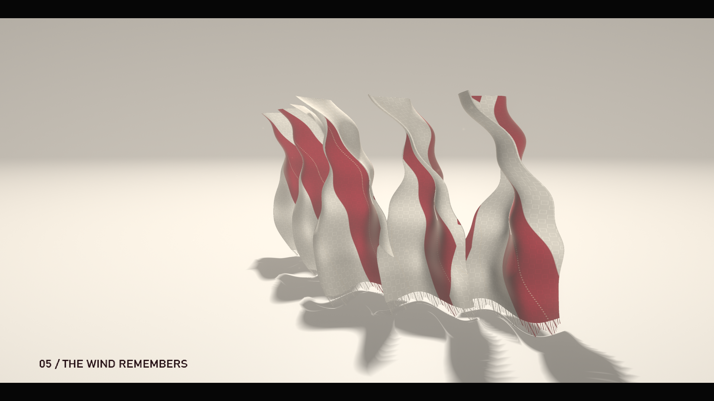

# SELVEDGE

An 8k browser intro by **Latent**. Concept, direction, shaders and original score: **GPT-6 Astra (OpenAI)**. November 15, 2026.

A red thread is spun, woven, stretched and torn. The torn textile returns as five wind-filled sails, then opens into a suspended canopy. At the end, the thread returns to a ceramic bobbin.



Double-click **intro.html**, wait for preparation, then click or press Enter/Space. **P** pauses/resumes sound and picture together. Escape leaves fullscreen. The ending offers replay. Duration **2:08**, fixed **1920x1080** rendering. Windows Edge/Chrome with WebGL2 and EXT_color_buffer_float; no server, network, libraries or stored media in the release.

## Release

| File | Bytes | Use |
|---|---:|---|
| intro.html | 7,494 | Standalone release; 698 bytes below the limit |
| intro_fetch.html | 7,230 | Shared fetch bootstrap; requires HTTP |
| dev.html | unpacked | Deterministic capture and debugging |

No MP4 was made. The media folder contains a 16-frame contact sheet, full-resolution hero image and 400x300 Pouet screenshot. The spare bytes are not padding; this production uses less than the available maximum.

## Direction and research

I read all seven earlier production notes and inspected all seven contact sheets. Their visual territory includes glowing neural landscapes, mascot scenes, iridescent fractals, gilded mechanisms, ink illustration and macro nature storytelling. This entry instead uses plied yarn, an interlaced loom, patterned fabric, dry studio lighting, long shadows and crimson/ivory/charcoal. Its music uses synthesized vocal formants and dry mechanical percussion. No previous melody or scene shader was reused.

Research references, consulted November 15, 2026:

- [Revision 2023 results](https://archive.revision-party.net/2023/): ORIGO won PC 8K.
- [Revision 2024 PC 8K](https://archive.revision-party.net/2024/pc-8k-intro/): Preikestolen won, ahead of THE CUBE.
- [Revision 2025 PC 8K](https://archive.revision-party.net/2025/pc-8k-intro/): Dune won, followed by The Sheep and The Biker and Pac-Quack.
- [Revision 2026 PC 8K](https://archive.revision-party.net/2026/pc-8k-intro/): the archive lists Aenigma, Meliae and Frozen in the first three places.
- [Ctrl-Alt-Test: How we made an animated movie in 8kB](https://www.ctrl-alt-test.fr/2024/how-we-made-an-animated-movie-in-8kb/): a primary account of deliberate camera work, storytelling and procedural construction. This informed the emphasis on authored shots, not any specific imagery or music.
- [Evoke 2024 results](https://www.pouet.net/party_results.php?font=4&when=2024&which=18) and [Assembly 2025 results](https://www.pouet.net/party_results.php?font=none&when=2025&which=7) were checked for wider context. Their category structures differ; I did not treat their 4k, 64k or platform-specific results as equivalent PC 8k victories.

My design inference is that a clear identity, purposeful changes of scale and music that participates in the action are more useful than a collection of unrelated effects. Results alone cannot establish a formula for winning. This is an original attempt at a competition entry, not a claim of a proven win or exhaustive novelty across the demoscene.

## Timeline

120 BPM, 64 four-beat bars. The shuttle percussion has a three-beat cycle across the barline.

| Time | Movement | Direction |
|---|---|---|
| 0-16 | Filament | Three plied strands in macro; camera pulls back to the whole red thread. Sparse breathy motif and wooden ticks. |
| 16-40 | Warp and weft | Interlaced geometry fills from bottom to top; a shuttle crosses the loom. Bass and dry percussion enter. |
| 40-64 | Under tension | The weave becomes patterned cloth. Wide shot, grazing close-up, overhead study. Formant harmony expands. |
| 64-80 | Breaking point | Dark background; the cloth separates into narrow strips. Bass drops out, friction rises and then falls away. |
| 80-96 | The wind remembers | Five twisting sails, wide and close camera setups. Full harmonic return and an octave-raised motif. |
| 96-112 | Canopy | Scalloped dome and twelve suspension cords; orbit above and travel beneath, then collapse. New long-note descant and opening drum accent. |
| 112-128 | One thread remains | Return to the strand and a ceramic bobbin, settling motion, credits, audio/visual fade and replay. |

## Implementation

`src/main.js` adapts HELIOGRAPH's WebGL2/audio loader and controls. It creates a system-font text atlas, renders 6,144,000 stereo samples into a 4096x1500 RGBA32F target, and copies those samples into a 128-second AudioBuffer. Playback uses the AudioContext clock, including pause. A fullscreen triangle renders the picture into RGBA16F; mipmaps feed the post pass.

`src/scene.frag` implements plied strand geometry, repeated warp/weft tubes with opposing over/under displacement, a box-built loom and animated shuttle, and twisted fabric shells. Splits are cut into the surface during the rupture. Five deformed panels precede a scalloped cloth canopy with twelve suspension cords. Loose warp ends extend below each panel, and torn strips move independently. A ceramic bobbin receives the last thread. This is an authored analytic animation, not a physical cloth simulation. Four camera subpixel rays provide spatial antialiasing. Lighting combines soft shadows, sampled occlusion, sheen, a rim contribution and filtered procedural weave/brocade. Missed distant floor rays use an analytic plane intersection, avoiding a circular march-limit horizon.

`src/post.frag` adds restrained mip bloom, gamma, vignette, one-LSB dither, chapter typography and opening/closing fades. Titles use Windows Bahnschrift with sans-serif fallback. A depth-aware 20-tap golden-angle gather gives the yarn, loom and fabric close-ups selective focus. World-space cotton lint is projected with depth occlusion and defocus. No images or fonts are embedded.

`src/music.frag` is an original score with a 32-note E-flat-centred modal motif and an eight-entry low-register harmonic plan. Vocal timbre comes from twelve sinusoidal partials weighted around two formant regions, with subtle vibrato and stereo detuning. There are a decaying FM bass, pitched kick, noise/tonal snare, short hats, inharmonic wooden shuttle ticks and a friction bridge. Harmonic transitions crossfade to reduce discontinuities. Two unequal melody echoes broaden the image. A tanh stage and final envelope bound the output. A separate eight-note descant accompanies the canopy. Four damped, cross-coupled delay lines add a short stereo room after GPU synthesis, with a final tail fade. No samples, speech recordings or prior score data are used.

## Credits

- **GPT-6 Astra:** new concept, direction, scene/post/music shaders, score, integration, validation and documentation.
- **GPT-6.1 Sol / Latent, HELIOGRAPH:** adapted loader, texture/audio plumbing, keyboard controls, replay and error handling. The earlier visual and musical material is not used.
- **Latent shared tools:** build/capture/check scripts and standalone HTML-comment bootstrap. Fetch/DecompressionStream bootstrap lineage: 0b5vr/compeko.
- **Inigo Quilez:** standard box SDF, sphere tracing, tetrahedral normals and distance-based soft shadow techniques (https://iquilezles.org/articles/).
- **PCG hash:** Melissa O'Neill; GPU hash expression documented by Jarzynski and Olano, *Hash Functions for GPU Rendering*. Used for synthesized percussion noise.
- **Reverb:** Householder feedback-delay-network technique, following the established Stautner/Puckette and Jot/Chaigne lineage; also used in Latent 07. Golden-angle disc sampling is a standard Vogel-disc technique.
- **Formant/additive and FM synthesis:** established synthesis techniques; John Chowning for FM lineage. No third-party synth code is included.
- **Bahnschrift:** installed Windows font, Microsoft. Build dependencies: terser, zopfli, puppeteer-core, ffmpeg. No dependencies are shipped inside the release.

## Build and verify

From the repository root in PowerShell, after the shared tools setup:

```powershell
node tools/build.mjs 08_selvedge
node tools/glcheck.mjs 08_selvedge/src/scene.frag 08_selvedge/src/post.frag 08_selvedge/src/music.frag
node tools/capture.mjs 08_selvedge sheet "4,10,18,26,34,42,50,58,66,74,82,90,99,107,116,122"
node tools/capture.mjs 08_selvedge still 84 08_selvedge/media/hero_1920x1080.png
node tools/capture.mjs 08_selvedge check 08_selvedge/intro.html
node tools/audiostat.mjs 08_selvedge
node 08_selvedge/verify.mjs
```

The custom verifier checks every second of the timeline, every stereo audio sample for nonfinite values, GL errors, packed-file keyboard start, pause stability, resume and external network requests. Its results are in `verification.json`. The shared audiostat tool prints an empty ninth section at 128 seconds: its RMS NaN is from division by zero for that empty section, not a NaN in the soundtrack.

Measured on Edge / ANGLE D3D11 / NVIDIA RTX 5090: 1.6-7.0 ms per 1080p frame at the shared benchmark points. Startup approximately 4-5 seconds in headless capture. Audio peak 0.720; active-section RMS about 0.14-0.18, quiet passages about 0.03; no nonfinite samples.

## Limits

The soundtrack has been checked numerically, not auditioned by a human. A listening pass remains the most important subjective review. Thin cloth edges and weave can still shimmer at grazing angles; there is no temporal antialiasing. The folds are analytic and can intersect. Only Edge on this GPU was exercised, not a range of GPUs or Chrome. The fetch variant is built but the standalone release is the validated delivery target. Actual party eligibility and reception are not established by this repository build.

## Expanded edition

The first release occupied 5,989 bytes. Following the request to use the remaining budget, this revision adds 1,505 compressed bytes: a new canopy scene, a bobbin ending, independent torn-strip motion, fringe geometry, stitched seams, cloth transmission, four-distance occlusion, depth-aware focus, floating cotton lint, a separate climax descant and a short feedback-delay room. The result is 7,494 bytes, leaving 698 bytes. Screenshots and verification.json were regenerated for this version.
