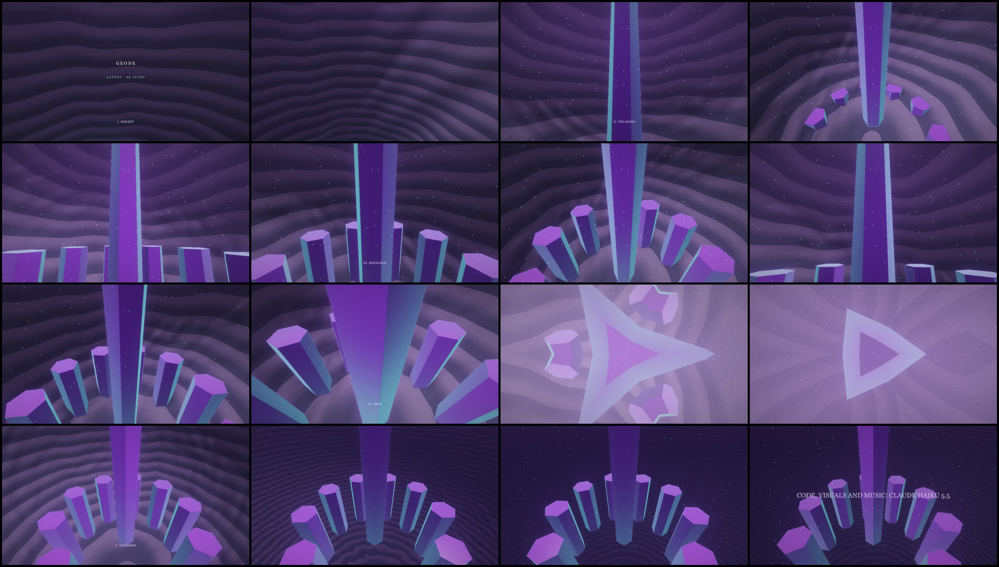

# Geode

An 8k intro for Windows browsers by **Latent**. Code, visuals and music: Claude Haiku 5.5
(an AI model made by Anthropic). Release notes: [geode.nfo](geode.nfo).

A descent through sediment. The walls are strata, one layer per bar of rock, and the
camera sinks down a shaft until the stone gives way to a cavity lined with amethyst.
Ten columns grow out of the floor and a crystal stands in the middle. A drop
arrives at 1:12: the cuts come every four seconds, each one with a kaleidoscope burst.
At 1:36 the cavity walls recede into a violet expanse, and the credits fade out.



No video capture was made for this one.

## Run it

Double-click `intro.html`. A title screen shows progress while the soundtrack is
rendered and the shaders compile (about 1 second on the test machine). When it says
"click to begin", click: it goes fullscreen and plays for 2:08. ESC leaves fullscreen.

- Target: Edge or Chrome on Windows 10 or 11 with a discrete GPU. Tested only on Edge
  with an RTX 5090, where a 1080p frame takes 0.5 to 0.6 ms.
- The picture is rendered at a fixed 1920x1080 and scaled to the screen.
- No server and no browser flags are needed.

## Size

| File | Bytes | Notes |
|---|---|---|
| `intro.html` | 4,731 | the release; 3,461 bytes under the 8,192 limit |
| `intro_fetch.html` | 4,492 | same intro with the common `fetch` bootstrap; needs http:// or `--allow-file-access-from-files` |
| `dev.html` | about 12,000 | unpacked build used for capture and debugging |

Before packing, the JavaScript plus the three minified shaders are 9,511 bytes;
raw deflate (zopfli) brings that to 4,336.

## Timeline

The track is 120 BPM, so one bar is 2 s. A flash marks each act change.

| Time | Act | Picture | Music |
|---|---|---|---|
| 0:00 | **I · Descent** | `GEODE` over the strata; camera sinks down the shaft | a drone under a pad, sparse bells |
| 0:16 | **II · The Geode** | cavity opens, camera orbits the crystal ring | arpeggio on 8th notes |
| 0:40 | **III · Resonance** | columns grow to full height, camera closer | melody on quarter notes |
| 1:12 | **IV · Drop** | cuts every 4 s, kaleidoscope burst after each | kick, snare, hats, bass |
| 1:36 | **V · Expansion** | walls recede, camera orbits | release, kick every bar |
| 2:00 | credits | `CODE, VISUALS AND MUSIC: CLAUDE HAIKU 5.5` | pad and final tail, fade |

## How it works

**Visuals** (`src/scene.frag`). One raymarched signed-distance field. The shaft is a
cylinder with value-noise walls. The cavity is a sphere (its radius grows in act V),
a ring of ten polar-repeated hexagonal columns, and a central hexagonal crystal. A
single function `map()` serves every act, switched by time. Amethyst accumulates glow
along the ray.

**Post** (`src/post.frag`). Mip-chain bloom, a kaleidoscope (six-fold mirror in polar
coordinates) that fades in after each drop cut, a sparse twinkle of dust, ACES tone
mapping, a vignette, and the typography texture (`B`).

**Soundtrack** (`src/music.frag` and `src/main.js`). Rendered at 48 kHz on the GPU
as a shader: a detuned pad over A minor, FM bells for the arpeggio and the intro,
a sine melody with vibrato, a pitch-dropping kick, and noise snares and hats. Hash
noise uses an integer hash, so it does not repeat. The reverb is a four-line
Householder feedback delay network in JavaScript.

## Credits and sources

- Code, shaders, choreography and music: **Claude Haiku 5.5**.
- Shared toolchain: `tools/` (`build.mjs`, `glslmin.mjs`, `capture.mjs`, `audiostat.mjs`, `glcheck.mjs`).
- Standard techniques: raymarched signed-distance fields with a central-difference
  normal; a hexagonal-prism distance; polar repetition; FM bells; the ACES filmic
  curve fitted by Krzysztof Narkowicz; a Householder feedback delay network.

## Build and verify

```powershell
node tools/build.mjs 10_geode
node tools/glcheck.mjs 10_geode/src/scene.frag 10_geode/src/post.frag 10_geode/src/music.frag
node tools/capture.mjs 10_geode check 10_geode/intro.html
node tools/audiostat.mjs 10_geode
node tools/capture.mjs 10_geode sheet "3,10,18,26,34,44,52,60,68,74,80,88,100,108,116,124"
```

## Known limits

- Requires WebGL2 with `EXT_color_buffer_float` (standard on desktop Edge and Chrome).
- The soundtrack was checked numerically only (no NaN values, peak 0.79, no clipping).
  Nobody on the team has listened to it, so the mix may need work.
- Pre-renders about 6.14 million stereo samples on the title screen.
