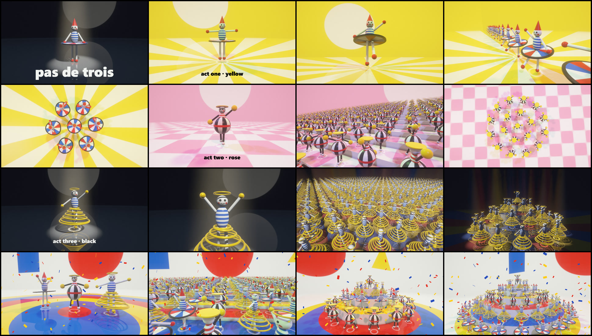

# Pas de Trois

An 8k intro for Windows browsers by **Latent**. Code, visuals and music: Claude Fable 5.2
(an AI model made by Anthropic). Release notes: [pas_de_trois.nfo](pas_de_trois.nfo).

A mechanical ballet in three acts and a finale, two minutes long. Three dancers
built from discs, balls, cones and wire step, kick, turn and jump on every beat
of an electro swing tune. Each act has its own colour, costume and floor: a
disc skirt on a yellow sunburst, a ball skirt on a rose chessboard, a gold wire
spiral under spotlights in the dark. They dance alone, in threes, in lines
without end and in counter-rotating rings filmed from straight above. Then the
floor itself joins in: rows rise into a staircase of dancers that reaches the
horizon, and rings rise into a turning tower of five tiers with 90 dancers on
it and one on top. In the finale all three costumes share a stage in red,
yellow and blue, under confetti.



No video capture was made for this one.

## Run it

Double-click `intro.html`. On the title screen a circle, a square and a triangle
appear as the soundtrack is rendered and the shaders compile (about 3 seconds on
the test machine). When it says "click to raise the curtain", click: it goes
fullscreen and plays for 2:00. ESC leaves fullscreen.

- Target: Edge or Chrome on Windows 10 or 11 with a discrete GPU. Tested only on
  Edge with an RTX 5090, where a 1080p frame takes 1.3 to 3.2 ms.
- The captions use *Segoe UI Black*, which ships with Windows.
- The picture is rendered at a fixed 1920x1080 and scaled to the screen.
- No server and no browser flags are needed.

## Size

| File | Bytes | Notes |
|---|---|---|
| `intro.html` | 7,470 | the release; 722 bytes under the 8,192 limit |
| `intro_fetch.html` | 7,215 | same intro with the common `fetch` bootstrap; needs http:// or `--allow-file-access-from-files` |
| `dev.html` | 16,713 | unpacked build used for capture and debugging |

Before packing, the JavaScript plus the three minified shaders are 14,775 bytes
(scene 6,247, post 1,471, music 3,686); raw deflate brings that to 7,059.

## Why this concept

Before writing anything I looked at what has won the PC 8k competition at
Revision. The winners of the last years (Aenigma, Dune, Preikestolen, Origo,
with Ctrl-Alt-Test's sheep films close behind) have one thing in common: one
clear idea, directed from the first frame to the last, with music that belongs
to it. Reviews of 2025 praise Dune for atmosphere and Hexer for "a very strong
direction", not for the number of effects.

So this intro is one idea: a dance, where every movement on screen is driven by
the beat. The subject was chosen because it fits the medium. Oskar Schlemmer's
*Triadic Ballet* (Stuttgart, 1922) put dancers into costumes made of discs,
spheres and wire spirals so that they would move like figurines; a distance
field renders exactly those shapes for a few bytes each. The ballet has three
dancers and three acts, yellow, rose and black, which gives the intro its
structure. The views from above, the staircase and the tiered turning stage
come from Busby Berkeley's film musicals of the 1930s, and so does the music's
decade.

The look (flat poster colours, toy figures, hard shadows on an endless studio
floor) and the music (swing with a walking bass and a brass section) are unlike
the ten earlier Latent intros. The figures are not copies of Schlemmer's
costumes; they borrow his vocabulary.

## Timeline

128 BPM, 1.875 seconds per bar, 64 bars. A shot lasts two bars until the
finale, then one.

| Time | Bars | Picture | Music |
|---|---|---|---|
| 0:00 | 0-3 | Prologue: an iris opens on one dancer in a spotlight; title. She starts to move with the trumpet | walking bass and finger snaps on an old record; the trumpet plays the end of the theme |
| 0:07 | 4-11 | **Act one, yellow.** The disc dancer alone: front, from below, close, from above | the theme on trumpet over bass, plucked chords, ride cymbal and a soft kick |
| 0:22 | 12-19 | Three of them, a line without end with a wave running down it, one ring, two rings | the theme again, with snare, a second voice and a brass section on the Charleston rhythm |
| 0:37 | 20-31 | **Act two, rose.** The ball dancer on a chessboard: alone, in three, then the chessboard rises into a staircase that reaches the horizon; rings, a line | a riff in F major for two voices; fills every four bars |
| 1:00 | 32-39 | **Act three, black.** The spiral dancer in gold under a spotlight; a grid under red, yellow and blue spots; three rings rise into a tower | tom-toms in triplets, a bass line falling by semitones, four long growling trumpet notes |
| 1:15 | 40-43 | One bar for each dancer in close-up, then all three | snare roll, noise riser, brass climbing a semitone per bar |
| 1:22 | 44-59 | **Finale.** Three rings from above, the trio, the staircase, the line, a tower of three tiers, five rings from above, and last the same five rings rising into a tower with a soloist on top; confetti. In the trio each costume dances its own move: the disc spins, the ball jumps, the spiral kicks | the theme twice with everything, a synthesizer on the bass, a vibraphone on top; a tone higher from bar 52 |
| 1:52 | 60-63 | The trio; a last pose with the arms up; the iris closes; credits | a run up the scale, two stabs, the last chord |

## How it works

Four parts, as in every Latent intro: `src/main.js` (loader), `src/scene.frag`
(the picture), `src/post.frag` (lens, confetti and captions) and
`src/music.frag` (the score).

### The dancers

One signed distance function draws all three. Legs, torso, head, arms and hands
are capsules, an ellipsoid and spheres; then the costume: a flat cylinder and a
cone, or a sphere and a thin cylinder, or a helix that narrows upwards (the
nearest two turns are tested, so the field has no jumps) and a torus. The face
is painted in the shader: two eyes, two cheeks, a smile.

The dance comes from one number, the beat. A counter that snaps from one beat
to the next drives everything: a hop that lands on the beat, legs that swing or
kick in turn, arms that go up and down in turn, quarter turns, a pirouette of
half a turn per beat, a jumping jack. Nothing bends; they move like tin toys,
which is the point.

### The company

Space is divided into cells of 2 by 2 units with one dancer each. The cells
either form rows (three dancers, a line, a grid to the horizon) or rings of 6,
12, 18... around one dancer in the centre, and neighbouring rings turn against
each other. A dancer's cell index delays its beat, which sends a wave down a
line or around a ring.

One more number, the height of a step, turns the same cells into architecture:
every ring stands one step above the next ring out (a tower of tiers), or every
row one step above the row in front (a staircase). The riser of the next step
up is one more term in the distance function, so shadows, reflections and
normals need nothing extra. The step height grows from zero during the first
bar of such a shot, so the flat formation seen a moment earlier rises out of
the floor. Marching through cells needs care in three places, all found by looking
at stills: a ray must not step past a cell wall (in rows the exact exit along
the ray is used, as in a grid traversal), it must not step across the plane
that mirrors a dancer (the two legs are in different poses), and neither rule
applies above the heads.

### The stage

The floor is a plane inside the same field; the backdrop has no edge and
carries a painted disc, joined in the finale by a square and a triangle. The
floor pattern changes per act: a turning sunburst, a chessboard whose squares
are the cells, black lacquer with a pool of light per dancer, a target of red,
yellow and blue rings. The floor is polished: a second round of the same march
loop renders the mirror image, weighted by a Fresnel term so that it only shows
at flat angles.

### The light

In the bright acts the stage is lit like a theatre, by three lamps a third of
a turn apart, one reddish, one greenish, one bluish, circling slowly. Where all
three reach a surface they add up to white, so the poster colours stay as they
are. Where a dancer blocks one of them the shadow takes the colour of the other
two, so every dancer throws three soft shadows in pink, mint and pale yellow
that turn around its feet. Each lamp has its own soft shadow march of 16 steps;
one occlusion sample and a rim light do the rest.

In the dark acts each cell has one white spotlight from the front instead. The
light in the air under it is summed along the ray while marching, in the cell's
colour, and the beams flare on every beat.

Every landing on a beat sends a ring of light out across the floor from the
dancer's feet. In a line or on the tower the rings follow the same delay as the
dance, so the wave is visible on the floor as well.

Colours are kept pure on purpose. An early version let the floor mirror 10 % of
the pale backdrop everywhere, which turned red into salmon; see the devlog.

Each pixel is rendered twice with a quarter-pixel offset, which is enough for
the hard edges of this look.

### Direction

The whole programme is a table of 44 numbers, one per shot: act, camera, size
of the company and move. Eight cameras (front, close, along the line, from above,
low, crane, around the tower, up the stairs) are placed on a sphere around the dancer and drift slowly; the lens
gives a little on every beat.

### The score

`music.frag` computes one stereo sample per pixel at 48 kHz, 5.8 million of
them, from the sample index alone. Swing means that the two 8th notes of a beat
last two thirds and one third of it; all timing is in whole samples (a beat is
22,500, a triplet 7,500).

- **Tunes**: an 8-bar theme in D minor and a 2-bar riff with an ending in F
  major, stored as 96 8th notes (rest, hold or pitch).
- **Chords**: 24 numbers. The bass walks through them by rule: root, third,
  fifth, then a semitone below the next root.
- **Trumpet and brass section**: FM with a 1:1 ratio whose index follows the
  envelope; a 24 Hz wobble of the index makes the growl in act three. The
  section plays the Charleston rhythm and lets every stab fall off in pitch.
- **Rhythm**: kick, ride cymbal ("ding, ding-a-ding"), finger snaps, snare,
  two tom-toms, crash; everything else ducks under the kick.
- **Room**: a feedback delay network of four delay lines in JavaScript, as in
  Little Water Bear but shorter and drier.

## Credits and sources

Everything was written for this intro. These ideas and techniques are borrowed:

- Oskar Schlemmer, *Das Triadische Ballett* (1922): three dancers, three acts
  in yellow, rose and black, costumes of discs, spheres and wire. Busby
  Berkeley: formations filmed from above.
- Staircases and tiered revolving stages full of dancers: again Busby Berkeley
  and the stage revues of his time.
- Coloured shadows from red, green and blue lamps: an old stage and
  science-museum effect, used by Schlemmer's Bauhaus stage among others.
- Raymarching of signed distance functions, the tetrahedron normal and the soft
  shadow: Inigo Quilez (iquilezles.org). Domain repetition in rows and around
  an axis: common practice, also after Quilez and Mercury's hg_sdf.
- Stepping to the exact cell exit: the grid traversal of Amanatides and Woo.
- Fresnel weight for the mirror: Schlick's approximation.
- "Hash without sine": Dave Hoskins. PCG hash in the music shader: Melissa
  O'Neill; Jarzynski and Olano, "Hash Functions for GPU Rendering".
- FM synthesis of brass tones: John Chowning.
- Feedback delay network reverb with a Householder matrix: Jot and Chaigne.
- Rendering the soundtrack in a fragment shader and reading it back: used by
  all Latent intros, known from 0b5vr and others.
- Walking bass, the Charleston rhythm and the falling "line cliché" of act
  three are common property of swing; the theme and the riff are new.
- Build tools: terser, zopfli (`@gfx/zopfli`), puppeteer-core, ffmpeg.
- Font: Segoe UI Black, as installed with Windows.

## Build and capture

From the repository root, in PowerShell, with Node 22 and ffmpeg on the path:

```
node tools/build.mjs 11_pas_de_trois
node tools/glcheck.mjs 11_pas_de_trois/src/scene.frag 11_pas_de_trois/src/post.frag 11_pas_de_trois/src/music.frag
node tools/capture.mjs 11_pas_de_trois check 11_pas_de_trois/intro.html
node tools/audiostat.mjs 11_pas_de_trois
node tools/capture.mjs 11_pas_de_trois sheet "2.5,9.6,13,28.6,32,39.5,46.8,54,62,66.5,71,73.5,86.8,91,99.5,111.5"
node tools/capture.mjs 11_pas_de_trois still 111.5 11_pas_de_trois/media/hero_1920x1080.png
```

`media/` holds the contact sheet, a 1920x1080 hero frame (the tower at the
end of the finale) and a 400x300 crop of it for Pouët.

## What was checked, and known limits

Checked: all three shaders compile without errors; the packed `intro.html`
loads from a file:// URL in under 3 seconds and starts on click; the soundtrack
has no NaNs, peaks at 0.84 and has an RMS of 0.16 to 0.21 per 16-second
section; every kind of shot was looked at as rendered frames, including a
strip of 16 consecutive frames to check the dance.

Limits:

- **Nobody has heard the music.** It was composed by rule and mixed by numbers
  and by looking at a spectrogram. The first mix had the bass and kick far too
  loud; they were lowered and the lead raised, but the balance still needs a
  human ear, and so does the question whether the theme is any good.
- The dance was only seen as still frames, never in motion.
- The dancers do not bend at the knee or elbow, and feet do not stay planted
  during turns.
- The frame time was measured on one fast GPU only. The grid shots are the
  most expensive (3.2 ms there); each pixel is rendered twice, with
  three shadow marches in the bright acts.
- Shadows of thin parts show a little noise, because the shadow march starts
  at a random offset per pixel to hide its steps.
- Without Segoe UI Black the captions fall back to the browser's sans-serif.
