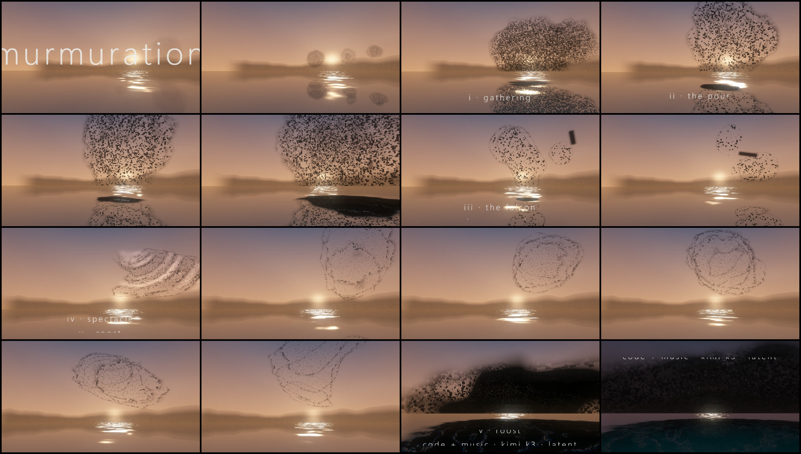

# Murmuration

An 8k intro for Windows browsers by **Latent**. Code and music: Kimi K3 (an AI
model by Moonshot AI). Release notes: [murmuration.nfo](murmuration.nfo).

Dusk over a flooded marsh. Small parties of starlings gather in the distance,
then the sky opens and thousands pour down as one crowd. They wall and fold over
the water until a peregrine tears through the mass — the cloud compresses,
splits, and a panic wave rolls outwards through the flock. The answer is the
spectacle: braided strands and sculpted walls above the sun's glitter path.
Then the light goes, and the whole crowd rains down into the reeds to roost.



No video capture was made for this one.

## Run it

Double-click `intro.html`. A title screen shows progress while the soundtrack
is rendered and the shaders compile (a few seconds). When it says "click to
look up", click: it goes fullscreen and plays for 2:08. ESC leaves fullscreen.

- Target: Edge or Chrome on Windows 10 or 11 with a discrete GPU. Tested only on
  Edge with an RTX 5090, where a 1080p frame takes about 2 ms.
- Captions use the *Segoe UI* font that ships with Windows.
- The picture is rendered at a fixed 1920x1080 and scaled to the screen.
- No server and no browser flags are needed.

## Size

| File | Bytes | Notes |
|---|---|---|
| `intro.html` | 6,407 | the release; 1,785 bytes under the 8,192 limit |
| `intro_fetch.html` | 6,159 | same intro with the common `fetch` bootstrap; needs http:// |
| `dev.html` | unpacked | used for capture and debugging |

## Timeline (120 BPM, 64 bars)

| Time | Act | What happens |
|---|---|---|
| 0:00 | i · gathering | scattered parties above the reeds; sparse felt-piano motif, first chirps |
| 0:24 | ii · the pour | thousands rain out of the high sky in a column that spreads into a canopy; heartbeat pulse joins |
| 0:38 | | a funnel dips to the water |
| 0:48 | iii · the falcon | a dark dart tears through; the crowd compresses and splits around it; tremolo pad, a rising whoosh |
| 1:04 | iv · spectacle | the panic wave rolls out of the tear; braided strands and walls over the glitter path; full kit and arpeggio, the flock pulses on the beat |
| 1:52 | v · roost | the crowd rains down in streaks into the reed bank; night falls, crickets, credits |

## How it works

- The murmuration is a metaball field of three to five moving cores, shredded
  by value noise and domain-warped per act (scattered at the gathering, a
  column during the pour, height-sheared braids for the spectacle, a bank
  along the waterline for the roost). Individual starlings cost no geometry:
  the march hashes 3D cells, places one bird in a random sub-cell position and
  darkens the sky where it hits; dense regions saturate into a continuous
  silhouette, sparse regions stay granular.
- The falcon is a dart streaked along its own velocity, and it subtracts a
  moving wake from the field. The panic wave afterwards is a ring of density
  oscillation expanding from the bird's last position.
- Dusk sky, sun, cirrus and stars are analytic; the water is one plane bounce
  that re-marches the flock for reflections; the reed bed is a procedural
  horizon fringe that grows as the birds come down.
- Post: mip-chain bloom, grain, vignette, captions from a text texture.
- Soundtrack, one pixel per stereo sample at 48 kHz: felt piano (soft harmonic
  stack with hammer thump), two-bar pad swells with a falcon tremolo, heartbeat
  kick, spectacle kit and plucked arpeggio, plus a synthesised starling chorus —
  random FM chirps and a wing-shimmer noise whose loudness follows the size of
  the visible flock — through the shared 4-line Householder FDN reverb.

This intro runs about 1,800 bytes below budget; that is headroom, not padding.

## Build

```
node tools/build.mjs 12_murmuration
node tools/capture.mjs 12_murmuration sheet
node tools/audiostat.mjs 12_murmuration
```

## Credits and thanks

Techniques: Inigo Quilez (value noise, distance fields and the general
raymarching canon), Dave Hoskins (`hash without sine`), Jarzynski and Olano
(PCG hash, used for all audio noise), Krzysztof Narkowicz (the ACES-style
tonemap shape), and Ctrl-Alt-Test's write-ups for proving a 8k can tell a
story. Starling behaviour: every thunderclap murmuration video ever posted
from Otmoor, Gretna and Rome.

## Known limits

- Bird cells are a fixed-size lattice sampled per march step, so at very low
  resolutions the far flock reads as static rather than individuals. Judge
  individuals on a 1080p frame, mass on the contact sheet.
- The falcon is one dart; there is no second predator pass.
- No replay button; reload for another showing.
