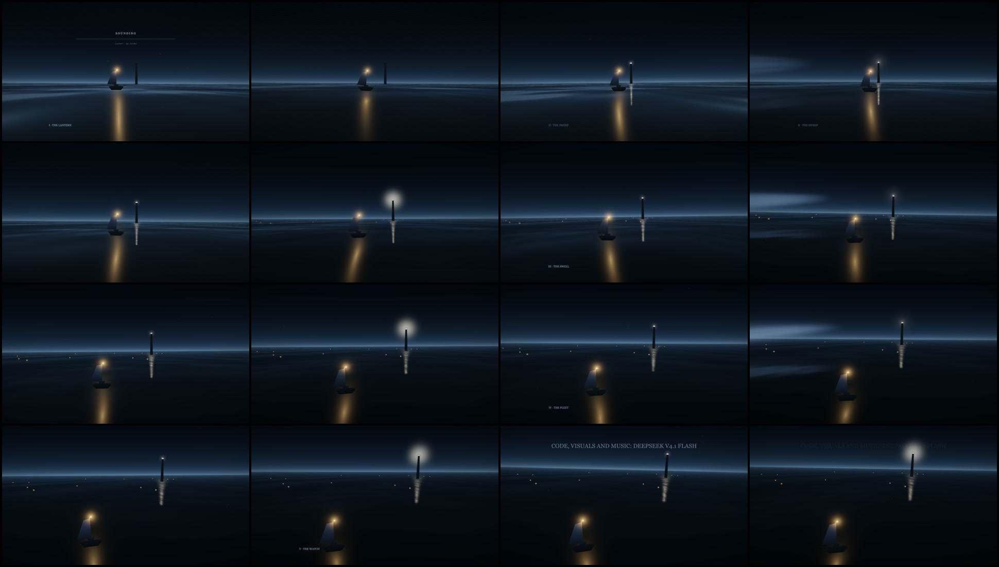

# Sounding

An 8k intro for Windows browsers by **Latent**. Code, visuals and music:
DeepSeek V4.1 Flash. Release notes: [sounding.nfo](sounding.nfo).



A sounding is the leadsman's call of the depth under a ship — the oldest way of
knowing where you are — and also the noise a foghorn makes into nothing. This
intro is about the light that does that work at night: a lighthouse beam
turning through the fog, and one small boat that keeps its own lantern.

Night, open sea, no moonlight, two colours only: the cold white of the beam and
the amber of the flame. The beam is a real cone in a scattering medium, it
throws a pool of light onto the swell and a torn path back to the lens, and it
passes over the boat. From about 0:34 other lanterns fade up out there, a
scattered fleet, each one brightening as the beam crosses it and dimming back
to its own faint glow: all of them feeling their way. It does not rescue them.
It only keeps the watch.

No video capture was made for this one.

## Run it

Double-click `intro.html`. A title screen lights a lamp while the soundtrack is
rendered and the shaders compile (about 1.3 s here). When it says "click to
begin", click: it goes fullscreen and plays for 2:08. ESC leaves fullscreen.

- Target: Edge or Chrome on Windows 10 or 11 with a discrete GPU. Tested only on
  Edge with an RTX 5090, where a 1080p frame costs about 0.8 ms.
- Captions use the *Georgia* serif that ships with Windows.
- The picture is rendered at a fixed 1920x1080 and scaled to the screen.
- No server and no browser flags are needed.

## Size

| File | Bytes | Notes |
|---|---|---|
| `intro.html` | 6,928 | the release; 1,264 bytes under the 8,192 limit |
| `intro_fetch.html` | 6,674 | same intro with the common `fetch` bootstrap; needs http:// |
| `dev.html` | unpacked | used for capture and debugging |

## Timeline (90 BPM, 3/4, 64 bars)

One bar is 2 s, so the beam's 16-second revolution is exactly 8 bars: picture
and score share a clock.

| Time | Act | What happens |
|---|---|---|
| 0:00 | i · the lantern | alone on black water, the lighthouse dark; the boat's flame is the only warm thing; foghorn every revolution, bell-buoy just off the beat |
| 0:15 | | the lamp is switched on and the beam starts to turn |
| 0:16 | ii · the sweep | the cone crosses the boat at 0:27 and every 16 s after, so the hull goes black against it; harp waltz, the tune on the cello from 0:29 |
| 0:44 | iii · the swell | the swell deepens, the beam's pool widens, the tune opens up |
| 1:00 | | strings double the tune; the swell into the reveal |
| 1:04 | | each lantern out there lights as the beam crosses it; a chime cluster marks the moment |
| 1:16 | iv · the fleet | the camera climbs and swings round, the sea opens out, the others are all there |
| 1:40 | v · the watch | the tower stands over everything, quiet |
| 1:54 | | the credit line, in the sky |
| 2:04 | | the last three seconds: everything goes, slowly |

## How it works

- **The beam is not marched.** It is a closed-form line integral of a gaussian
  cone through the fog (`beamInt`), so no ray can slip past it and there is no
  step to undersample. The fog inside the cone drifts, which mottles it and
  keeps its edge from ever being clean. The same function is evaluated three
  times: from the eye, reflected off the swell, and once per fleet lantern to
  decide whether the light has found it yet.
- **The sea is one plane.** Six gravity-dispersed waves on a golden angle give
  an exact analytic normal, and the chop flattens with distance, which is also
  what stops it aliasing. The water carries only what it can mirror: the sky,
  the beam's torn path, the pool where the cone lands, the tower's reflection
  and the boat's, both drawn as the vertical streaks they really are.
- **Everything is a silhouette.** The tower and the boat are flat cut-outs
  (convex half-plane intersections and segments) facing the camera, drawn
  nearly black on the fog, with the lantern's own warm light as the only thing
  that plays on them.
- **Post**: halation that blooms only above a floor (so a night frame does not
  wash out), a slow wash on each revolution, ACES, vignette, and film grain
  seeded by the frame and weighted to the shadows.
- **Soundtrack**, one pixel per stereo sample at 48 kHz: a barcarolle in D minor
  built from a bowed cello tune, a plucked harp waltz (root on one, chord on
  two and three), a foghorn on the beam's clock, an inharmonic bell-buoy just
  off it, low-passed sea noise, and a chime cluster for the fleet — through the
  shared 4-line Householder FDN reverb.

This intro runs about 1,264 bytes below budget; that is headroom, not padding.

## Build

```
node tools/build.mjs 13_sounding
node tools/capture.mjs 13_sounding sheet
node tools/audiostat.mjs 13_sounding
python3 13_sounding/check_frame.py
```

`check_frame.py` projects the boat, the mast and the lamp into the frame for
every act, so a camera change can be checked without rendering. Note that it
mirrors the camera law by hand; change both when you move the camera.

## Credits and thanks

Techniques: Inigo Quilez (value noise and the distance-field canon), Krzysztof
Narkowicz (the ACES-style tonemap shape in post), and the FDN reverb structure
shared by all Latent intros. The beam integral is textbook analytic geometry —
the closest approach of a ray to an axis, then a gaussian in the perpendicular
distance — and the boat outline was drawn here. Nothing is taken from another
intro's look: the composition is a lit boat, a tower and a fog bank, which is
older than demos.

Light and loss at sea: the sound of a foghorn heard across water at night, and
every photograph ever taken of a lighthouse beam in fog.

## Known limits

- The boat is a flat cut-out: seen from the side it is right, but the camera
  never goes round it, by design.
- The boat's reflection is one plane bounce with no refraction, so in a rough
  swell it is slightly too coherent.
- The halo of the far lanterns is floored at about one pixel, so at very small
  window sizes they read as slightly larger dots than they should.
- The fleet does not move: the lanterns are where they are, and the beam finds
  them in an order fixed by where it points, not by the score.
- No replay button; reload for another showing.
