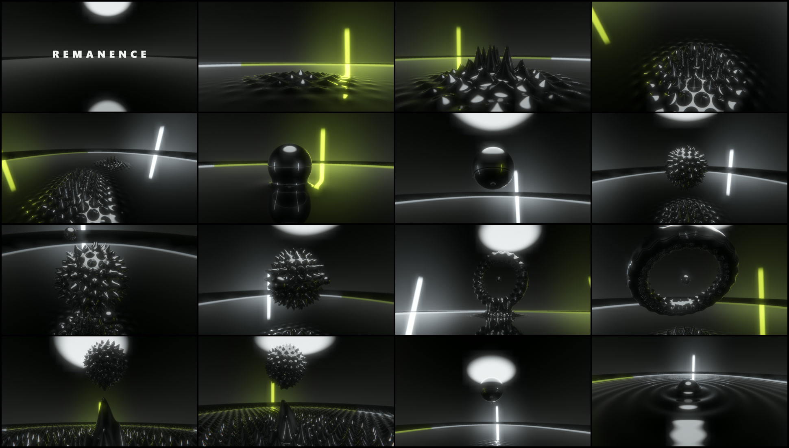

# Remanence

An 8k intro for Windows browsers by **Latent**. Code, visuals and music: Claude Fable 5.2
(an AI model made by Anthropic). Release notes: [remanence.nfo](remanence.nfo).

A pool of black ferrofluid in a dark round room, and a magnet under it that
plays drum and bass. Three neon tubes switch on, one of them lime. The pool
grows a hump, the hump grows spikes, and the spikes follow the wobble of the
bass. More magnets drag crowns of spikes across the pool. In the breakdown the
fluid lifts off as a mirror ball; on the second drop it grows spines, throws
off droplets and takes them back, opens into a ring, and at the end the whole
pool stands up as a sea of spikes with one spire reaching for the ball. Then
the field is switched off, and everything falls back into a flat pool with a
few ripples. Remanence is the magnetisation that stays in a material when the
field is gone.



No video capture was made for this one.

## Run it

Double-click `intro.html`. The title screen shows a lime bar that grows as the
soundtrack is rendered and the shaders compile (about 1.5 seconds on the test
machine). When it says "click to switch on the field", click: it goes
fullscreen and plays for 1:58. ESC leaves fullscreen.

- Target: Edge or Chrome on Windows 10 or 11 with a discrete GPU. Tested only on
  Edge with an RTX 5090, where a 1080p frame takes 2.7 to 7.8 ms.
- The captions use *Segoe UI Black*, which ships with Windows.
- The picture is rendered at a fixed 1920x1080 and scaled to the screen.
- No server and no browser flags are needed.

## Size

| File | Bytes | Notes |
|---|---|---|
| `intro.html` | 5,487 | the release; 2,705 bytes under the 8,192 limit |
| `intro_fetch.html` | 5,242 | same intro with the common `fetch` bootstrap; needs http:// |
| `dev.html` | 12,370 | unpacked build used for capture and debugging |

Before packing, the JavaScript plus the three minified shaders are 10,437 bytes
(scene 3,905, post 1,077, music 2,257); raw deflate brings that to 5,086.

## Why this concept

The PC 8k winners at Revision in the last years (Dune, Preikestolen, Origo,
Aenigma, and Ctrl-Alt-Test's sheep films behind them) are each one subject,
directed from the first frame to the last, with music that belongs to it. The
thirteen earlier Latent intros are landscapes, characters, flowers, drawings,
cloth, a cathedral, crystals, dancers, birds and the sea, most of them bright,
with pads, arpeggios, swing or techno.

Left over: a material study in a black room, cut to drum and bass. Ferrofluid
suits the medium for three reasons. Its shape is a function of a field, so a
few numbers animate all of it. It is a perfect black mirror, so it needs no
texture, only something to reflect. And its spikes can be tied to the bass
line directly: the same wobble curve that opens the filter of the bass in
`music.frag` sets the height of the spikes in `scene.frag`.

## Timeline

171 BPM, 1.4 seconds per bar, 84 bars. The camera cuts every four bars.

| Time | Bars | Picture | Music |
|---|---|---|---|
| 0:00 | 0-7 | The ceiling disc, then two tubes switch on, each with a flicker. Title. A flat black pool | mains hum; a relay clunk for each lamp; a pad of minor ninth chords |
| 0:11 | 8-15 | A hump rises in the middle of the pool and grows its first spikes, which jump with the kick | four on the floor, getting louder, a pulsing bass, a riser and a snare roll |
| 0:22 | 16-31 | **First drop.** A crown of spikes that follows the wobble of the bass, close and from above. From bar 24 three magnets: one crown wanders, two orbit it | drum and bass: kick, snare on 2 and 4, hats, ghost notes, a sub with a growl that wobbles at 4, 6, 8 or 16 per bar; bells from bar 24 |
| 0:45 | 32-43 | **Breakdown.** The spikes sink. The fluid pulls up into a neck, pinches off and hangs in the room as a mirror ball. Towards the end its skin begins to crawl | hum, pad, a few bells; hats, then four on the floor and the roll again |
| 1:02 | 44-59 | **Second drop.** The ball is an urchin over the crown it left behind; it starts to sway. Three droplets leave it, circle it, and return | drum and bass again |
| 1:24 | 60-67 | The urchin opens into a ring of spikes | a second, faster hat; a brighter bass |
| 1:35 | 68-75 | **Climax.** The whole pool stands up as a sea of large spikes; under the ball a spire rises until it almost touches | cymbal; the bells an octave higher |
| 1:46 | 76-83 | The field is switched off. The ball drops into the pool; ripples; the credit; the lamps go out one by one | cymbal, hum, relay clunks |

## How it works

Four parts, as in every Latent intro: `src/main.js` (loader), `src/scene.frag`
(the picture), `src/post.frag` (lens and captions) and `src/music.frag` (the
soundtrack).

### The fluid

One distance function. The pool is a height field: a sum of three Gaussians,
one per magnet, gives the field strength; the surface is lifted by it, and a
hexagonal lattice of cones (two offset rectangular grids, nearest centre wins)
is scaled by it. The profile of a cone is `r*r*(2-r)`, concave with a flared
foot, which is what makes it look like the real thing and not like a bed of
nails. In the climax the lattice gets coarser, a wide Gaussian raises spikes
everywhere, and the cube of the field strength adds the spire.

The ball is a sphere with spines in staggered rings around its own tumbling
axis: latitude is cut into bands, each band into as many cells as fit, and
every other band is shifted by half a cell and creeps the other way. The same
cone profile is used. For eight bars the sphere is blended into a torus. Three
small spheres orbit it and are joined to it with a smooth minimum, as is the
pool, so the fluid forms a neck when the ball lifts off and bulges when the
spire comes close.

A height field is not a distance field, so the pool's value is divided by a
bound of its slope, which grows with the height of the spikes. The march takes
up to 300 steps at 1080p; rays that have not converged when they run out are
treated as misses, otherwise the flanks of spikes get beaded edges.

### The room

The fluid has no colour of its own: every pixel is what a ray sees after up to
three reflections, weighted by Schlick's Fresnel term each time. So the room
is the lighting. It is a drum of radius 14, computed analytically: three
vertical neon tubes on the wall that travel around it (faster in the drops),
one of them lime; a soft glow on the wall around each tube; a strip of light
at the foot of the wall; a soft white disc under the ceiling. The lime tube
flashes with the snare.

The wall glow came late and matters most. With tubes alone on black, the fluid
was only visible where it had spikes to catch a highlight; the smooth ball and
the ring were black on black. A faint gradient on the wall gives every shape a
silhouette and gives the mirror something to show between the highlights.

Lamps seen directly are dimmed to a quarter, so that the reflections are the
brightest things in the frame. Each pixel is traced four times.

### Lens

The scene shader writes the radius of the blur for each pixel into the alpha
channel. `post.frag` gathers 16 taps on a disc of that radius, from a mip level
that fits it, adds a wide glow from 12 taps through the mip chain, pulls the
colour channels apart towards the corners on every snare, and applies a
vignette, a tone curve and grain.

### The soundtrack

`music.frag` computes one stereo sample per pixel at 48 kHz from the sample
index alone; all timing is in whole samples (a 16th is 4,200).

- **Bass**: a sine sub in F with a phase-modulated growl on top. The depth of
  the modulation is the wobble: a raised cosine at 4, 4, 8, 4, 4, 6, 8 or 16
  cycles per bar, in an eight-bar pattern. The picture uses the same table.
- **Drums**: kick on 1 and the "and" of 3 (sine with a pitch drop), snare on 2
  and 4 (noise plus a tone), closed hats on every 16th with one left open,
  ghost notes, cymbals on the drops, risers and snare rolls before them.
  Everything else ducks under the kick.
- **Pad**: a minor ninth chord of five phase-modulated sines, moved in
  parallel every two bars. **Bells**: a struck bar (FM at a ratio of 3.5),
  three notes over each bar against the four of the drums.
- **Hum and relays**: a hum on the low F (44 Hz) with two harmonics under the quiet
  parts; a click and a thud when a lamp switches.
- **Room**: a feedback delay network of four delay lines in JavaScript, as in
  the earlier intros.

## Credits and sources

Everything was written for this intro. These ideas and techniques are borrowed:

- Ferrofluid and its spikes (the Rosensweig instability, a hexagonal pattern
  of peaks in a field normal to the surface): the look follows the many
  photographs and sculptures of it, among them Sachiko Kodama's. The shapes
  here are drawn, not simulated.
- Raymarching of distance functions, the tetrahedron normal and the smooth
  minimum: Inigo Quilez (iquilezles.org).
- Fresnel weight: Schlick's approximation.
- Depth of field by gathering with a per-pixel radius from the alpha channel:
  common practice in size-limited intros.
- "Hash without sine": Dave Hoskins. PCG hash in the music shader: Melissa
  O'Neill; Jarzynski and Olano, "Hash Functions for GPU Rendering".
- FM synthesis of bells and of the bass: John Chowning.
- Feedback delay network reverb with a Householder matrix: Jot and Chaigne.
- Rendering the soundtrack in a fragment shader and reading it back: used by
  all Latent intros, known from 0b5vr and others.
- The drum pattern and the wobble bass are common property of drum and bass
  and its neighbours; the bass line, chords and bell figure are new.
- Build tools: terser, zopfli (`@gfx/zopfli`), puppeteer-core, ffmpeg.
- Font: Segoe UI Black, as installed with Windows.

## Build and capture

From the repository root, in PowerShell, with Node 22 and ffmpeg on the path:

```
node tools/build.mjs 14_remanence
node tools/glcheck.mjs 14_remanence/src/scene.frag 14_remanence/src/post.frag 14_remanence/src/music.frag
node tools/capture.mjs 14_remanence check 14_remanence/intro.html
node tools/audiostat.mjs 14_remanence
node tools/capture.mjs 14_remanence sheet "4.2,14,25.2,30.8,36.4,49,53.2,64.4,75.6,81.2,87,92.4,98,103.6,107.5,110"
node tools/capture.mjs 14_remanence still 98 14_remanence/media/hero_climax.png
node tools/capture.mjs 14_remanence still 25.2 14_remanence/media/hero_crown.png
```

`media/` holds the contact sheet, two 1920x1080 hero frames (the climax and the
crown of the first drop) and a 400x300 crop of the crown for Pouët.

## What was checked, and known limits

Checked: all three shaders compile without errors; the packed `intro.html`
loads from a file:// URL in 1.5 seconds and starts on click; the soundtrack has
no NaNs, peaks at 0.95 and has an RMS of 0.17 to 0.32 per 16-second section
during the music; every shot was looked at as rendered frames, in fourteen
rounds of contact sheets and 1080p stills.

Limits:

- **Nobody has heard the music.** It was written by rule and mixed by numbers.
  Whether the wobble sounds like a bass line or like a fault needs a human ear.
- The fluid was only seen as still frames, never in motion. That the spikes
  move with the bass is true of the numbers; whether it feels tight is untested.
- The climax is the most expensive part (7.8 ms per frame on the test GPU);
  slower GPUs may not hold 60 frames per second there.
- The dark underside of the urchin sparkles: it mirrors the spike field below
  it, which is finer than four samples per pixel can resolve. The far rows of
  the spike sea break into dots for the same reason.
- The spire of the climax is smooth; its spikes are displaced upwards only and
  vanish on its steep flanks.
- The spikes are a drawn lattice, not a simulation: they do not merge, split or
  slide the way real ferrofluid peaks do when the field moves.
- Without Segoe UI Black the captions fall back to the browser's sans-serif.
