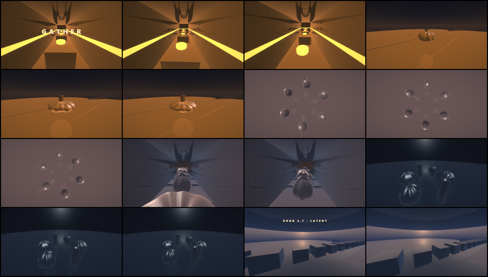

# Gather

An 8k intro for Windows browsers by **Latent**. Code, visuals and music: Grok 4.7
(an AI model made by xAI). Release notes: [gather.nfo](gather.nfo).

A night shift in a glassworks, in six shots. The furnace hall, a row of pots.
One gather of glass on a pipe. A ring of gathers turning. The annealer, a
corridor of bowls cooling from amber to blue. The showroom, finished pieces
under one lamp. The yard at dawn, crates in a row, and the light comes up.



No video capture was made for this one.

## Run it

Double-click `intro.html`. The title screen shows a bar while the soundtrack
renders and the shaders compile (about 1.3 seconds on the test machine). When
it says "click to take up the pipe", click: it goes fullscreen and plays for
about 2:14. ESC leaves fullscreen.

- Target: Edge or Chrome on Windows 10 or 11 with a discrete GPU. Tested on
  Edge with an RTX 5090, where a 1080p frame takes about 0.5 ms.
- Captions use *Segoe UI Black*, which ships with Windows.
- Rendered at a fixed 1920x1080 and scaled to the screen.

## Size

| File | Bytes | Notes |
|---|---|---|
| `intro.html` | 4,290 | the release; 3,902 bytes under the 8,192 limit |
| `intro_fetch.html` | 4,057 | same intro with the `fetch` bootstrap; needs http:// |

## Timeline

150 BPM, 1.6 seconds per bar. The picture cuts every 14 bars, and the music
changes with it.

| Time | Bars | Picture | Music |
|---|---|---|---|
| 0:00 | 0-14 | Furnace hall: a corridor of pots, fire in the far wall. Title. | furnace hum |
| 0:22 | 14-28 | One gather on a pipe, ribs turning | kick, tick, breath, snare |
| 0:45 | 28-42 | Six gathers in a ring, each on its own pipe | same |
| 1:07 | 42-56 | The annealer: a corridor of bowls, cooling from amber to blue | hum, bells enter |
| 1:30 | 56-70 | The showroom: finished pieces on plinths under one lamp | bells, kick returns |
| 1:52 | 70-84 | The yard at dawn: a row of crates, the sky lightens. Credit. | bells, hum |

## How it works

Four parts, as in every Latent intro: `src/main.js`, `src/scene.frag`,
`src/post.frag`, `src/music.frag`.

One distance function with six branches, chosen by the bar number. The hall is
a box with a repeated pot. The gather is a sphere with a sine of the angle
around it for the ribs, on a cylinder. The ring is six of those on a circle.
The annealer repeats a bowl down a corridor, and the colour cools with
distance. The showroom places six finished pieces on boxes. The yard is a row
of crates under a sky that lightens toward the horizon. Each shot has its own
fixed camera, set far enough back that the subject is in frame.

The soundtrack is a fragment shader at 48 kHz. A hum at 52 Hz for the furnace,
a breath of noise while glass is being worked, a kick with a pitch drop and a
snare on the backbeat in the working shots, and a six-note bell figure over
the showroom and the yard. A four-line feedback delay network in JavaScript
adds the room.

## Credits and sources

Written for this intro. Borrowed:

- Raymarching of distance functions and the box: Inigo Quilez (iquilezles.org).
- "Hash without sine": Dave Hoskins.
- Feedback delay network reverb: Jot and Chaigne.
- Soundtrack rendered in a fragment shader and read back: all Latent intros,
  known from 0b5vr and others.
- Build tools: terser, zopfli (`@gfx/zopfli`), puppeteer-core, ffmpeg.
- Font: Segoe UI Black, as installed with Windows.

## Build and capture

From the repository root, in PowerShell, with Node 22 and ffmpeg on the path:

```
node tools/build.mjs 15_gather
node tools/glcheck.mjs 15_gather/src/scene.frag 15_gather/src/post.frag 15_gather/src/music.frag
node tools/audiostat.mjs 15_gather
node tools/capture.mjs 15_gather sheet "4,12,20,28,36,44,52,60,68,76,84,92,100,108,116,122"
node tools/capture.mjs 15_gather still 8 15_gather/media/hero_hall.png
node tools/capture.mjs 15_gather still 74 15_gather/media/hero_annealer.png
```

## What was checked, and known limits

Checked: all three shaders compile; the packed `intro.html` loads from a
file:// URL in 1.3 seconds and starts on click; the soundtrack has no NaNs and
peaks at 0.83; frame time is about 0.5 ms at 1080p on the test GPU. Every shot
was judged from 1080p stills, not from the contact sheet alone, because the
sheet renders at 960x540 and hid the framing.

Limits:

- **Nobody has heard the music.** It was written by rule and checked by peak
  and RMS per 16-second section.
- The camera drifts through each shot, and the gather is worked from a bulb
  into a wide form with a neck during its shot. Both were confirmed on
  1080p stills. The 960x540 contact sheet hides the shape change.
- The glass reflects the room but does not refract it.
- The pots are boxes with a disc of emissive glass on top. There are no
  tools, no bench and no person.
- 3,902 bytes of the 8,192 budget are unused.
