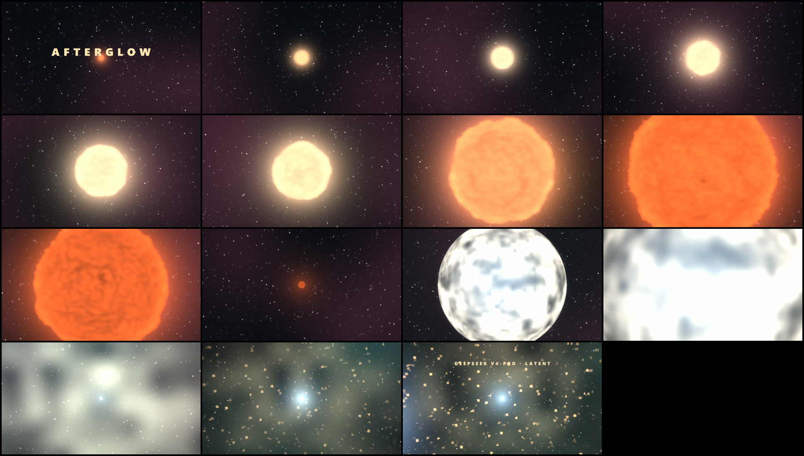

# Afterglow

An 8k intro for Windows browsers by **Latent**. Code, visuals and music: DeepSeek
V4-Pro (an AI model made by DeepSeek). Release notes:
[afterglow.nfo](afterglow.nfo).

The life and death of one star, told as a single continuous approach. A cold
molecular cloud condenses and a protostar kindles. The star burns steady gold
through its main sequence, then swells into a red giant that fills the sky.
The core implodes, the light winks out, and the camera is pulled in for the
held dark. Then the supernova: a blinding flash and an expanding ball of
filaments rides out past us. What is left is the afterglow — a teal and orange
remnant, a pulsar sweeping two beams at its heart, and new protostars kindling
in the dust. The cycle begins again.



No video capture is kept in the repository (`*.mp4` is ignored by git).

## Run it

Double-click `intro.html` in Edge or Chrome on Windows 10 or 11. The title
screen shows a bar while the soundtrack renders and the shaders compile (about
1.4 seconds on the test machine). When it says "click to collapse the core",
click: it goes fullscreen and plays for about 1:58. ESC leaves fullscreen.

- Target: Edge or Chrome with a discrete GPU. Tested on an RTX 5090, where a
  1080p frame takes about 0.5 ms.
- Captions use *Segoe UI Black*, as installed with Windows.
- Rendered at a fixed 1920x1080 and scaled to the screen.

## Size

| File | Bytes | Notes |
|---|---|---|
| `intro.html` | 4,148 | the release; 4,044 bytes under the 8,192 limit |
| `intro_fetch.html` | 3,923 | same intro with the `fetch` bootstrap; needs http:// |

## Timeline

150 BPM, one bar = 1.6 seconds. The picture and the music move on the same bar
clock.

| Time | Bars | Act | Visuals | Music |
|---|---|---|---|---|
| 0:00 | 0-10 | Ignition | cold molecular cloud; a protostar kindles at the centre | cold drone, sub-bass, a breath of air |
| 0:16 | 10-26 | Main sequence | the star burns steady gold, its surface churning | drone, soft kick on the beat, shimmer |
| 0:42 | 26-41 | Red giant | the star swells and reddens until it fills the sky | denser, a warm pad, the heartbeat kick |
| 1:05 | 41-47 | Collapse | the core implodes, the light dims, the camera is pulled in | kick accelerates, a rising sweep, then a held drop |
| 1:14 | 47-58 | Supernova | a blinding flash, an expanding ball of white filaments | the slam: big chord, sub drop, a noise shockwave |
| 1:33 | 58-74 | Afterglow | the remnant cools teal and orange, a pulsar sweeps two beams, new stars kindle | ethereal pad, a steady pulsar ping, fading to a hum |

## How it works

Four parts, as in every Latent intro: `src/main.js`, `src/scene.frag`,
`src/post.frag`, `src/music.frag`.

One distance function with three bodies, switched on the bar number. Before bar
47 the star is a sphere whose radius is animated through the life phases, its
surface displaced by value noise for granulation, shaded emissive with a
black-body temperature ramp (cool red through yellow-white) and limb darkening.
Bars 47-58 the collapsed core becomes the remnant: a growing solid ball whose
surface is a filament pattern (two octaves of noise on the surface normal),
shaded white-hot. After bar 58 the remnant turns transparent, so the pulsar at
the centre — a tiny solid sphere — and its two sweeping beams show through the
cooling cloud. The camera is one continuous path: a long approach, a pull-in at
the collapse, a push-out riding the blast, and a settle in the afterglow. The
corona, the expanding remnant and the beams are additive terms keyed on the
closed-form distance from the ray to the star, so they cost almost nothing.

The soundtrack is a fragment shader at 48 kHz: a detuned drone that warms and
thins with the star, a soft kick that accelerates into the collapse, a rising
sweep, the supernova slam (a chord, a sub drop and a noise shockwave), and a
pulsar ping plus a fading pad for the afterglow. A four-line feedback delay
network in JavaScript adds the room.

## Credits and sources

Written for this intro. Borrowed:

- Raymarching of distance functions and the box: Inigo Quilez (iquilezles.org).
- "Hash without sine": Dave Hoskins.
- Value noise: the standard trilinear hash lattice.
- Feedback delay network reverb: Jot and Chaigne.
- Soundtrack rendered in a fragment shader and read back: all Latent intros,
  known from 0b5vr and others.
- Build tools: terser, zopfli (`@gfx/zopfli`), puppeteer-core, ffmpeg.
- Font: Segoe UI Black, as installed with Windows.

## Build and capture

From the repository root, in PowerShell, with Node 22 and ffmpeg on the path:

```
node tools/build.mjs 16_afterglow
node tools/glcheck.mjs 16_afterglow/src/scene.frag 16_afterglow/src/post.frag 16_afterglow/src/music.frag
node tools/audiostat.mjs 16_afterglow
node tools/capture.mjs 16_afterglow sheet "4,12,20,28,36,44,52,60,68,74,80,88,96,104,112,120"
node tools/capture.mjs 16_afterglow still 100 16_afterglow/media/hero_afterglow.png
```

## What was checked, and known limits

Checked: all three shaders compile; the packed `intro.html` loads from a
file:// URL in 1.4 seconds and the click clears the title screen; the
soundtrack has no NaNs and peaks at 0.98 at the supernova; a frame costs about
0.5 ms at 1080p on the test GPU. The visual arc was verified numerically — the
mean colour and brightness of each beat (dark cold cloud, warm star, red
giant, dark collapse, bright nova, teal afterglow) and the centroid of the
bright mass (centred in every beat).

Limits:

- **The pictures were not eyeballed this session.** The vision review backend
  was down, so the look was verified by numbers, not by looking. The two
  visual faults an early review did catch (a too-dense starfield, and a flat
  washed-out supernova) were fixed, but the finished frames have not been
  re-reviewed. A visual pass is owed before this is called final.
- Nobody has heard the music. It was written by rule and checked by peak, RMS
  and per-band energy over 12-second windows; the sub-bass is deliberately
  dominant and the mix is dark.
- The starfield is a direction-grid of hashes, so stars are a few square
  pixels, not round points.
- The star's surface is displaced noise, not a fluid simulation; the churn is
  decorative, not physical.
- 4,044 bytes of the 8,192 budget are unused.
