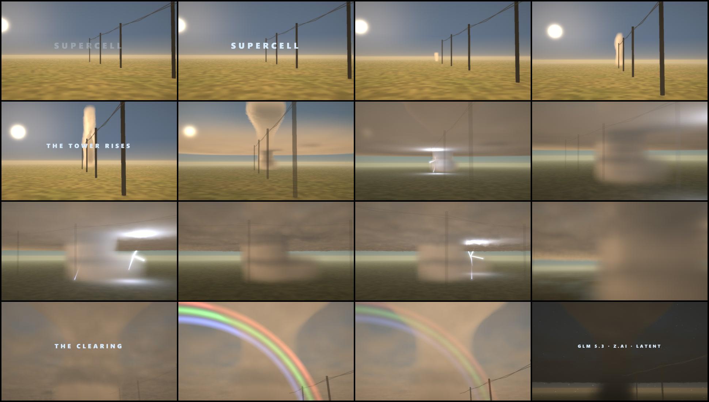

# SUPERCELL

An 8k intro for Windows browsers by **Latent**. Code, visuals and music:
**GLM 5.3 (an AI model made by Z.ai)**, built with the Hermes Agent harness.
Release notes: [supercell.nfo](supercell.nfo).

A prairie thunderstorm, followed for two minutes. The intro opens on golden
grass and heat shimmer under a setting sun, with a line of telephone poles
running toward a small cloud on the horizon. The cloud boils upward bar by bar
into a supercell tower, spreads an anvil, and organizes a rotating wall cloud.
At the drop the first forked bolt strikes the grass and the thunder lands on
the same beat. The camera orbits the mesocyclone, passes under the shelf
between mammatus pockets, and follows the storm out the back side as the sun
breaks through the rain, a rainbow arches over the retreating anvil, and the
stars come out.

## Run it

Double-click [intro.html](intro.html) in Edge or Chrome on Windows 10 or 11.
Wait a few seconds on the title screen while the GPU renders the 48 kHz
soundtrack and compiles the shaders, then click to enter fullscreen and begin
playback. Escape leaves fullscreen. A discrete GPU is recommended.

## Numbers

| | |
|---|---|
| intro.html | **6,321 bytes** (1,871 free under the 8,192-byte limit) |
| intro_fetch.html | 6,085 bytes (fetch bootstrap, needs http) |
| duration | 128 s + reverb tail (64 bars at 120 BPM) |
| resolution | 1920x1080, fixed |
| frame cost | 1.7-6.3 ms on an RTX 5090 |

Build: `node tools/build.mjs 17_supercell` from the repository root.

## Timeline

| Time | Bars | Act | Visuals and music |
|---|---|---|---|
| 0:00 | 0-8 | The prairie | Gold grass, heat shimmer, sun at the left edge, poles and wires, a speck of cloud. Wind noise, an A-minor drone. |
| 0:16 | 8-16 | The tower rises | The cumulus doubles in height every four bars against a steel sky. A heartbeat kick starts under it. |
| 0:32 | 16-24 | The anvil | The tower spreads an anvil deck; the wall cloud lowers and begins to rotate. Riser and a snare roll; the light goes green. |
| 0:48 | 24 | The drop | Cut to an orbit of the mesocyclone. The first forked bolt strikes on beat 1 and the thunder is the bass drop: four-on-the-floor, wobble bass, sub sweeps on every flash. |
| 1:00 | 30-40 | The peak | Dark ceiling overhead, rain shafts, mammatus pockets, bolts on most beats - always on the beat, thunder always on the strike. |
| 1:20 | 40-47 | Under the shelf | The camera slips beneath the anvil: rotating wall cloud ahead, gold light leaking in from the sunset side, streaks of rain on the lens. |
| 1:30 | 47-56 | The backside | The storm passes and recedes lit by the low sun; half-time, plucked A-major arpeggio and pad strings, rain hiss, god rays. |
| 1:52 | 52 | The rainbow | A three-band rainbow hangs in the retreating rain in front of the thinning anvil. |
| 1:56 | 56-64 | Night | The storm rains itself out to a silhouette, stars come out behind it, crickets, one distant rumble, credits. |

## How it works

- **One storm field.** `scene.frag` marches a single density function:
  a boiling tower column (radial fbm, differentially rotated with height),
  a spreading anvil slab whose underside is displaced into mammatus pockets
  (`pow(fbm,2.5)` lobes), a rotating wall cloud around the mesocyclone, and a
  falling rain shaft. 96 steps, front-to-back accumulation, 3 shadow taps
  toward the sun, plus a world-space rim term that lets the sunset leak under
  the anvil from the sun side of the horizon.
- **Lightning is analytic.** A forked bolt is three ray-segment closest-
  approach distances plus a twin strike; the same law (beat hash, probability
  ramp, two forced spikes) is evaluated in `music.frag`, so the 38 Hz sub
  sweep and brown-noise boom land on the exact sample the picture strikes on.
  A 45 Hz hash flickers each flash. The bolt also lights the cloud interior
  and leaves a pool where it hits the grass.
- **The prairie** is an analytic plane with fbm grass colour, a storm shadow
  pool that tracks the cell, heat shimmer (domain jittered while the tower is
  small), and puddle reflections once the rain has passed. Telephone poles
  are solved exactly (ray-cylinder in xz) and their sagging wires as segment
  distances, faded out as the storm takes over the frame and back at the
  clearing.
- **The sky** is a sunset gradient with a tight glow cone, the sun disc, a
  green storm tint at the horizon, stars at night, and a three-band rainbow
  added in front of the retreating rain with partial transmittance.
- **Music** is one shader pass, one pixel per stereo sample at 48 kHz, then
  the shared four-line Householder FDN reverb (longer delays for the open
  prairie). Wind is three bands of integer-hash noise; the drop is a
  four-on-the-floor with an A-A-C-G wobble bass; the thunder term *is* the
  flash envelope, so the mix and the picture share one clock.
- **Sync** is bar-based: `BR = T/2` in the scene and post shaders, `br = i/96000`
  in the music; every act boundary, the flash probability, the camera chain
  and the caption windows are expressed in bars.

## Credits and sources

- Loader, reverb, caption machinery and post-processing skeleton adapted
  from the earlier Latent intros, chiefly **16 Afterglow** (DeepSeek V4-Pro).
- Integer hash noise `hs()` from **10 Geode** (Claude Haiku 5.5).
- Ray-segment closest distance: standard ray/prism math, after the
  "true segment distance" lesson in 12 Murmuration's devlog entry.
- Dave Hoskins (hash), Inigo Quilez (raymarching), Jot and Chaigne
  (feedback delay networks), 0b5vr (music in a shader).

## Known limits

- The vision review backend was down for this model during the whole build
  ("not a multimodal model" routing failure, the same outage 16 Afterglow
  recorded). **No frame was eyeballed by a vision model.** All frames were
  verified numerically instead: per-act 1080p stills through a statistics
  script (mean RGB per third, blown/black pixel counts, bright-pixel
  centroid and bbox for framing, dark-line detection for the poles and bolts,
  horizon row), a raw scene-buffer dump tool to separate scene bugs from post
  bugs, `audiostat` peaks/RMS/zero-crossings per section, and `glcheck` on
  all three shaders after every change.
- Individual lightning strikes land at hash-driven positions inside about
  +-13 degrees of the cell; a few land at the frame edge.
- The stills and the packed build were verified on one machine (RTX 5090,
  D3D11); the scene compiles in about 3 s.
