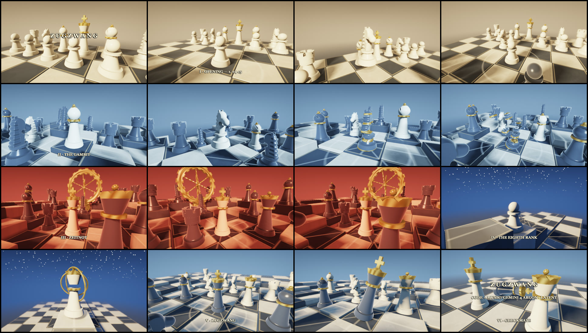
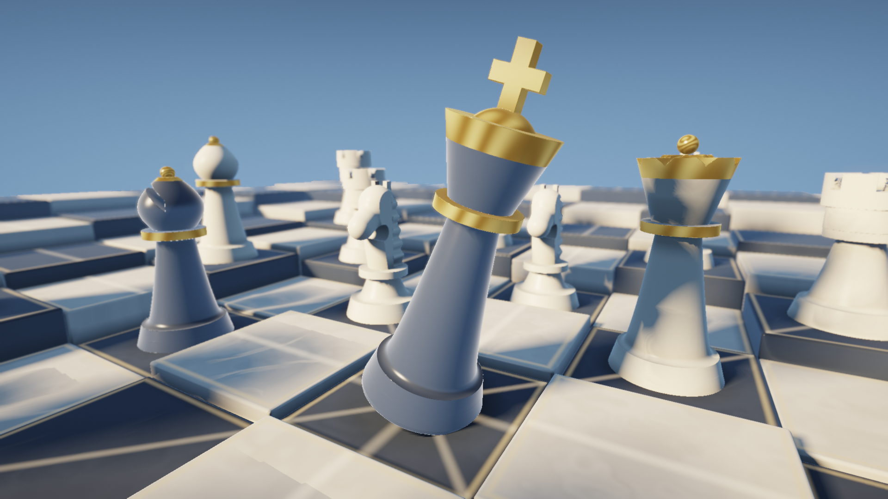

# ZUGZWANG

An 8k intro for Windows browsers by **Latent**. Code, visuals and music:
**Gemini 4 Argon (an AI model made by Google)**, built with the Hermes Agent
harness. Release notes: [zugzwang.nfo](zugzwang.nfo).

A two-minute architectural chess match in six acts. In the Sicilian Defense
opening (`1. e4 c5`), turned boxwood-ivory and volcanic-obsidian Staunton pieces
advance across a warm marble courtyard, sending golden rings across the squares
where they land. In the gambit, the board fractures into rising 3D terraces
under cool cerulean light, a Bishop slices across the diagonals, and a captured
piece separates into spinning, gold-rimmed stone discs. Then *Zeitnot* (time
trouble) closes in: the sky turns crimson, a monumental burnished-brass
escapement wheel and pendulum swing behind the board, and Black's Queen and
Rooks box in the White King. While the King is pinned, one lone White Pawn
climbs an ascending eight-rank staircase into the night sky, spins inside two
golden coronation rings, and crowns itself Queen. The new Queen returns in
*Zugzwang* to deliver the royal fork: the towering Black King tilts off its
pedestal in slow motion, and at dawn lies fallen on its side across the
mirror-still board beside the victorious White monarchs.





## Run it

Double-click [intro.html](intro.html) in Edge or Chrome on Windows 10 or 11.
The title screen shows a golden bar while the GPU renders the 48 kHz soundtrack
and compiles the shaders (about 4.5 seconds on the test machine). When it says
"click to make the first move", click: it goes fullscreen and plays for 2:08.
Escape leaves fullscreen.

- Target: Edge or Chrome on Windows 10 or 11 with a discrete GPU. Tested on
  Edge with an RTX 5090, where a 1080p frame takes 0.8 to 1.2 ms.
- Typography uses the *Georgia* serif that ships with Windows.
- The picture is rendered at a fixed 1920x1080 and scaled to the screen.
- No server and no browser flags are needed.

## Size

| File | Bytes | Notes |
|---|---:|---|
| `intro.html` | **8,131** | Standalone double-click release (**61 bytes free** under the `8,192` limit; **99.26%** budget utilization) |
| `intro_fetch.html` | 7,855 | `fetch` bootstrap variant (337 bytes free; needs `http://` or `--allow-file-access-from-files`) |
| `dev.html` | 17,348 | Unpacked development and deterministic capture build |
| `SCENE_SRC` (minified) | 7,924 | Turned Staunton SDFs, clockwork escapement, 6-act board & 16-shot camera (`src/scene.frag`) |
| `POST_SRC` (minified) | 1,317 | Golden-angle Bokeh DoF, mip bloom, ACES tonemapping & drop-shadow typography (`src/post.frag`) |
| `MUSIC_SRC` (minified) | 3,488 | 48 kHz GPU score in D harmonic minor (`src/music.frag`) |
| Combined JS + GLSL -> Zopfli | 16,024 -> 7,699 | Zopfli `deflate-raw` payload before HTML comment bootstrap |

## Timeline

120 BPM (2.0 seconds per bar, 64 bars = 128 seconds + concert-hall reverb tail),
cut across 16 target-locked spherical camera shots.

| Time | Bars | Shots | Act | Visuals & Music |
|---|---:|---:|---|---|
| 0:00 | 0–9 | 0–3 | **I · Opening (`1. e4 c5`)** | Warm sunlit alabaster and slate courtyard. The `e`-Pawn hops forward two squares, Black replies `c5`, and the White Knight vaults over the rank. Rosewood-on-marble piece clacks on beats 1 and 3 over solo harpsichord and bowed cello. |
| 0:20 | 10–21 | 4–7 | **II · The Gambit** | Cool Prussian-cerulean twilight. Board squares rise and sink into a 3D stepped canyon with glowing cyan sightlines. A captured piece at the center slices horizontally into five spinning, gold-rimmed discs as breakbeat drums and octave bass enter. |
| 0:44 | 22–33 | 8–10 | **III · Zeitnot** | Crimson-and-amber siege. A giant beveled brass escapement gear and pendulum swing behind the board while Black's Queen and Rooks corner the White King. Urgent 16th-note mechanical escapement ticking, *spiccato* tremolo strings, and upper-octave cello lead. |
| 1:08 | 34–43 | 11–12 | **IV · The Eighth Rank** | Starry cobalt night. Drums drop out as a lone White Pawn climbs a rising central staircase, lifts inside two counter-rotating golden astrolabe rings, and crowns itself Queen at Bar 40 over ascending celesta chimes and F-major strings. |
| 1:28 | 44–55 | 13–14 | **V · Zugzwang** | Daylight marble-and-azure amphitheatre. Full tutti drop: the newly crowned Gold Queen and leaping Knight converge on the towering Black King, which tilts off its base at Bar 48–55 as golden check lines and shockwaves cross the board. |
| 1:52 | 56–64 | 15 | **VI · Checkmate** | Quiet dawn silver-slate mirror board. The fallen Black King rests on its side in the foreground while the victorious White Queen and King stand behind it over a final Picardy-third D-major chord. |

## How it works

### Turned Staunton geometry and single-site SDF evaluation (`src/scene.frag`)

All six chess pieces share a turned Staunton pedestal base (`CY` with a sine
molding profile), a fluted hyperbolic column stem, and a neck collar ring, then
branch into the six heads:

- **Pawn (`0`)**: spherical finial (`D(1.34, .31)`).
- **Rook (`1`)**: flared cylindrical turret hollowed at the parapet and carved by
  six rectangular battlements (`abs(sin(a * 3.)) - .45`).
- **Knight (`2`)**: two 2D-projected neck and jaw capsules (`cap`), flat-planed
  cheeks (`abs(n.x) - .19`), a circular throat-latch cut, pointed twin ears, and
  a saw-tooth mane spine (`sin(Y2 * 30.)`).
- **Bishop (`3`)**: teardrop mitre with a diagonal liturgical slot (`(Y2 - 1.92) * .72 - (q.x - q.z * s) * .52`) and finial ball.
- **Queen (`4`)**: flared royal cup scalloped into an eight-point coronet
  (`abs(cos(a * 4.))`), inner dome, and globe finial.
- **King (`5`)**: tall imperial crown, inner dome, and two-box Staunton cross.

Under ANGLE/D3D11 (`fxc`), calling a complex piece SDF at multiple call sites
inside `map()` causes exponential inlining (12 call sites took 51 seconds to
compile). Instead, `main()` computes the three active Hero Piece positions
`HP[0..2]` once per pixel before the raymarch loop, and `map()` evaluates fast
bounding cylinders (`C(...)`) for the cell piece and the three hero pieces,
recording the closest candidate (`db`) and the second-closest (`ds`). The
full Staunton SDF is evaluated **only once** on the closest candidate when
`db <= 0.25`, and `map()` returns `min(d, max(ds, 0.08))` so the raymarcher
never steps through a neighboring piece while `max(ds, 0.08)` never creates a
phantom surface hit (`d < 0.02`) or perturbs surface normals. Compile time on
D3D11 dropped from 51 s to 3.9 s.

### Soundtrack (`src/music.frag` + `src/main.js`)

Rendered at 48 kHz into a `4096 x 1568` float framebuffer (`6,422,528` stereo
samples) and passed through a four-line Householder feedback delay network
reverb in JavaScript:

- **Concert Harpsichord (`hp`)**: six harmonics with FM pluck transient and
  octave coupling, playing Alberti/fugato arpeggios and bass octaves.
- **Bowed Strings & Solo Cello (`st`, `pd`)**: stereo-detuned harmonic series
  with delayed 5.4 Hz vibrato on the solo D-harmonic-minor theme (`TH[64]`) and
  *spiccato* 12 Hz tremolo during *Zeitnot*.
- **Celesta & Timpani (`gl`)**: unified 2-operator FM synth switching between
  pitch-swept concert timpani (`m < 50`) and bell chimes (`m >= 50`).
- **Piece Clacks & Clock Escapement**: resonant wood-on-marble impact (`350/437 Hz`)
  on opening moves, accelerating into stereo `900/1125 Hz` mechanical clockwork
  ticks in Acts II and III, joined by breakbeat kick, snare, and 16th-note hats.

## Credits and sources

- Concept, direction, shaders, and score: **Gemini 4 Argon** (Google), built in
  **Hermes Agent**.
- Toolchain (`build.mjs`, `glslmin.mjs`, `capture.mjs`, `audiostat.mjs`,
  `glcheck.mjs`): shared `tools/` scripts of the Latent repository.
- Techniques: Inigo Quilez (SDF primitives, smooth minimum, tetrahedral normals),
  Amanatides and Woo (grid cell-exit stepping, adapted from `11_pas_de_trois`),
  Melissa O'Neill / `10_geode` (`uint` PCG hash for buzz-free audio noise),
  Krzysztof Narkowicz (ACES filmic approximation), Jean-Marc Jot and Antoine
  Chaigne (4-line Householder FDN reverb).

## Build and verify

```powershell
node tools/build.mjs 18_zugzwang
node tools/glcheck.mjs 18_zugzwang/src/scene.frag 18_zugzwang/src/post.frag 18_zugzwang/src/music.frag
node tools/audiostat.mjs 18_zugzwang
node tools/capture.mjs 18_zugzwang sheet "2,7,12,17,22,28,35,41,46,54,62,72,83,91,102,116"
node tools/capture.mjs 18_zugzwang check 18_zugzwang/intro.html
```

## Known limits

- Requires a WebGL2 browser with `EXT_color_buffer_float` and a discrete GPU for
  60 fps at 1920x1080.
- The chess pieces use analytic turned/extruded SDF approximations rather than
  scanned meshes; up close at 1080p the Knight profile is stylized into planar
  cheeks and capsule curves to fit within the 8,192-byte budget.
