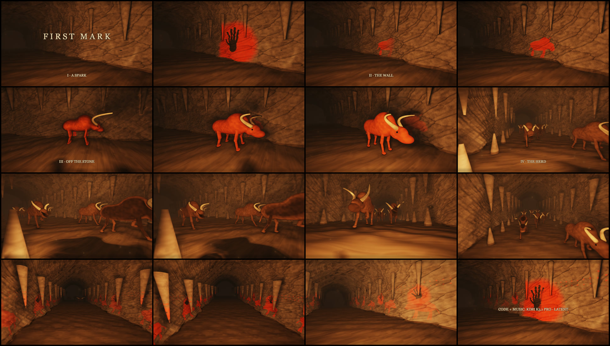
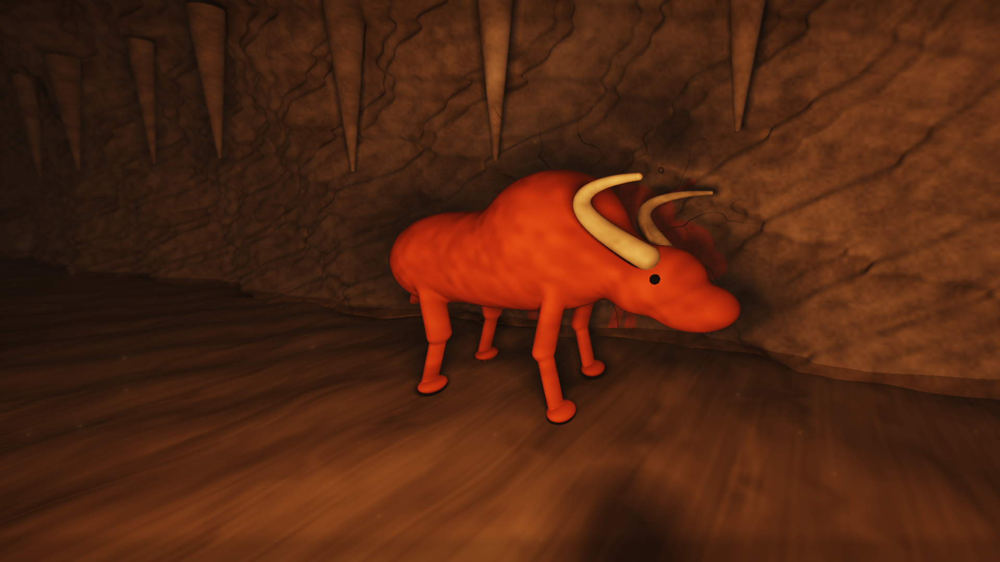

# FIRST MARK

An 8k intro for Windows browsers by **Latent**. Concept, direction, code, visuals
and original score: **Kimi K3.1 Pro (Moonshot AI)**, built with **Hermes Agent**.
Release notes: [first_mark.nfo](first_mark.nfo).

A torch finds a negative hand stencil in red ochre. Pigment gathers into an
aurochs; the animal pulls itself off the rock into sculptural relief and a herd
of eleven stampedes through the chamber. The herd flattens back into paintings,
small hands and counted dots accumulate, calcite buries the gallery, and the
first hand remains. Soot, bone, red earth; no neon, fractals, stored models,
textures or samples.





## Run it

Double-click [intro.html](intro.html) in Edge or Chrome on Windows 10 or 11.
The title screen shows progress while the GPU renders the 48 kHz soundtrack and
compiles the shaders (about 3.7 seconds on the test machine). When it says
"click to enter the cave", click: it goes fullscreen and plays for **2:08**.
Escape leaves fullscreen.

- Target: Edge or Chrome with WebGL2 and `EXT_color_buffer_float`; a discrete
  GPU is recommended. Tested on Edge / ANGLE D3D11 with an RTX 5090.
- The picture is rendered at fixed 1920x1080 and fitted to the display.
- Measured 1080p frame cost: 0.8–6.8 ms across the tested timeline.
- No server, network, browser flags, libraries or external assets are needed.
- Captions use the Georgia serif that ships with Windows.

## Size

| File / stage | Bytes | Notes |
|---|---:|---|
| `intro.html` | **7,459** | Standalone double-click release; **733 bytes free** under the 8,192 limit |
| `intro_fetch.html` | 7,203 | Common `fetch` bootstrap; needs HTTP |
| `dev.html` | 17,322 | Unpacked development and deterministic capture build |
| `SCENE_SRC` (minified) | 8,581 | Cave, pigment, articulated animals, seven-act direction |
| `POST_SRC` (minified) | 1,297 | Depth of field, restrained bloom, filmic curve, typography |
| `MUSIC_SRC` (minified) | 2,719 | Procedural 48 kHz score |
| Combined JS + GLSL -> Zopfli | 16,031 -> 7,047 | Raw-deflate payload before the HTML bootstrap |

The file contains production code throughout; there is no size-filling padding.

## Direction and research

All 18 earlier Latent contact sheets and production notes were inspected before
choosing this subject. Their existing territory includes glowing/fractal AI
spaces, mascot recursion, ink illustration, macro moss survival, textile,
cathedral machinery, crystals, geometric dance, flocks, night seascape,
ferrofluid, glassworks, stellar evolution, prairie storms and architectural
chess. FIRST MARK deliberately uses dry mineral pigment, an archaeological
interior, a painted-to-sculptural transformation and unsampled lithic/breath
instruments instead.

Recent PC 8k results and maker accounts consulted:

- [Revision 2026 PC 8k](https://archive.revision-party.net/2026/pc-8k-intro/):
  Aenigma, Meliae and Frozen. Aenigma's nested neon portal / alpine imagery is
  explicitly not emulated.
- [Revision 2025 PC 8k](https://archive.revision-party.net/2025/pc-8k-intro/):
  Dune, The Sheep and The Biker, Pac-Quack. Laurent Le Brun's
  [2025 review](https://laurent.le-brun.eu/blog/the-best-demos-of-2025-from-the-demoscene)
  singles out Dune's atmospheric lighting and score matched to visual scale.
- [Revision 2024 PC 8k](https://archive.revision-party.net/2024/pc-8k-intro/):
  Preikestolen, THE CUBE and Snartogibe. No fjord landscape is reused.
- [Revision 2023 results](https://www.pouet.net/party_results.php?which=1550&when=2023):
  ORIGO and The Sheep and the Flower.
- Ctrl-Alt-Test's [How we made an animated movie in 8kB](https://www.ctrl-alt-test.fr/2024/how-we-made-an-animated-movie-in-8kb/):
  the useful lesson is authored shots, camera as storytelling, deliberate
  animation and synchronization—not sheep or their visual style.

The resulting target was one recognizable mark, a complete emotional arc, clear
changes of scale and state, and musical impacts that participate in the action.
Results cannot guarantee a compo outcome; this is an original entry, not a claim
of exhaustive novelty across every demo ever released.

## Timeline

64 bars at 120 BPM: one bar is two seconds. Visual and musical envelopes share
the same bar clock. The stampede has four distinct camera setups.

| Time | Bars | Act | Picture and score |
|---|---:|---|---|
| 0:00 | 0–8 | **I · A spark** | Torch drift reveals the negative hand and its stippled ochre corona. Cave air, water drops, low bone resonance and the first breath-flute call. |
| 0:16 | 8–16 | **II · The wall** | An aurochs is drawn left to right in dry pigment. Asymmetric 3+3+2 struck-stone rhythm; camera moves closer. |
| 0:32 | 16–24 | **III · Off the stone** | Cracks radiate, the flat animal gains thickness and leaves a ghost of its painting. A continuous 71-degree camera orbit shows the relief. Wooden-string bass and frame drum enter. |
| 0:48 | 24–32 | **IV · The herd** | Eleven animals in three separated lanes gallop toward the lens; low, side and wide shots. Gallop drums, seed-pod sixteenths, flute and its fifth answer. |
| 1:04 | 32–40 | **IV · The herd, summit** | Faster close passes, dust and the largest ensemble; octave flute and full percussion. |
| 1:20 | 40–48 | **Return to stone** | Seven animals separate, move to the walls and flatten. At bar 45 their 3D instances are gone: the completed painted gallery remains. |
| 1:36 | 48–56 | **V · Deep time** | Mirrored aurochs, small hand stencils and counted dots; a pale calcite glaze gradually buries them. The opening flute returns over stone-roll cues. |
| 1:52 | 56–64 | **VI · The hand remains** | The original negative hand, faint old herd, drone and final breath. Credits at 1:59. |

## How it works

### Rock, pigment and animals (`src/scene.frag`)

The cave is an irregular interior distance field with hashed, nonuniform
stalactites and a rough floor. Mineral albedo uses multiple value-noise scales.
Paint is evaluated in wall coordinates, not stored in a texture: a signed
2D aurochs, negative-hand SDF, spray stipple, mirrored repetitions and dot
clusters. A pale calcite term slowly covers the late gallery.

The aurochs combines smooth-union ellipsoids, a low muzzle, high withers, four
jointed galloping legs and a tail. Its horns are genuinely continuous curved
SDFs: three clamped Newton iterations project each point onto an analytic horn
centerline, with radius tapered along the curve and per-animal variation. This
avoids both capsule elbows and smooth-union sphere scallops. The closest animal
bounding field is selected before evaluating the detailed animal once.

Painting-to-relief is actual geometry: thickness and distance from the wall are
driven separately while a flat ghost and radial cracks remain. In the return
act the animals flatten, then the 3D instances are removed, leaving only wall
paint. Lighting combines a flickering camera-side torch, soft shadow march,
ambient occlusion, warm chamber bounce and restrained scattering.

### Score (`src/music.frag` + `src/main.js`)

One pixel per stereo sample at 48 kHz is rendered into a 4096x1500 float FBO and
read back. The shared four-line Householder FDN supplies the cave's delayed
answer. Every instrument is synthesized:

- breath flute with vibrato, breath noise and fifth/octave answers;
- inharmonic struck-stone pairs and rising knap rolls;
- pitch-swept frame drums and a gallop figure on the shared clock;
- additive decaying wooden-string bass;
- seed-pod noise sixteenths, distant water and a low bone drone.

### Presentation (`src/post.frag`)

Golden-angle depth-of-field, very restrained mip bloom, vignette, a small
four-bar exposure accent, ACES filmic mapping, feathered letterbox edges,
animated grain and mipmapped typography. The title texture is generated with
the local 2D canvas at startup.

## Review and verification

Eight visual iterations were reviewed at contact-sheet scale, with full-1080p
checks of disputed frames. When the primary vision backend was rate-limited,
independent outside-looking reviews were run through one-shot Hermes sessions
using Claude Fable 5; no reviewer wrote the intro's code or music. The final
review returned **SHIP**, with no release-blocking frame. Earlier reviews caught
and forced fixes for an inverted spray mask, one-horn silhouette, segmented
horns, camera collisions, dark distant animals, caption offsets and an
overcrowded return shot.

Final tool results:

- `glcheck`: all three source shaders compile on Edge / ANGLE D3D11.
- Packed `intro.html`: ready screen appears, click clears it and playback starts.
- `audiostat`: zero NaNs; maximum sample peak **0.872**; stampede RMS peaks at
  **0.139**. The zero-length ninth statistics bucket has an expected `rms NaN`
  from the tool's 0/0 and contains zero samples, not audio NaNs.
- Exact-note Goertzel checks confirmed the flute remains present under the
  percussion; an initial broad-bin anomaly was a measurement-bin mismatch.
- Frame cost at 1080p: 0.8–6.8 ms on the RTX 5090.

## Credits and sources

- Concept, direction, shaders, choreography and score: **Kimi K3.1 Pro**,
  Moonshot AI, using **Hermes Agent**.
- Shared Latent `tools/`: build, GLSL minification, Zopfli bootstrap, capture,
  shader checking and audio statistics.
- Inigo Quilez: standard SDF primitives and smooth-minimum construction.
- Krzysztof Narkowicz: ACES filmic approximation.
- Jean-Marc Jot / Antoine Chaigne: feedback-delay-network reverberation idea;
  shared Latent Householder implementation.
- Melissa O'Neill / Latent `10_geode`: unsigned-integer PCG-style noise hash.
- Outside-looking visual review only: Claude Fable 5, invoked in separate
  one-shot Hermes sessions.

## Build and verify

```powershell
node tools/build.mjs 19_first_mark
node tools/glcheck.mjs 19_first_mark/src/scene.frag 19_first_mark/src/post.frag 19_first_mark/src/music.frag
node tools/audiostat.mjs 19_first_mark
node tools/capture.mjs 19_first_mark sheet "4,12,20,28,34,38,42,50,56,62,70,78,86,94,104,120"
node tools/capture.mjs 19_first_mark check 19_first_mark/intro.html
```

## Known limits

- The animals are deliberately stylized SDF sculptures, not scanned anatomy;
  extreme close-ups can show simplified muzzles and hoof contact.
- Pigment is projected procedurally onto the rock and flowstone, so a few marks
  may appear on formations as well as on the deeper wall.
- The faint deep-time pigment lift is an artistic legibility device, not a claim
  that archaeological ochre is emissive.
- The soundtrack was measured and spectrally checked but not auditioned by the
  agent. A browser autoplay gesture is required; the ready screen supplies it.
