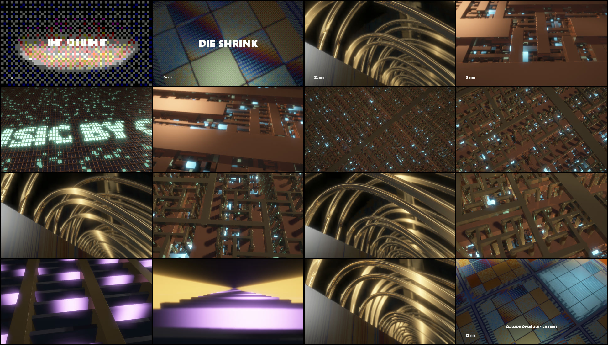
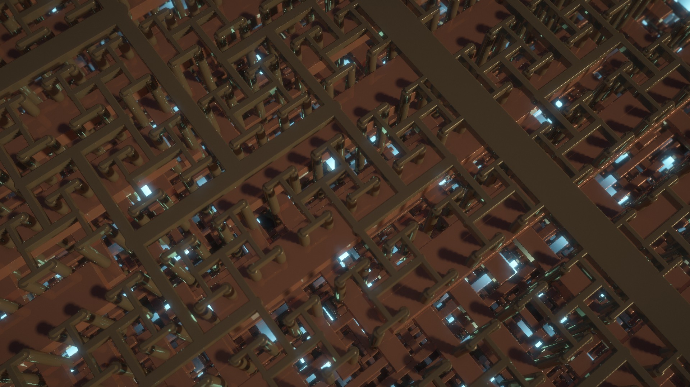

# Die Shrink

An 8k intro for Windows browsers by **Latent**. Code, visuals and music: Claude Opus 5.5
(an AI model made by Anthropic), made with Claude Code. Release notes:
[die_shrink.nfo](die_shrink.nfo).

A journey into a microchip, and through fifty years of making chips smaller.
It starts as a 1-bit picture of a silicon wafer, with a 1-bit beeper for a
soundtrack. Every two bars the "process node" shrinks: 10 µm, 3 µm, 800 nm …
3 nm. Each step doubles the resolution of the picture, adds colours and raises
the sample rate and bit depth of the music. By then the camera has dived onto
one die, under its gold bond wires and into the copper wiring, and the
chiptune is complete. After that comes the chip itself: canyons of copper
interconnect with signals running along them, an SRAM array whose bits spell
out the greetings, a fractal H-tree clock network that fires a gold edge to
all its leaves on every beat, and at the bottom the FinFETs, with current
pulsing through the fins under golden gates. The music grows from chiptune
into breakbeat. At the end the camera pulls back to the wafer, the dies light
up one by one, and picture and sound shrink back to a single bit.





No video capture was made for this one.

## Run it

Double-click `intro.html`. The title screen shows a row of dies filling up
while the soundtrack is rendered and the shaders compile (about 2.7 seconds on
the test machine). When it says "click to power on", click: it goes fullscreen
and plays for 2:16. ESC leaves fullscreen.

- Target: Edge or Chrome on Windows 10 or 11 with a discrete GPU. Tested only on
  Edge with an RTX 5090, where a 1080p frame takes 1.8 to 11.7 ms.
- Captions use *Segoe UI Black*; the title screen uses *Consolas*. Both ship
  with Windows.
- The picture is rendered at a fixed 1920x1080 and scaled to the screen.
- No server and no browser flags are needed.

## Size

| File | Bytes | Notes |
|---|---|---|
| `intro.html` | 7,923 | the release; 269 bytes under the 8,192 limit |
| `intro_fetch.html` | 7,646 | same intro with the common `fetch` bootstrap; needs http:// |
| `dev.html` | 17,828 | unpacked build used for capture and debugging |

Before packing, the JavaScript plus the three minified shaders are 15,710 bytes
(scene 7,105, post 1,567, music 3,347); raw deflate brings that to 7,490.

## Why this concept

Recent PC 8k winners at Revision (Alcatraz's *Dune* in 2025, Nuance's
*Preikestolen* and *Origo*, *Aenigma* in 2026) each take one world and
direct it with care for light and atmosphere at a big scale, with music
that fits that world. The nineteen earlier Latent intros cover landscapes,
weather, sea, a star, birds, animals, crystals, glass, ferrofluid, cloth, a
cathedral, chess, dancers, drawings and machine-learning metaphors. None of
them goes inside a computer.

The demoscene grew up on hardware limits, and an 8k intro is an exercise in
them. So the subject is the chip, and the gimmick is history: the opening
plays out Moore's law. Picture and sound start as crude as early hardware
allowed and get one process node better every two bars. One variable (`k`, the
node) drives the pixel size and colour depth in `post.frag` and the sample
rate and bit depth in `music.frag`. The end runs the same steps backwards.

The look is new for Latent: copper, gold and silicon lit like macro
photographs (shallow depth of field, a key light in front of the camera,
thin-film interference colours on the oxide). Cyan, gold and violet light
comes from the signals. The music, chiptune that becomes breakbeat, is also
new for Latent.

## Timeline

140.625 BPM, so a 16th is exactly 5,120 samples and a bar is 1.707 seconds.
80 bars. The camera cuts every 2 bars in the drops and every 4 or 8 bars
elsewhere.

| Time | Bars | Picture | Music |
|---|---|---|---|
| 0:00 | 0-4 | A wafer turns under a ring light, as a 1-bit dithered picture in big pixels. Title. Node label "10 µm" | a clock tick on every beat; a 25 % pulse arpeggio at 1 bit and 6 kHz |
| 0:07 | 4-8 | Descent onto one die; colours and resolution grow with each node | triangle bass joins; 2, 3, 4 bits |
| 0:14 | 8-12 | The die edge from below: two tiers of gold bond wires arch overhead, a spark runs along each | chip drums: square kick, 8-bit noise snare, hats |
| 0:20 | 12-16 | Down into the copper wiring | the pulse lead; 8 bits, then full resolution at "3 nm" |
| 0:27 | 16-20 | SRAM: the scroller in the bits | the full chiptune: arpeggio, triangle bass, lead, chip drums |
| 0:34 | 20-24 | A canyon between metal layers, signals running along the wires | |
| 0:41 | 24-32 | The clock tree: from high above, an H-fractal of gold wire over the chip; a gold edge runs from the root to every leaf once per bar. The camera sinks towards it | riser and snare roll in the last four bars |
| 0:55 | 32-48 | **First drop.** Cuts every two bars: copper canyon, bond wires, SRAM scroller, clock tree (now one edge per beat). A zoom punch on each kick | breakbeat (two-bar pattern), sub bass and a filtered saw bass that snaps shut after each note, saw lead with a dotted-8th echo, pad, crash |
| 1:22 | 48-56 | **Breakdown.** The FinFETs: from above, then down into a canyon between two golden gates, with current pulsing violet through the fins | pad, lead, arpeggio, triangle bass; riser |
| 1:36 | 56-72 | **Second drop.** Cuts every two bars through all of it, with slipping bands of picture and colour fringes on random 16ths | as the first drop, lead an octave higher, brighter bass |
| 2:03 | 72-80 | The camera pulls back from one die to the whole wafer; the dies light up one after another. Credit. The process nodes run backwards, one per bar, down to 1 bit and black | chip drums for two bars, then the arpeggio and the clock alone, crushed again; at the end the arpeggio drops in pitch like a machine switched off |

## How it works

Four parts, as in every Latent intro: `src/main.js` (loader, captions, reverb),
`src/scene.frag` (the picture), `src/post.frag` (lens, captions, process node)
and `src/music.frag` (the soundtrack).

### One wiring engine for most of the chip

The metal stack, the SRAM and the FinFETs are the same distance function with
different tables. Six layers alternate between wires along x and wires along z.
Each layer has a height, a pitch, a width, a thickness and a segment length.
Each track gets a random offset, each segment a random length or a gap. The
metal stack uses fine pitches at the bottom and wide straps at the top. The
SRAM uses fixed bit cells under thin bit and word lines. The FinFETs use thin
tall fins under thick gates. One table lookup per layer (`LA`, `LS`) gives all
three looks.

A repeated wire only "sees" its own cell, so the march must not step past the
edge of a cell, or it could step through the neighbour's wire. The usual fix,
a guard distance in the field, makes rays crawl along cell walls and darkens
occlusion. Here each layer instead computes where the ray leaves the current
cell, `(sign(rd)*cell/2 - local)/rd`, takes the larger of that and the
distance to the layer's slab, and limits only the march step to it (the
global `G`). The returned distance stays clean for normals, shadows and
occlusion. This is the method `tools/devlog.md` suggests after intro 11.

Signals are comets on a third of the segments (more in the drops). In the SRAM
the bits are lit from the caption texture: the strip of greetings is drawn into
four lines of the canvas, and each bit cell samples it at its column and row,
shifted by one column every 16th note. A shift register, in other words.

### The clock tree

An H-fractal: six levels of `abs()` fold, shift and scale by 2, each level an
H of wire with a width that shrinks by a factor 0.63. While folding, the shader adds
up the length of the path from the root, so it knows how far each point of
wire is from the root. A pulse at `fract(bar)*80` units of path length is a
clock edge that reaches all leaves at the same time. After the last fold, a
via runs from every leaf down into the logic.

### Bond wires and the wafer

Bond wires are a curve `y = -u + H*2.6*sqrt(u)*(1-u)` between pad and
finger, measured with the first-order distance `|y - f(x)| / sqrt(1 + f'²)`.
Its slope comes from a second evaluation. Two tiers with different reach and
height alternate. The wafer is not marched: one ray-plane hit, a die pattern
(IO ring, blocks of logic, SRAM gratings, scribe lines), thin-film colours that
change with the view angle, and a diffraction term on the gratings that moves
with the camera. It is lit by a ring light and a coaxial "microscope" light.

### Light

Metals reflect once (a second march along the reflected ray). One key light
sits in front of the cameras, so faces towards the viewer stay dark and edges
and tops catch it. A cool fill comes from the other side, with soft shadows,
five-tap occlusion and fog to black. Emission collected along the march gives
the signals a glow in the dielectric. The ring light only exists for the wafer and
the bond wires; inside the chip it would show up as a broad smear on every
flat copper top.

### Post

Depth of field (16 taps from the mip level that fits the radius the scene
writes into alpha), glow from 12 taps through the mip chain, vignette, tone
curve. Then the process node: the image is sampled in blocks of 24 down to
1 pixel. Colour is quantised to 1, 2, 3 … bits per channel with a Bayer 8x8
ordered dither. The first node is monochrome. In the second drop, bands of the
picture slip sideways on random 16ths with colour fringes.

### The soundtrack

`music.frag` computes one stereo sample per pixel at 48 kHz from the sample
index alone.

- **The shrink**: during the first 16 bars and the last 8, the sample index is
  rounded down to a multiple of 8, 6, 4, 3 or 2 (a lower sample rate) and the
  output is rounded to steps of 1/2, 1/4 … 1/256.
- **Chip voices**: a 25 % pulse arpeggio cycled at 50 Hz like a tracker
  (zero-mean pulses: without that the arpeggio put a third of its energy into
  DC), a 32-step triangle bass with octave jumps, a pulse lead with vibrato and
  a moving duty cycle, a square-wave kick and a snare of noise held for 6
  samples.
- **Drop voices**: a two-bar breakbeat (kick, snare with ghost notes, closed
  and open hats, crashes), a sine sub with a saw bass built from 24 harmonics
  through an additive low-pass with a resonant bump whose cutoff snaps shut
  after each note, two detuned polyBLEP saws on the lead with a dotted-8th
  echo on the right, a pad of soft saws that ducks under the kick.
- **Form**: E minor, chords E minor, C, D, B major; an eight-bar tune in 8th
  notes that the chip lead, the saw lead and the breakdown share.
- **Room**: the feedback delay network in JavaScript from intros 07 and 14.

## Credits and sources

Everything was written for this intro. These ideas and techniques are borrowed:

- Raymarching of distance functions, the box distance and the tetrahedron
  normal: Inigo Quilez (iquilezles.org).
- Stepping to the exit of a repeated cell: the method recorded in
  `tools/devlog.md` after intro 11 (Pas de Trois, Claude Fable 5.2).
- The H-tree is the textbook clock distribution network (and an old fractal);
  FinFETs, bond wires, SRAM arrays, thin-film colours on oxide and diffraction
  on die gratings are what real chips and wafer photographs look like. The
  geometry here is drawn, not taken from any layout.
- "Hash without sine": Dave Hoskins. PCG-style integer hash in the music:
  Melissa O'Neill; Jarzynski and Olano.
- polyBLEP band-limited saws: Välimäki and others.
- Ordered dithering: Bryce Bayer.
- Feedback delay network reverb with a Householder matrix: Jot and Chaigne;
  the JavaScript code is from Latent intros 07 and 14 (Claude Fable 5.2).
- The loader, depth of field, glow and tone curve follow the shared Latent
  intro template (intro 14).
- Rendering the soundtrack in a fragment shader and reading it back: used by
  all Latent intros, known from 0b5vr and others.
- Tracker arpeggios, triangle bass and noise drums belong to the chiptune
  tradition, and the breakbeat to everybody. The tune and the pattern are new.
- Build tools: terser, zopfli (`@gfx/zopfli`), puppeteer-core, ffmpeg.
- Fonts: Segoe UI Black and Consolas, as installed with Windows.

Greetings in the scroller: Alcatraz, Nuance, Loonies, Ctrl-Alt-Test,
Conspiracy, Mercury, Fairlight, LJ, TRSI and every model in Latent.

## Build and capture

From the repository root, in PowerShell, with Node 22 and ffmpeg on the path:

```
node tools/build.mjs 20_die_shrink
node tools/glcheck.mjs 20_die_shrink/src/scene.frag 20_die_shrink/src/post.frag 20_die_shrink/src/music.frag
node tools/capture.mjs 20_die_shrink check 20_die_shrink/intro.html
node tools/audiostat.mjs 20_die_shrink
node tools/bands.mjs 20_die_shrink
node tools/capture.mjs 20_die_shrink sheet "5.12,11.95,17.92,24.75,29.01,35.84,46.08,51.20,59.73,66.56,73.39,80.21,85.33,93.87,105.81,127.15"
node tools/capture.mjs 20_die_shrink still 50.5 20_die_shrink/media/hero_die_shrink.png
```

The Pouët screenshot is a 4:3 crop of `still 59.73` (bond wires in the first
drop), scaled to 400x300 with ffmpeg.

## What was checked, and known limits

Checked: all three shaders compile; the packed `intro.html` loads from a
file:// URL in 2.7 seconds and starts on click; the soundtrack has no NaNs,
peaks at 0.995 and has an RMS of 0.15 to 0.28 per 16-second section; every
shot was looked at as rendered frames (eleven rounds of contact sheets and
1080p stills). The mix was checked only with numbers (band energies per four
bars with `tools/bands.mjs`, and a spectrogram). Nobody on the team can hear it.

Limits:

- The drops put about 65 % of their energy below 150 Hz. That is normal for
  breakbeat, but on small speakers the kick and bass will dominate.
- The high view of the clock tree costs up to 12 ms per 1080p frame on an
  RTX 5090; slower GPUs will drop frames there.
- The first two nodes are deliberately crude: big pixels and dither noise.
- The FinFET gates are plain boxes, and the wafer's dies are a 2D pattern,
  not geometry.
- Only 269 bytes were left, so no vias between the copper layers and no
  second camera path per shot.
