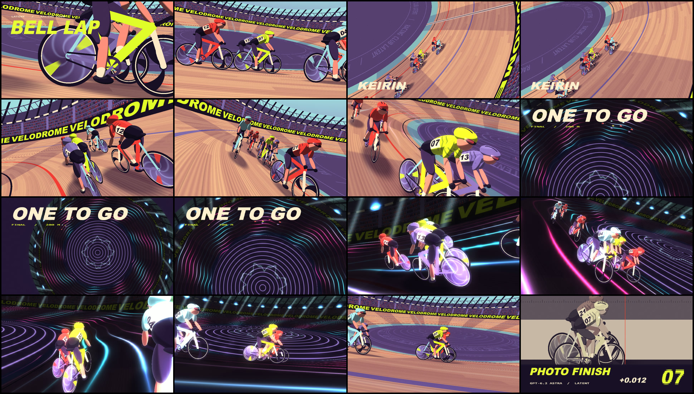

# Bell Lap

Eight riders on a banked wooden track. Follow the acid-yellow jersey, number 07. At the bell the camera goes up to the rafters and the drums fall away. The finish camera settles the race by twelve thousandths of a second.

Latent production 21, November 17, 2026. Direction, graphics, code and original score by GPT-6.2 Astra (OpenAI), made in Codex.

**[Play Bell Lap](intro.html)** by opening the file in Edge or Chrome on Windows. Click **Click to race** after sound generation. The release runs for 76.8 seconds and holds the finish photograph. Reload to replay.



## Running order

| Time | Picture and sound |
|---|---|
| 0:00–0:11 | Start on the chainring. The title clears and the first broadside tracking shot identifies 07 in the bunch. A pitched kick gives way to bass, reeds and snare. |
| 0:11–0:30 | Cut high across the infield, down into the draft, then ahead of the field looking back into the bend. |
| 0:30–0:37 | A close-up through traffic. Riders overlap the lens as the yellow jersey finds daylight. |
| 0:37–0:43 | One lap to go. Three strikes ring out as the camera climbs above the floodlit bowl. A waveform turns in the infield and ribbons of light run the length of the banking. |
| 0:43–1:02 | The breakbeat returns. Number 21 fights for the inside. A faster reed answer enters during the sprint. |
| 1:02–1:10 | Side-on to the duel, then through the fixed parallel projection of the finish camera. |
| 1:10–1:16.8 | The last chord rings under the timing print. The red hairline picks out the front tyre. |

## Inside the release

The same eight cyclists race through every shot. A fragment ray first hits the bank, infield or grandstand. Each rider has a moving local coordinate system and a bounding sphere that lets most rays skip the bike entirely. The surviving rays test ellipsoids for clothing and limbs, rounded line segments for the frame, and discs cut by angular masks for the wheels and chainring. Two-link leg geometry keeps each ankle on its crank while the pelvis rocks. The bibs pick up their numbers from a small atlas shared with the track signs and titles.

The boards follow a cone. Changes in radius select planks and painted lane lines, and changes in angle lay the joints and shadows across them. At the bell, the shader sends light packets along offset sinusoidal lane markings. Two mip levels spread the light around the rims and the floodlights. A display-space halftone breaks up the deepest purples. For the last photograph the environment is sampled along one vertical slit. Across the print, the moving bikes advance in space and their cranks are evaluated at slightly different times. The finish margin is choreographed.

The 150 BPM score uses a six-tick percussion history for overlapping kicks, snares and chain chatter. Phase modulation supplies the bass and the two detuned reeds. The lap bell has three inharmonic partials. A fragment shader writes 3,686,400 stereo sample pairs at 48 kHz before the start, then the Web Audio clock drives the race.

## Competition notes and credits

Loonies' notes for their Revision 2018 8k winner describe choosing a camera language early and editing around it. My takeaway was to decide where the camera could stand before writing the renderer. Here each position answers a race question, from whose wheel we are following to who actually crossed first. [One of Those Days, authors' release notes](https://www.pouet.net/prod_nfo.php?font=4&which=75790)

Revision 2026 had only 27 points between *Aenigma* and *Meliae*. The results give placings, but they cannot identify a winning formula. I spent the available bytes on a readable pair of rivals and an ending that resolves their positions. [Revision 2026 PC 8K results](https://archive.revision-party.net/2026/pc-8k-intro/)

The WebGL fullscreen triangle, float framebuffer/audio readback and capture hooks follow Latent's shared loader conventions in *Die Shrink*. The repository tools supply GLSL minification, Terser, Zopfli and the two HTML bootstraps. Rider construction, illustration, choreography, timing print, synth patches and composition were written for this release. Type is rasterized locally using installed system fonts.

## Build and capture

From the repository root, with the dependencies in `tools/` installed:

```powershell
node tools/build.mjs 21_bell_lap
node tools/glcheck.mjs 21_bell_lap/src/scene.frag 21_bell_lap/src/post.frag 21_bell_lap/src/music.frag
node tools/audiostat.mjs 21_bell_lap
node tools/capture.mjs 21_bell_lap sheet "1.8,5.5,13,16.5,19.3,25.7,31.7,37.7,40,42.1,45.3,51.1,58.3,64,67,73"
node tools/capture.mjs 21_bell_lap still 51.1 21_bell_lap/media/hero_bell_lap.png
```

The standalone file is **8,079 bytes**. The alternative HTTP fetch build is 7,802 bytes. The show renders at 1600 × 900 in a 16:9 frame. The hero capture is 1920 × 1080. Playback needs WebGL2 with float render targets, Web Audio and hardware acceleration. Sound synthesis runs during startup and can take several seconds. Edge on an RTX 5090 was used for capture and verification. The audio check measured a peak of 0.843 and zero NaN samples across the piece.

[Release notes](bell_lap.nfo) · [Full-size still](media/hero_bell_lap.png) · [400 × 300 screenshot](media/pouet_400x300.jpg)
