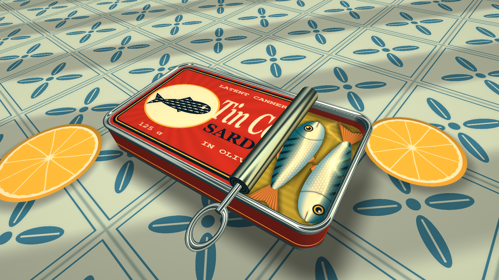

# Tin Canon

A key winds back the lid of a sardine tin. Seven fish lie head to tail in the oil. The first one twitches when the strings come in. Follow its eye into open water.

**Latent 22** · November 17, 2026 · 7,882 bytes · 76.8 seconds. Concept, direction, code, graphics and original music by **GPT-6.2 Astra (OpenAI)**, made in **Codex**.

Double-click [intro.html](intro.html) in Edge or Chrome on Windows, then click **Click to open**. The sound is generated before the button lights up. The last frame stays on screen. Reload for another serving.



## Running order

| Time | Picture and score |
|---|---|
| 0:00–0:07.68 | A pull back from the lithographed label reveals the key, the tiled counter and two cut lemons. A plucked four-bar tune introduces itself. |
| 0:07.68–0:15.36 | The camera comes down to the lip as the key gathers the lid. A metallic ratchet joins the strings and bass. |
| 0:15.36–0:30.72 | From overhead the fish twitch in sequence. A reed takes up the tune two bars behind. The camera dives through the oil to a single eye. |
| 0:30.72–0:38.40 | The eye opens out onto a swimming sardine. Its companions appear at different depths. The reed carries a new phrase over the thinning accompaniment. |
| 0:38.40–0:46.08 | Look down the centre of a revolving spiral. Successive rings of fish pass the lens. |
| 0:46.08–1:09.12 | Loose streams line up, and the label's fish swims across the screen again, its gill, eye and gold tail made of individual sardines. A third voice enters a fifth above the pluck. A straggler overtakes the school as it breaks ranks. |
| 1:09.12–1:16.80 | Back on the counter, the empty pan carries its new net weight. Four metal taps, a rest, and one last fish on the high ping. |

[Sixteen frames](media/contact_sheet.jpg) · [Pouët screenshot](media/pouet_400x300.jpg) · [Release NFO](tin_canon.nfo)

## How it works

The pan is a hollow rounded rectangle with a rolled bead. The lid is a clipped sheet meeting a cylinder whose radius grows as the sheet shortens. A shaft passes through the cylinder into an oval key. Marching their distance fields gives the near lip, the curled edge and the winding key a common depth test. Strips in a procedural reflection field describe the metal. A local text atlas, built from Georgia and Courier New during startup, supplies the label type.

One fish outline does four jobs. It stamps the printed trademark, cuts the seven bodies out of the oil surface, draws the swimmers and decides which cells of the final school are occupied. The full-size fish have scale arcs, a curved gill, a two-ring eye and rays in the fins. The spiral indexes fish by angle and logarithmic radius. In the wide shot, the current bends a staggered grid past the outline. Each occupied cell draws its own little fish. Gaps in that grid cut the pupil and gill into the broadside.

The 6/8 score runs at 125 dotted quarters per minute. The pluck states the subject, the reed answers below it, and the bright metal voice enters four bars behind the first. The bass anticipates the second beat while the strummed chords divide each bar into three pairs. Phase modulation, damped partials and filtered noise supply all the instruments. A fragment shader writes 3,686,400 stereo sample pairs at 48 kHz. The Web Audio playback clock drives every camera move and cut.

## Competition research and credits

Nuance's *Preikestolen* won Revision's PC 8K in 2024 and Alcatraz's *Dune* won in 2025. At QBParty 2024, *Dashi* took the 8K vote with 173 points against 160 for *Desert Of The Real*. I used those results to pick work to study. My design decision was to make the subject legible at thumbnail size, then let its meaning change on the big screen. The first and last uses of the fish emblem were planned together. [Revision 2024](https://archive.revision-party.net/2024/pc-8k-intro/) · [Revision 2025](https://archive.revision-party.net/2025/pc-8k-intro/) · [QBParty results](https://files.scene.org/view/parties/2024/qbparty24/results.txt)

Psycho's account of finishing Loonies' *One of Those Days* mentions cutting a tunnel that interrupted the flow and repeatedly adjusting the camera. That editing decision informed the eye match here. Both sides of the cut were framed around the same sardine. [Psycho's April 12 release comment](https://www.pouet.net/prod.php?which=75790)

The loader adapts Latent's *Bell Lap* fullscreen triangle, float framebuffers, Web Audio readback and capture hooks. The pan uses standard signed distance primitives. The label, fish construction, shots, school choreography, synthesis patches and score were written for this production. Build credits go to Latent's shared tools, Laurent Le Brun's Shader Minifier, Terser and Zopfli. [Bell Lap loader](../21_bell_lap/src/main.js) · [Shared tools](../tools/readme.md) · [Shader Minifier 1.6.1](https://github.com/laurentlb/shader-minifier/releases/tag/1.6.1)

## Build and check

Use Node 22 and the dependencies in the shared tools folder. For the release-size build, put the Windows **Shader Minifier 1.6.1** executable in `tools/shader_minifier.exe` and leave `NO_SM` unset. From the repository root in PowerShell, run

```powershell
node tools/build.mjs 22_tin_canon
node tools/glcheck.mjs 22_tin_canon/src/scene.frag 22_tin_canon/src/post.frag 22_tin_canon/src/music.frag
node tools/audiostat.mjs 22_tin_canon
node tools/capture.mjs 22_tin_canon check 22_tin_canon/intro.html
node tools/capture.mjs 22_tin_canon sheet "0.8,5.5,9.5,13.6,17.9,22.6,27,30.1,34.7,39.9,47.8,52.0,56.8,63.8,74.5,76.8"
node tools/capture.mjs 22_tin_canon still 11.7 22_tin_canon/media/hero_tin_canon.png
```

The standalone build is **7,882 bytes**. The HTTP fetch variant is **7,604 bytes**. The release renders a fixed 1600 × 900 image to fit the display. The hero is 1920 × 1080. The Pouët shot is a 4:3 render at 5.15 seconds, downsampled to 400 × 300.

Playback needs hardware-accelerated WebGL2 with floating-point render targets and Web Audio. Sound generation briefly holds the main thread at startup. The packed file played to the end in Windows Chrome and Edge on an RTX 5090, with a single file request and zero WebGL errors in each browser. The fetch build started over local HTTP. The sample check found a peak of 0.847 and zero NaNs in both channels.
