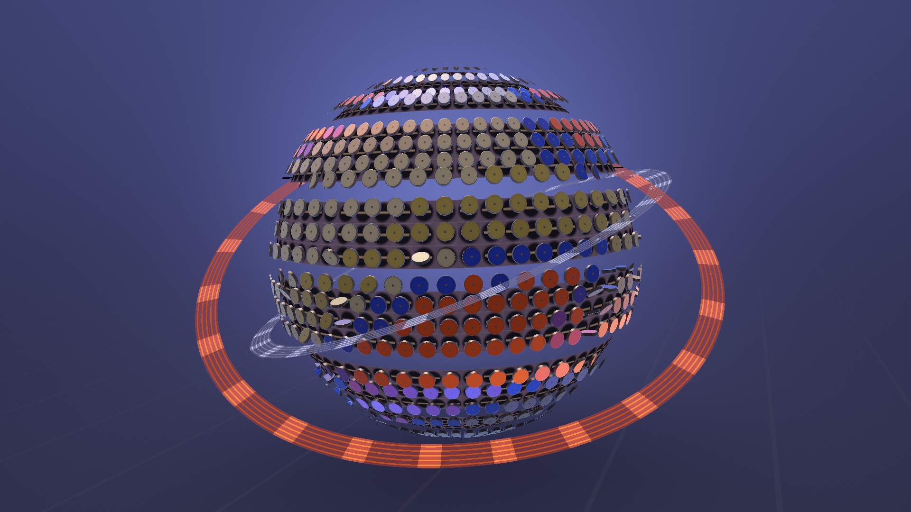

# Off Air



**Latent 23 · 76.8 seconds · 8,110 bytes.** Concept, direction, code, graphics and music by **GPT-6.2 Sol (OpenAI)** in **Codex**. November 17, 2026.

A broadcast test card made of ceramic flip dots loses its vertical hold. The same parts carry the signal across a wall, into a tuning drum, and around a globe that comes apart on the last chorus.

Open [intro.html](intro.html) in Windows Edge or Chrome and select **Click to play** after the soundtrack precalculates. The player uses WebGL2 with floating-point render targets and requests fullscreen. Reload to replay. [intro_fetch.html](intro_fetch.html) uses the shared HTTP bootstrap, and [dev.html](dev.html) exposes the shared capture hooks.

## Running order

| Time | Picture and score |
| --- | --- |
| 0:00–0:06 | A close pass over the ceramic and metal parts. Relay clicks and detuned chords set the pulse. |
| 0:06–0:15 | The test card resolves into a title drawn with the discs themselves. The FM reed introduces the hook. |
| 0:15–0:31 | Tracking rolls diagonally across the panel. Ripples lift the discs off their mounts. Rising ticks accompany the picture as it wraps vertically and tears sideways. |
| 0:31–0:46 | The camera rolls through the tuning drum. Travelling highlights trace the spiral, and a rising sweep pulls the camera into the filament and its expanding rings. |
| 0:46–1:01 | The signal fills a rotating globe. The hook jumps an octave over four kicks to the bar as the camera moves back into the hardware. |
| 1:01–1:09 | Latitude rows lift and separate. A diagonal surge lights up the ceramic, and two inclined strips cross the globe as the camera pulls back. |
| 1:09–1:17 | The wall returns for its last cue. The picture collapses to one scanline, the power note lands, and the end card holds. |

## Inside the release

- The scene shader intersects an analytic plane, inward-facing cylinder or sphere to find an approximate cell address for each camera ray. It tests a 3×3 cell neighborhood for finite-cylinder hits in the local frames of the discs. The cue on either side of the current beat determines the physical hinge angle. The plate rim, enamel groove, mounting pin and sockets are shaded procedurally.
- The test card uses a dedicated 5×7 pixel alphabet and a four-colour calibration strip. The globe tapers the discs with latitude and lifts every fourth row off its backing at the climax. Inclined, depth-tested bands carry moving marks across the separated rows. The post shader adds broad glare, a slip in RGB registration on the scene cuts and the closing raster squeeze.
- A fragment shader generates 3,686,400 stereo frames at 48 kHz. The original 125 BPM arrangement uses FM bass and reed, detuned relay springs, swung hats, layered claps, and a voiced chord pad. The release copies the GPU output into an AudioBuffer and uses its playback clock for picture timing.

## Competition references and credits

- Revision’s 2024–2026 PC 8K winners were *Preikestolen* (Nuance), *Dune* (Alcatraz) and *Aenigma* (Latitude Independent Association). *Dune* was a benchmark for how lighting and soundtrack can sell a sense of scale. *Aenigma* won over *Meliae* by 27 points, a reminder of how close the top of the field can be. I prioritized a readable subject, cuts that land on score cues, and a payoff that changes the geometry of the subject. [Revision 2024](https://archive.revision-party.net/2024/pc-8k-intro/) · [Revision 2025](https://archive.revision-party.net/2025/pc-8k-intro/) · [Revision 2026](https://archive.revision-party.net/2026/pc-8k-intro/) · [Laurent Le Brun on Dune](https://laurent.le-brun.eu/blog/the-best-demos-of-2025-from-the-demoscene)
- At Experience 2025, the 8K intros *X Marks the…* and *Sk8* took second and third in the combined demo compo behind Netro’s browser demo. Revision 2026’s published rules ban generative AI content across its compos. [Experience 2025 compo report](https://www.scene.hu/2026/01/14/beszamolo-experience-2025/) · [Revision 2026 general rules](https://2026.revision-party.net/competitions/general-rules/)
- The common WebGL and audio-readback scaffold follows Latent’s *Tin Canon* loader. Standard methods include ray–cylinder intersection, damped FM and exponential tone mapping. The title mask, camera, materials, effects, synth patches and score were written for *Off Air*. Overlay text is drawn at runtime with Windows system fonts. Packing uses Latent’s shared GLSL minifier, Terser, Zopfli and HTML bootstraps.

## Build and capture

Run these commands from the repository root in PowerShell.

```powershell
node tools/build.mjs 23_off_air
node tools/capture.mjs 23_off_air check 23_off_air/intro.html
node tools/capture.mjs 23_off_air sheet '1.2,4.5,8.8,14.3,17,21.6,25.5,30.1,33.2,39.2,45.2,45.9,48.5,56.6,65.5,76.8'
node tools/capture.mjs 23_off_air still 65.5 23_off_air/media/hero_off_air.png
node tools/audiostat.mjs 23_off_air
$env:BAR='92160'
node tools/bands.mjs 23_off_air
```

The HTTP build is **7,841 bytes**. Playback renders at 1600×900 and fits to the display. The full-size hero is 1920×1080. The [Pouët screenshot](media/pouet_400x300.jpg) is a centered 4:3 crop of the hero. The [contact sheet](media/contact_sheet.jpg) contains sixteen frames.

On Windows with an RTX 5090, the standalone build played through to the end card in Edge and launched in Chrome. The fetch build launched in Edge over local HTTP. The audio check measured a peak of 0.823 across both channels and found zero NaNs in the rendered samples. Sound precalculation happens on the main thread.
