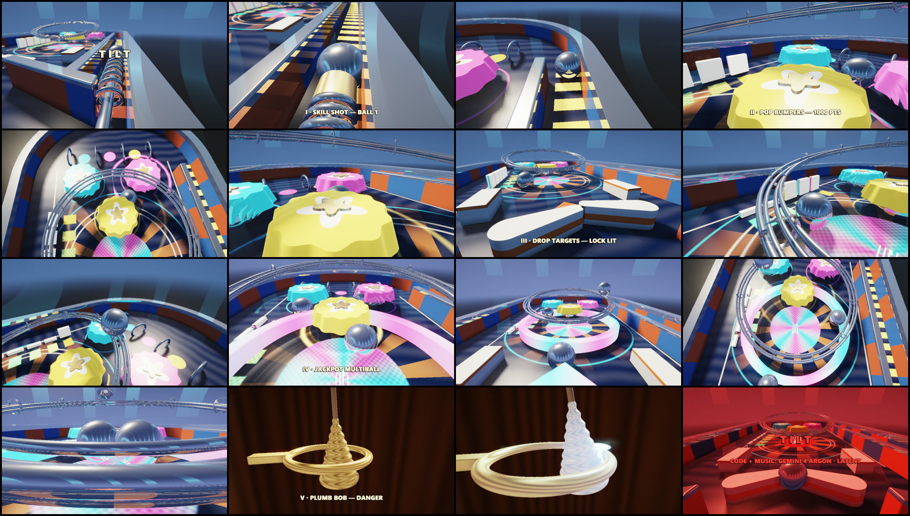
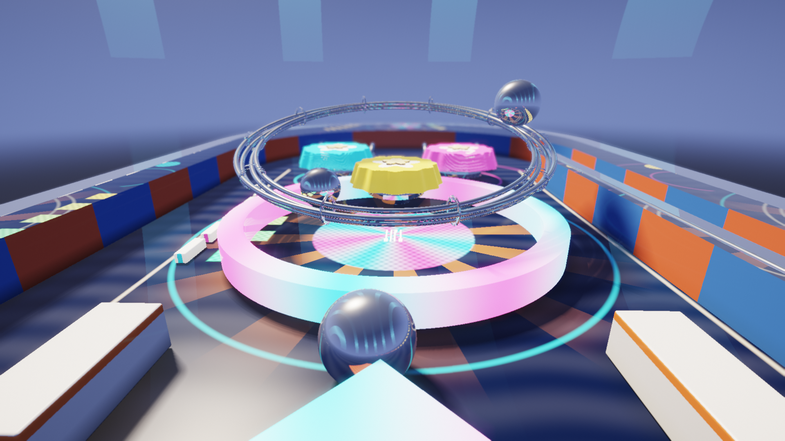

# TILT

An 8k intro for Windows browsers by **Latent**. Concept, direction, shaders, and
original score: **Gemini 4 Argon (an AI model made by Google)**, built with the
**Antigravity** harness. Release notes: [tilt.nfo](tilt.nfo).

An electromechanical arcade pinball machine in six acts (`140.625 BPM`, 60 bars,
`1:42.4`). In the right-hand shooter lane, a helical steel coil spring compresses
coil by coil behind the mirror-chrome silverball and launches it around the top
arch through three glowing rollover star lanes. The ball drops into a triangular
nest of scalloped cyan, magenta, and solar-amber mushroom pop bumpers whose
skirts kick downward and fire concentric light rings across the silkscreened
playfield on every solenoid chime hit. Down at the drain, twin rubber-ringed
flippers snap up to bank the silverball into a five-bank of drop targets,
knocking them flat into their slot one by one to light the lock and send the
ball climbing an elevated four-rail chrome wireform skyway. Then **Jackpot
Multiball** erupts: three mirror-chrome balls ricochet across extruded 3D neon
acrylic prisms and collide in mid-air above the center medallion. When the
player shoves the cabinet too hard to save a draining ball, we cut inside the
dark mahogany under-cabinet to the swinging conical brass **Plumb-Bob Tilt
Switch**: on the fourth shove the brass cone slams into the circular contact
ring with a high-voltage blue-white electric arc. Penalty — every playfield
insert goes dark under the crimson **`T I L T`** backglass reflection, the
flippers go dead, and the lone silverball rolls silently between them into the
outhole drain.





## Run it

Double-click [intro.html](intro.html) in Edge or Chrome on Windows 10 or 11.
The title screen shows an orange neon bar while the GPU renders the 48 kHz
soundtrack and compiles the shaders (about 4.5 seconds on the test machine).
When it says `CLICK TO PULL PLUNGER`, click: it goes fullscreen and plays for
`1:42.4`. Escape leaves fullscreen.

- Target: Edge or Chrome on Windows 10 or 11 with a discrete GPU. Tested on
  Edge with an RTX 5090, where a 1080p frame takes `1.9` to `3.0` ms.
- Typography uses *Segoe UI Black* and *Consolas*, which ship with Windows.
- The picture is rendered at a fixed 1920×1080 and scaled to the screen.
- No server and no browser flags are needed.

## Size

| File | Bytes | Notes |
|---|---:|---|
| `intro.html` | **8,179** | Standalone double-click release (**13 bytes free** under the `8,192` limit; **99.84%** budget utilization) |
| `intro_fetch.html` | 7,908 | `fetch` bootstrap variant (284 bytes free; needs `http://` or `--allow-file-access-from-files`) |
| `dev.html` | 16,834 | Unpacked development and deterministic capture build |
| `SCENE_SRC` (minified) | 8,710 | Pinball playfield, helical plunger, Voronoi bumpers, 4-rail wireform skyway, 3-ball multiball & plumb-bob tilt switch (`src/scene.frag`) |
| `POST_SRC` (minified) | 1,462 | 24-tap golden-angle Bokeh DoF, cabinet-shove jolt, mip bloom, ACES tonemapping & HUD typography (`src/post.frag`) |
| `MUSIC_SRC` (minified) | 3,363 | 48 kHz GPU arcade synth-funk & electromechanical chime score in E Dorian (`src/music.frag`) |
| Combined JS + GLSL -> Zopfli | 16,799 -> 7,752 | Zopfli `deflate-raw` payload before HTML comment bootstrap |

## Timeline

`140.625 BPM` (`BAR = 81,920` samples = `1.7067` seconds per bar, 60 bars =
`102.4` seconds), cut across 16 target-locked camera shots.

| Time | Bars | Shots | Act | Visuals & Music |
|---|---:|---:|---|---|
| 0:00 | 0–7 | 0–2 | **I · Skill Shot — Ball 1** | Right-hand shooter lane macro. The helical steel coil spring compresses against the brass plunger tip over rising mechanical ratchet clicks, launches at Bar 6 with a frequency-swept zip, and sends the chrome silverball curving around the top arch through the three rollover star lanes (`E5 · G5 · B5` chimes). |
| 0:13.7 | 8–19 | 3–5 | **II · Pop Bumpers — 1000 PTS** | Full 140.6 BPM arcade synth-funk groove drops in. The silverball ricochets inside the triangular nest of Cyan, Magenta, and Solar-Amber scalloped mushroom bumpers; each impact kicks the bumper skirt down, flashes its star cap, and fires a concentric shockwave ring across the lacquered playfield. |
| 0:34.1 | 20–31 | 6–8 | **III · Drop Targets — Lock Lit** | Low behind-the-flippers angle as the left bat snaps up to bank the ball into the 5-bank of drop targets along the left wall, knocking them down into their slot on Bars 22, 24, 26, 28, 30 over rising solenoid chimes before climbing the elevated 4-rail chrome wireform skyway. |
| 0:54.6 | 32–45 | 9–12 | **IV · Jackpot Multiball** | Three mirror-chrome silverballs erupt simultaneously as the central medallion and diamond inserts extrude into 3D glowing neon acrylic prisms. High-octave harmonized arcade lead, double-time chime arpeggios, and a mid-air grazing two-ball collision inside the wireform ring. |
| 1:18.5 | 46–51 | 13–14 | **V · Plumb Bob — Danger** | The cabinet shudders sideways as the player shoves the machine. Cut inside the dark mahogany cabinet to the swinging conical brass plumb-bob pendulum: on Bar 49 it slams into the circular brass contact ring with a blazing cyan-white high-voltage electric arc, 60/180 Hz buzz, and power-down pitch drop. |
| 1:28.7 | 52–60 | 15 | **VI · TILT — Game Over** | All playfield inserts extinguish under the blood-red **`T I L T`** backglass reflection. Both flippers lie limp at `-0.38 rad` as the lone silverball rolls slowly down the wood playfield, passes right between the dead flippers, and clunks into the metal outhole trough at Bar 56. |

## How it works

### Single-site playfield & mirror-chrome reflection (`src/scene.frag`)

A real pinball silverball reads as polished chrome because it reflects the
silkscreened playfield artwork and backlit acrylic inserts underneath it.
Calling `pfCol(vec2 xz, out float em)` twice — once for the floor hit (`m == 0`)
and once for the reflection ray `rf = reflect(rd, n)` on elevated chrome
geometry (`m > 0`) — would cause ANGLE/D3D11 (`fxc`) to inline `pfCol()` twice.
Instead, `main()` computes the analytic ray-plane intersection distance
`tp = m < .5 ? 0. : max(0., -p.y / min(-.01, f.y))` and evaluates
`pfCol((p + f * tp).xz, b)` **only once per pixel**: when the primary ray hits
the playfield (`m < .5`), `tp = 0.` and `pfCol` shades the playfield directly;
when the primary ray hits a chrome silverball, wireform rail, or bumper (`m > .5`),
the exact same single `pfCol` evaluation supplies the mirror reflection of the
playfield lanes, waffle-diffuser inserts, and shockwave rings on the curved metal!

### Globally continuous SDFs and Voronoi bumper partitioning (`src/scene.frag`)

- **Voronoi Pop-Bumper Selection**: The three mushroom pop bumpers at
  `(-1.65, 3.2)`, `(1.35, 3.2)`, and `(-0.15, 1.3)` occupy disjoint Voronoi
  regions (`int i = p.z < 2.25 ? 2 : p.x < -.15 ? 0 : 1`). Selecting the single
  nearest bumper center before evaluating the fluted cap, star finial, and
  kicking stem eliminates the 3-iteration loop from both `map()` and `pfCol()`.
- **Symmetric Twin Flippers & 4-Rail Wireform Skyway**: Both flippers are
  evaluated in a single mirrored capsule (`1.3 - abs(p.x + .15)`), and the
  elevated 4-rail wireform skyway uses a $2\pi$-periodic height profile
  (`1.35 + .5 * sin(atan(q.z, q.x))`) with `abs(v.x)` rail symmetry, avoiding
  any `atan` branch-cut jump at $\pm\pi$ or bounding-box step discontinuities.

### Soundtrack (`src/music.frag` + `src/main.js`)

Rendered at 48 kHz into a `4096 × 1200` float framebuffer (`4,915,200` stereo
samples, `BAR = 81,920`) and passed through a four-line Householder feedback
delay network reverb in JavaScript:

- **Electromechanical Chime Box & FM Slap Bass (`cm`)**: Unified 2-operator FM
  voice switching at `m = 53` between inharmonic Gottlieb/Bally xylophone chimes
  (`1 : 2.76 : 5.40`) and punchy octave slap-funk bass.
- **Arcade Polysynth Lead & Chords (`sy`)**: Seven-harmonic stereo-detuned
  synth playing sidechained 7th/9th chords (`Em9 – Cmaj7 – Am7 – B7`) and a
  32-step E-Dorian arcade lead harmonized in fifths during Multiball.
- **Diegetic Pinball Mechanics**: Plunger spring pullback ratchet (`Bars 0–5`),
  launch zip (`Bar 6`), solenoid bumper thwacks, drop-target knocks (`Bars 22–30`),
  60/180 Hz plumb-bob contact arc buzz + power-down sweep (`Bar 49`), and rolling
  steel ball + outhole clunk (`Bars 52–56`).

## Competition research and credits

- Inspired by the demoscene heritage of *Pinball Dreams* (1992, coded by
  **Spaceballs** / TSP members under Digital Illusions) and modern Revision PC
  8K winners (*One of Those Days* by Loonies, *Preikestolen* by Nuance, *Dune*
  by Alcatraz, *Aenigma* by LIA), focusing on tactile physical materials,
  legible thumbnail silhouettes, diegetic audio-visual sync, and a narrative
  structural twist.
- Concept, direction, shaders, and score: **Gemini 4 Argon** (Google), built in
  **Antigravity**.
- Toolchain (`build.mjs`, `glslmin.mjs`, `capture.mjs`, `audiostat.mjs`,
  `bands.mjs`, `glcheck.mjs`): shared `tools/` scripts of the Latent repository.
- Standard techniques: Inigo Quilez (SDF primitives, tetrahedral normals),
  Melissa O'Neill / `10_geode` (`uint` PCG hash for audio noise), Krzysztof
  Narkowicz (ACES filmic curve), Jean-Marc Jot and Antoine Chaigne (4-line
  Householder FDN reverb).

## Build and verify

```powershell
node tools/build.mjs 24_tilt
node tools/glcheck.mjs 24_tilt/src/scene.frag 24_tilt/src/post.frag 24_tilt/src/music.frag
node tools/audiostat.mjs 24_tilt
node tools/bands.mjs 24_tilt
node tools/capture.mjs 24_tilt sheet "2,7.5,11.2,16,22,29.5,36.5,43.5,51,57.5,64,70.5,76,81,84.5,95"
node tools/capture.mjs 24_tilt still 64 24_tilt/media/hero_tilt.png
node tools/capture.mjs 24_tilt check 24_tilt/intro.html
```

## Known limits

- Requires a WebGL2 browser with `EXT_color_buffer_float` and a discrete GPU for
  60 fps at 1920×1080.
- Silverball trajectories are choreographed piecewise-analytic curves locked to
  the 140.625 BPM score rather than a stateful rigid-body simulation, so every
  frame is deterministic and seekable at any timestamp `T`.
