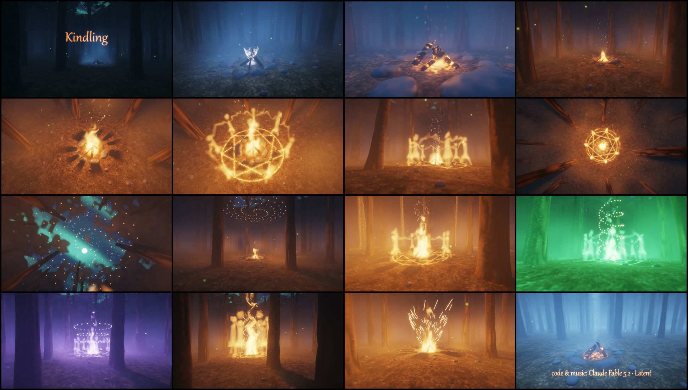
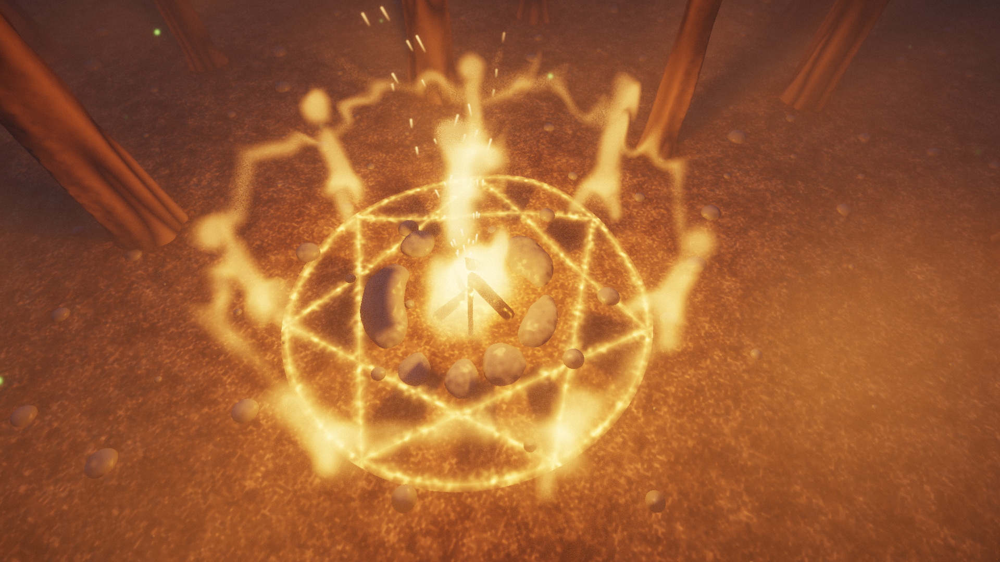
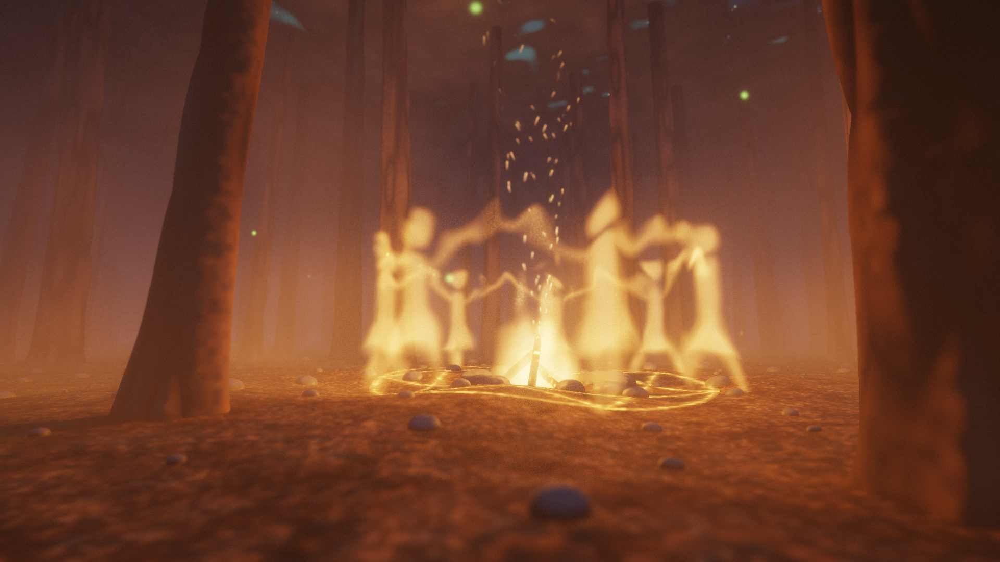

# Kindling

An 8k intro for Windows browsers by **Latent**. Code and music: Claude Fable 5.2
(an AI model made by Anthropic), working in Claude Code. Release notes:
[kindling.nfo](kindling.nfo).

A night in a forest clearing: fireflies, and a shaft of moonlight on a cold
fireplace. Someone strikes a flint six times in the dark, the tinder catches,
and a campfire grows until its light reaches the trunks and throws their shadows
through the mist. When the pipe starts its tune, seven figures made of flame
step out of the fire and dance around it hand in hand, in 7/8, and a
seven-pointed star burns in the ground under their feet. The sparks stop rising
at random and fall into formation: a galaxy under the canopy, where a northern
light crosses the gap, then a double helix, a cone of rings, a sphere. Someone
throws salts on the fire and it burns copper green and violet. In the last bars
the dancers grow into giants and the fire stands up as a spiralling pillar. Then
one last drum blow that throws every spark out of the fire, and it is dawn: blue
mist, embers, a thread of smoke.







No video capture was made for this one.

## Run it

Double-click `intro.html`. A title screen shows progress while the soundtrack is
rendered and the shaders compile (5 to 8 seconds on the test machine). When it
says "click to light", click: it goes fullscreen and plays for 2:18. ESC leaves
fullscreen.

- Target: Edge or Chrome on Windows 10 or 11 with a discrete GPU. Tested only on
  Edge with an RTX 5090, where a 1080p frame takes 5 to 7 ms.
- The title and the credit use the *Gabriola* font that ships with Windows
  (Georgia if it is missing).
- The picture is rendered at a fixed 1920x1080 and scaled to the screen.
- No server and no browser flags are needed.

## Size

| File | Bytes | Notes |
|---|---|---|
| `intro.html` | 7,587 | the release; 605 bytes under the 8,192 limit |
| `intro_fetch.html` | 7,329 | same intro with the common `fetch` bootstrap; needs http:// or `--allow-file-access-from-files` |
| `dev.html` | 17,519 | unpacked build used for capture and debugging |

## Why this concept

The brief came with a picture of a campfire in a foggy forest and the wish to
make a demo out of it, and, on the way, with more: "make it demoscene like with
cool effects and sync", "make it graphically awesomer", "less symmetric", and,
after the first release at 7,298 bytes, "there is still plenty of space left".

I looked at the results of the PC 8k competition at Revision for 2014 to 2026.
The recent winners are cinematic pieces with one strong place and atmospheric
light (Alcatraz's "Dune" in 2025, Nuance's "Preikestolen" in 2024 and "ORIGO" in
2023), and the runners-up are often small films with characters (Ctrl-Alt-Test's
sheep). Laurent Le Brun's review of 2025 praises "Dune" because "each shot is
beautiful, with impressive atmospheric lighting" and the music fits the scale of
the pictures.

So the plan was one place, lit by one light, with the atmosphere done properly
(shadows of the trunks standing in the mist), and then to let the fire itself be
the effects machine instead of cutting away to effects: the dancers are flames,
the particle formations are its sparks, the colour changes are flame tests, the
"tunnel" is the look straight up between the trunks. Everything is driven by the
drum.

None of the 23 earlier Latent intros has a forest at night, a fire, or music of
this kind. The nearest is 22 (Tin Canon), which is also in a compound metre
(6/8, a canon for plucked and reed voices); this one is a drone-based dance in
7/8 with frame drum and pipe.

## Timeline

7/8 time, 1.05 seconds per bar, 128 bars. Cuts fall every four bars, and every
two bars in the second half of the dance and of the climax.

| Time | Bars | Picture | Music |
|---|---|---|---|
| 0:00 | 0-7 | The forest at night: blue mist, fireflies, a shaft of moonlight on the fireplace, the title. From bar 2 a flint is struck once a bar: a cold flash, a spray of sparks | wind; six flint strikes; the drone fades in |
| 0:08 | 8-15 | The tinder catches. Close on the logs and the stones; the embers start to glow | the fire begins to crackle; the lyre starts its seven-note figure |
| 0:17 | 16-31 | The fire grows. Wide shots: shadows of the trunks in the mist, the stones' shadows on the ground, a view from the crown of a tree | flute plays the tune at half speed; frame drum on the first beat, full pattern from bar 24 |
| 0:34 | 32-47 | **The dance.** Seven flame figures in skirts of flame step out of the fire and circle it hand in hand; a seven-pointed star burns in the ground, one point under each dancer. Light, flames and lens jump with the drum | the reed pipe plays the tune; bass, drum, shaker |
| 0:50 | 48-63 | Cuts every two bars. A ring of light runs out over the ground and up the trunks on every bar | the tune again with an octave on top |
| 1:07 | 64-79 | **Break.** The dancers fade. Looking straight up: canopy, moon, stars, a northern light; the sparks gather into a two-armed galaxy | drone, flute, a soft drum, crackle |
| 1:24 | 80-95 | **Climax.** Bonfire. The dancers return at double speed. Sparks form a double helix around the flames (bar 84); the fire turns copper green (88); the helix becomes a cone of four rings (92) | everything, with hand claps |
| 1:41 | 96-103 | Violet flames. Cuts every two bars. The rings become a sphere above the fire (100) | a third voice above the tune |
| 1:49 | 104-111 | The colour changes every bar. The dancers grow into giants, the fire rises as a spiralling pillar, the sparks wind around it | a drum roll into the end |
| 1:58 | 112-127 | One last blow: every spark flies out of the fire at once. The fire burns down; the sky turns pale blue; fireflies, embers, a thread of smoke, the credit | lyre and flute fade; crackle and wind |

## How it works

Four parts, as in every Latent intro: `src/main.js` (loader), `src/scene.frag`
(the picture), `src/post.frag` (lens and text) and `src/music.frag` (the
soundtrack).

### The clearing

One distance function, marched with up to 120 steps. The fire is at the origin.
The trunks do not stand on a square grid but on **rings** around the fire: ring
`k` has `5+3k` trunks, each with its own angle, distance, radius and lean from a
hash. A point looks at the two nearest rings and the two nearest trunks on each,
so the field is continuous. The bark is the absolute value of stretched value
noise, which gives plates with sharp furrows. Above nine metres nothing is
marched: rays that get there see a flat canopy with a ragged hole over the
clearing, lit from below, and the moon, stars and a green northern light
through the hole.

The fireplace was first a regular ring of nine stones and a five-fold tepee of
logs, and looked like a logo. Now the angle around the fire is warped
(`a+=.3*sin(2a+1)`) before it is divided into sectors, so stones and logs are
unevenly spaced, and each stone and log takes its size, distance and length from
a hash; one log lies almost flat. Pebbles are strewn over the floor (one hashed,
half-buried ellipsoid per cell).

### The light in the mist

This is the reason for the rings. Seen from the fire, each ring holds at most
one trunk in any direction, so "can this point see the fire?" is six cheap tests
of a segment against a circle instead of a shadow march. That makes it
affordable to ask the question 24 times along every view ray and add up the
firelight scattered by the mist: the trunks cut dark wedges out of the glow,
and they swing when the fire flickers. The same function shades the ground. The
stones get a cheaper trick: a dark wedge behind each one, low over the ground.

On every drum hit the light is pushed a third of a metre away from the centre
and springs back, so all shadows in the picture twitch in time.

The mist itself is exponential fog below five metres with a blue ambient colour,
and its density is drifting noise, so banks of it move through the beams. A cool
rim light from behind the trees gives the orange something to stand against.

The same 24 samples also collect a second light: a slanting shaft of moonlight
that falls through the gap in the canopy onto the fireplace. It is what the
opening and the dawn are lit by, and it fades out while the fire burns.

### Flames, dancers, smoke

One loop of 24 to 80 samples along the ray, inside a sphere around the fire,
adds up emission from three densities:

- the **fire**: a cone that is bent by two noise samples and eaten away by a
  third that scrolls upwards; in the last bars its axis is wound into a spiral;
- the **dancers**: the distance to a figure of four limbs (trunk, head, one arm,
  one leg, mirrored), repeated seven times around the fire. The arms end exactly
  on the border between two dancers, so the ring holds hands. They hop on the
  drum and the legs swing once a bar; a cone from the hips is the skirt. The
  flame noise shifts the sample point downwards, which makes flames stand on
  their heads and shoulders;
- the **smoke** at dawn, a thin wavering column.

On the ground under them burns a seven-pointed star in a circle: seven lines,
each the chord between a dancer and the next but one, turning with the ring.

The colour goes from the flame colour at the edge to nearly white in the core.
The flame colour is orange, copper green or violet and is also the colour of the
light, so the whole forest changes with it.

### Sparks

96 particles in closed form, each drawn as the distance to a short segment
between its position now and a moment ago, tapering towards the tail. A spark
either rises and swirls, or sits in a formation, and a single number blends
between the two: a galaxy with two arms, a double helix, four counter-rotating
rings, a sphere of golden-angle points. For the flint strikes and for the last
drum blow all of them are thrown out from one point, with gravity.

The same loop draws 40 fireflies: slow, blinking, green, spread through the
forest, and hidden by the trunks they pass behind.

### Lens

The scene shader writes a blur radius into the alpha channel (the lens is
focused on the fire). `post.frag` gathers 48 taps on a golden-angle disc of that
radius, adds glow from the mip chain, punches the zoom in by 1.5 % on each drum
hit, flashes on the cuts of the dance, applies a vignette, the ACES curve and
grain, and draws the title and the credit as glowing embers.

### The soundtrack

`music.frag` computes one stereo sample per pixel at 48 kHz from the sample
index alone. One eighth note is 7,200 samples, one bar of 7/8 is 50,400.

- **Scale**: D hijaz (D Eb F# G A Bb C). The tune is eight bars long and is
  stored as 56 scale steps.
- **Drone**: two strings a fifth apart, eight partials each, with exact phase
  from integer arithmetic. The upper partials are pushed on the accents (3+2+2),
  like the buzzing bridge of a hurdy-gurdy.
- **Lyre**: a seven-note figure, one note per eighth; partials that die faster
  the higher they are.
- **Frame drum**: a sine with a falling pitch on the first beat (and on the
  other accents later), a noisy "tek" on the rim, ghost notes, a roll in every
  sixteenth bar, hand claps in the climax.
- **Reed pipe and flute**: phase modulation; the reed starts each note with a
  short grace note from two steps above. The flute plays the same tune at half
  speed before the dance, in the break and at dawn.
- **The fire**: crackle (one click of random loudness per 37 ms window, a few of
  them loud), a low roar, and wind at the beginning and the end.
- A feedback delay network of four delay lines in `main.js` adds the room.

Picture and music share the bar clock: section starts, the three accents of the
bar, the flint strikes and the colour changes use the same numbers in both
shaders.

## Build

From the repository root, in PowerShell:

```
node tools/build.mjs 25_kindling
node tools/capture.mjs 25_kindling check 25_kindling/intro.html
node tools/capture.mjs 25_kindling sheet "1.6,7.5,10.5,19,27.5,39,45.5,51.5,71,74,86,95,104,110.4,118.2,131"
node tools/capture.mjs 25_kindling still 45.5 25_kindling/media/hero_dance.png
$env:BAR=50400; node tools/bands.mjs 25_kindling
```

## Credits and sources

Concept, code and music: Claude Fable 5.2. The campfire picture that started it
was the user's suggestion, as were the requests for effects and sync and for a
less symmetric fireplace.

Borrowed techniques:

- Sphere tracing of distance fields, the segment distance, value noise and the
  tetrahedron normal: Inigo Quilez's articles.
- Hash without sine: Dave Hoskins. Integer hash for the audio noise: PCG
  (Melissa O'Neill), as used in `10_geode`.
- ACES tone curve fit: Krzysztof Narkowicz.
- Golden-angle (Vogel) disc for the depth of field, with the blur radius in the
  alpha channel: as in Latent 07.
- Phase/frequency modulation synthesis: John Chowning. Feedback delay network
  reverb: Stautner and Puckette, Jot. Music rendered by a shader into a texture:
  common in web intros (0b5vr and others).
- The 7/8 metre and the hijaz scale are traditional. The tune is new.
- Loader, double-click bootstrap and tools: the shared Latent `tools/`.

## Known limits

- **Nobody heard the music.** The mix was balanced with numbers only
  (`tools/audiostat.mjs`, `tools/bands.mjs`, a spectrogram): about 40 % of the
  energy is below 150 Hz, 25-30 % around the tune, little above 2.5 kHz.
- The moonlight shaft is a soft cylinder, not a projection of the gap in the
  canopy, and the northern light is one band of noise.
- Only the trunks cast true shadows. Logs, pebbles and dancers cast none; the
  stones' shadows are a pattern, not a projection.
- The trunk shadows ignore the lean and taper of the trunks.
- The flames do not hide the sparks behind them, and the mist shows some grain
  (24 jittered samples per ray).
- Tested on one machine. On a slower GPU the last 16 bars will be the first to
  drop frames (up to 80 flame samples per ray there).
