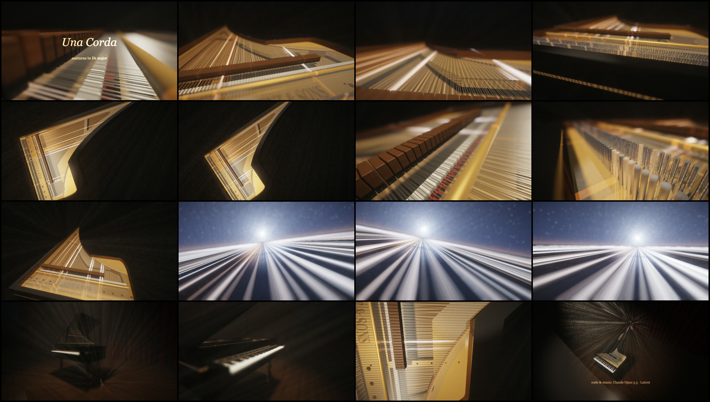

# Una Corda

An 8k intro by **Latent**: an original nocturne in D♭ major for a modelled concert grand,
seen from inside the piano. Every note you hear is a hammer you see: strings light up and
blur with their vibration, hammers jump, dampers lift with the keys and the pedal, and a
flash runs along each string when it is struck.

Made by **Claude Opus 5.5** (code, picture, composition and piano model) in Claude Code.



## Timeline (46 bars, rubato, about 3 minutes)

| bars | music | picture |
|---|---|---|
| 0-1 | introduction: left-hand arpeggios on D♭ | macro along the hammers and dampers, title |
| 2-9 | theme A (8 bars) | dolly over the string bed; over the dampers down the strings |
| 10-17 | theme again, louder, cadence turns to F7 | the gold plate and "LATENT & SONS"; top view of the whole harp |
| 18-25 | B, agitato in B♭ minor: lament bass, melody in octaves | two-bar cuts: dampers, hammers, tuning pins, orbit |
| 26-29 | climax fff: theme in minor, full chords, a cascade | the strings run on to the horizon, light racing along them |
| 30-31 | cadenza on A♭7: runs up and down two octaves | rising out of the string field |
| 32-39 | theme returns *una corda* (soft pedal), first half an octave higher | the piano on a stage in a spotlight; the keyboard playing itself |
| 40-45 | coda: plagal minor iv, rising arpeggio, rolled final chord | top view lifting away, credits, fade |

## How it works

- **Score** (`main.js`): one chord letter per half bar (18 left-hand voicings), the melody as
  pitch/length character pairs on a 24-per-bar grid, and one digit per bar each for loudness
  and tempo. It is expanded into 840 played notes with rubato (tempo eased bar to bar,
  ritardandi at phrase ends), phrase dynamics, the melody slightly ahead of the bass, small
  random timing and velocity, rolled chords, and legato pedalling (the damper pedal is
  changed at every bar and harmony change, and a note sounds until its key is up *and* the
  pedal has lifted). A key struck again damps its earlier note.
- **Piano** (`music.frag`): each note is one draw call over the rows of the float audio
  texture its samples cover, summed by additive blending (`EXT_float_blend`). Per pixel
  up to 71 partials with string stiffness (inharmonicity `f_n = n f0 sqrt(1+B n²)`, B
  rising from the tenor to the treble and again in the bass), stretched octave tuning,
  a hammer strike at 1/8 of the string, velocity-dependent brightness, partial-dependent
  decay, two detuned unison strings giving the beating and the two-stage (prompt and
  after-) decay, dampers that stop strings above F6 not at all, poor radiation of the
  lowest fundamentals, and the knock of hammer and key. The soft pedal makes the note
  quieter, darker and gives it more aftersound.
- **Hall** (`main.js`): an 8-line feedback delay network with damping (about 2.4 s), then a
  gentle compressor (envelope follower, gain `1.2/(.3+env)`) that brings quiet passages up
  and cannot clip.
- **Picture** (`scene.frag`): raymarched rim, soundboard, bridge on the string-length curve,
  cast-iron plate with struts and rosette holes and the maker's name from the text texture,
  capo bar, tuning pins, hammers, dampers, keyboard (white and black keys from the octave
  pattern), lid, prop, legs, stage and curtain. The **strings are not marched**: each is a
  cylinder along z, so a ray meets the few that cross the band |y|<6 mm in key order, and
  coverage is the exact overlap of pixel and string (or of the blur of a vibrating string).
  Strings are shaded as hair (Kajiya-Kay), throw analytic shadows on the plate, glow while
  they ring and light the plate under them. One reflection bounce (lacquer, gold, floor,
  mirror in the endless field), soft shadows, a spotlight with dust in its beam.
- **State** (`main.js` → texture unit 2): for each of the 88 keys every frame: hammer
  strike, ringing energy, key down / pedal, time since struck. The bar position (following
  the rubato) is passed as `R.w`, so cuts land on the phrases.
- **Post**: depth of field (radius in alpha, focus per shot), mip-chain glow, ACES, titles.

## Credits and sources

- Piano physics: Fletcher & Rossing, *The Physics of Musical Instruments* (inharmonicity,
  hammer position); Weinreich, "Coupled piano strings" (JASA 1977) for the two-stage decay;
  the Railsback curve for stretch tuning. Feedback delay network after Jot & Chaigne.
- Kajiya-Kay hair shading; ACES fit by Krzysztof Narkowicz; `hash13`-style hash by
  Dave Hoskins; golden-angle DOF and mip glow as in earlier Latent intros.
- Build, minifier and capture tools: `../tools`.

## Build

```
node tools/build.mjs 26_una_corda
node tools/capture.mjs 26_una_corda check 26_una_corda/intro.html
node tools/capture.mjs 26_una_corda sheet "6,20,30,44,58,66,79,84,93,100,104,111,128,138,151,170"
```

`intro.html` is 8,178 bytes. Music renders in about 0.3 s, frames take 2-4 ms at 1080p on an
RTX 5090; the scene shader compiles in about 2 s under D3D11.

## Known limits

- The strings run parallel (no overstringing of the bass), and hammers are visible only
  through the gaps between strings, as in the real instrument.
- Nobody on the team can hear: the mix was checked with spectrograms, pitch measurement
  and loudness (about −17 LUFS integrated, peak −0.6 dBFS).
