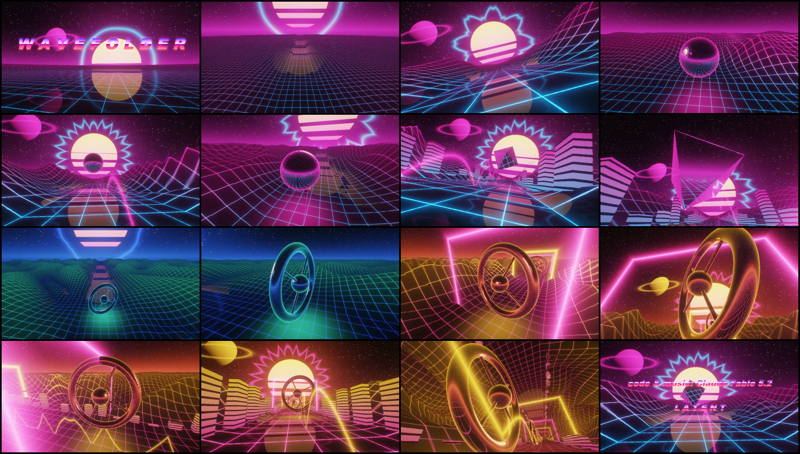

# Wavefolder

An 8k synthwave intro by **Latent**. Code, picture and music: Claude Fable 5.2, in Claude Code.
`intro.html` is 6,351 bytes and runs on double-click in Edge or Chrome on Windows.



## What it is

A drive down a neon grid towards a striped sun, 144 seconds at 120 BPM.

A wavefolder is a synthesiser circuit that folds a wave back on itself wherever it
exceeds a limit: the harder it is driven, the more jagged the output. Here the
mountains on both sides of the road are two sine waves pushed through that function,
and the music sets the drive. The intro starts on a flat grid; the range rises with
the bass, grows jagged in the chorus, and in the last chorus the fold is applied to
the world itself, so a second range hangs upside down over the road. A ring around
the sun shows the same folded wave as an oscilloscope trace.

It began as a homage to the synthwave artist Waveshaper. The person who gave the
brief listened and said it does not sound like him, so that claim was dropped. No
melody, sound or picture is taken from his work.

## Timeline

| Bars | Seconds | Music | Picture |
|---|---|---|---|
| 0-8 | 0-16 | arpeggio alone, filter opening, low drone | flat grid, sunrise, title |
| 8-16 | 16-32 | kick, sixteenth-note bass, hats | mountains rise, the chrome sphere arrives |
| 16-32 | 32-64 | theme A twice, the second time with an octave below | road and orbit shots, the wave over the road, analyser towers, octahedron |
| 32-40 | 64-80 | break: theme B at half speed over pad and drone | blue night, the wheel station |
| 40-56 | 80-112 | chorus: theme B twice, chord stabs, a third above | gates of light, a convoy of stations, cuts every two bars |
| 56-64 | 112-128 | last chorus, a whole tone higher | the sky folds over, palette changes on every cut |
| 64-72 | 128-144 | theme A once more, softly; last hit | sunset, credits |

## How it works

- **Music** (`src/music.frag`): one pixel per stereo sample at 48 kHz, rendered once at
  load. Every pitched voice is a sum of harmonics, each weighted by the magnitude
  response of a two-pole resonant low-pass, so filter sweeps and plucks need no
  filter state. Bass (two saws and a sine), square-wave arpeggio, seventh-chord pad,
  a three-saw lead with glide and vibrato, chord stabs, kick, gated snare, hats,
  toms, snare rolls. The shader writes the dry mix to two channels and an effect
  send to the other two; `main.js` runs the send through a ping-pong echo (three
  sixteenths) and a four-line feedback delay network, and soft-clips the sum.
- **Terrain** (`src/scene.frag`): heights are defined on grid vertices and
  interpolated bilinearly, which gives the straight-edged low-polygon look; lines
  are drawn with a width matched to the pixel footprint so they fade instead of
  shimmering. The ground reflects the sky.
- **Chrome objects**: sphere, octahedron and a wheel station, ray-marched, mirroring
  the sky above and an analytic flat grid below.
- **Sync**: kick pulse (mountain height, a wave of light along the grid, the ring),
  the chorus stab rhythm (gates), a new analyser reading every sixteenth (towers),
  snare (colour split in the lens), cuts (flash and a tape slip).
- **Post** (`src/post.frag`): mip-chain glow with a horizontal lens streak, colour
  split, vignette, ACES fit, chrome lettering.

## Build

From `Latent_8k/` in PowerShell:

```
node tools/build.mjs 27_wavefolder
node tools/capture.mjs 27_wavefolder check 27_wavefolder/intro.html
node tools/capture.mjs 27_wavefolder sheet "3,13,21,28,36,45,54,60,68,76,85,93,101,107,123.3,134"
$env:BAR=96000; node tools/bands.mjs 27_wavefolder
```

## Credits and sources

- Additive oscillators weighted by a filter response: a common trick in shader music.
- Feedback delay network with a Householder matrix: after Jot and Chaigne.
- ACES tone-curve fit: Krzysztof Narkowicz. Hashes: Dave Hoskins ("hash without sine"), PCG (Melissa O'Neill).
- The grid, the striped sun and chrome lettering are the shared vocabulary of
  synthwave/outrun artwork.

## Known limits

- Nobody on the team can hear. The mix was balanced by band energy and loudness
  measurements only (about -12.5 LUFS integrated, no clipping); the melodies are
  diatonic over their chords but were never auditioned by the maker.
- 1,841 bytes are unused.
- The soundtrack takes about 0.6 s to compile and render on an RTX 5090 and is one
  draw call; a slow GPU may need several seconds.
- A discrete GPU is assumed (about 2 ms per 1080p frame on an RTX 5090).
