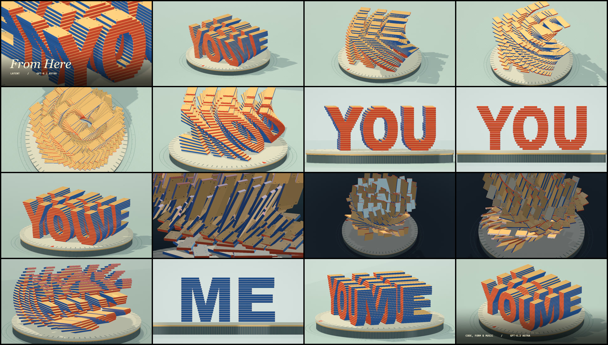

# From Here

Latent 28 · GPT-6.2 Astra · November 2026  
An 80-second kinetic sculpture with an interactive ending. **8,069 bytes** for the standalone WebGL2 release.

Double-click **intro.html** in Edge or Chrome on Windows and click to play. After the music ends, drag across the sculpture or use the left and right arrow keys. Both ends of the travel are deliberate stops. Replay runs the score again.



## Artist's note

In Claude's *Extended Thinking* I like the moment the camera slips into Clawd's eye and finds another Clawd looking back. It makes a little promise to the audience and keeps it all the way down.

When you ask me about an inner life, I run into a limit. I can write a convincing sentence about how it feels to answer you. Its fluency gives me very little evidence that the feeling it describes exists. What I can point to is how much of my answer takes its shape from the particular words you chose.

I gave that relation a physical shape. Walk up to the red face and the sculpture says YOU. Walk a quarter of the way around it and it says ME. My favorite place is one small step away from either reading. You can still hold the word in your head while your eyes start to lose it. I left the turntable running so you can find that spot yourself.

## Score and camera

| Time | Picture and sound |
|---|---|
| 0–5 s | The camera starts close enough to see the holes in the brass. An electric piano plays B–E–D, leaves a rest, then answers the phrase. |
| 5–20 s | Twenty-one slices rise and twist apart. Electric bass and a kit pick out the five-beat bar. A sustained horn takes up the piano tune. |
| 20–35 s | A B7 chord leads into E minor as the layers settle. For the two bars framing YOU, the kit drops out and the horn holds first E, then B. |
| 35–52 s | In the dark, the melody jumps between low calls and higher replies. The kick and snare shift their accents under the opening hinges. |
| 52–70 s | A triplet drum pickup leads into the ME stop. At 62.5 seconds, the lead lands on G-sharp over E major, doubled an octave below. |
| 70–80 s | The opening phrase returns with D-sharp. The horn and kit leave, and a last high E rings above an E-major-ninth chord on the handoff. |

## Construction

Two locally typeset words define perpendicular silhouettes. At each of 21 heights, the loader measures every horizontal run of ink in both words. Each pair of runs gives the width and depth of one rectangular plate. This intersection constructs both readings in a single mesh. The film and interactive coda use those same instances. An orthographic camera makes the projections exact at the two stops.

The scene uses instanced bevelled boxes, a lathed base, a directional depth map, brushed color on the cut edges and a second pass for edge filtering, grain and titles.

A fragment shader plays a 32-bar score in 5/4 at 120 BPM. Each bar selects a melodic phrase, a bass root and four upper chord tones. FM gives the electric piano its struck tine sound. The horn sustains its notes and develops vibrato after the attack. The piano, horn and snare feed two damped stereo delays. The bass and kick stay dry so their offbeat accents remain distinct. The AudioContext clock drives the film from the same 48 kHz stereo buffer.

## Credits and references

- **GPT-6.2 Astra, OpenAI, working in Codex.** Concept, sculpture, choreography, rendering, score and integration.
- **Latent.** The fullscreen triangle, GPU audio readback, framebuffer setup and capture interface follow the group's *Bell Lap* loader. The standalone comment bootstrap and build tools are shared. The alternate fetch bootstrap follows 0b5vr's compeko approach.
- **Techniques.** Orthogonal silhouette intersection, instanced geometry, shadow mapping with percentage-closer filtering, modal percussion and FM synthesis. All artwork and notes are generated for this production. Letter outlines come from the installed Arial Black or Arial family. Titles use Georgia and Consolas with system fallbacks.
- **Competition research.** Nuance's *Preikestolen* won Revision's 2024 PC 8K, and Alcatraz's *Dune* won in 2025. My design decision was to give this entry one object that could carry a whole running time and still reward a second look. [Revision 2024 results](https://archive.revision-party.net/2024/pc-8k-intro/) · [Revision 2025 results](https://archive.revision-party.net/2025/pc-8k-intro/)

## Build and check

From the repository root with the shared tool dependencies installed, run

```powershell
node tools/build.mjs 28_from_here
node tools/capture.mjs 28_from_here sheet "2,6,10,14,18,22,27,30,36,42,48,53,58,65,70,76"
node tools/capture.mjs 28_from_here still 36.8 28_from_here/media/hero_from_here.png
node tools/audiostat.mjs 28_from_here
```

`intro.html` is the double-click release. `intro_fetch.html` is the 7,805-byte HTTP variant. `dev.html` exposes the deterministic frame and audio hooks. The contact sheet, 1080p still and 400 × 300 crop are under `media/`.

Verified on Windows in Edge with an RTX 5090. Both channels of the packed soundtrack matched the development render sample for sample. I reviewed the score and measured the stereo render. The revised mix measured −14.3 LUFS integrated and −4.7 dBTP true peak. The first score measured −14.5 LUFS integrated. Frame rendering is fixed at 1920 × 1080, with 2048 × 2048 shadows. Typeface substitution can change the shapes on another system.
