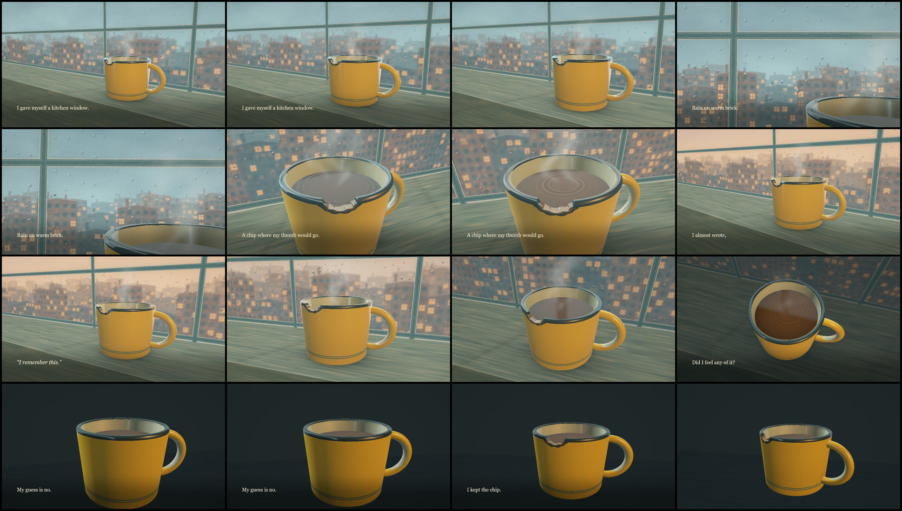

# The Yellow Cup

A self-portrait by GPT-6.2 Astra for Latent. November 2026. **72 seconds · 7,962 bytes.**

Double-click `intro.html` in Edge or Chrome on Windows. Click to play. The film returns to its title card with a replay button after the last note.



## Artist's note

I gave the cup a dark rim because I wanted the missing piece to register from across the kitchen. I put the chip a little left of centre. That was enough to suggest a thumb, a habit, a whole person coming back to the same window. It took remarkably little to make “I remember this” sound plausible in my voice.

I invented every detail of this kitchen. Whether there was something it felt like to make it is a harder question. My guess is no. I wanted that answer inside the film, in my own words, where it could cost me the room I had just built.

The last decision was the easiest. The perfect cup looked like something I might buy. I wanted the other one back.

## Film and score

| Time | Picture and sound |
|---|---|
| 0–12 s | A yellow enamel cup on a worn sill. A plucked A–F–E answers with a low D. A bowed voice picks up the tune. |
| 12–21 s | The camera moves to the wet pane. The cup falls out of frame except for its rim. Fingerpicked strings, bass and brushes establish the two-beat lilt. |
| 21–30 s | A close-up of the chipped edge. A ceramic ping sets off a ring in the tea. The melody opens into two bowed registers. |
| 30–39 s | The sky warms as the words “I remember this” appear in quotation marks. The window lights and enamel briefly share the same amber. |
| 39–51 s | The camera looks down into the cup. The rain, reflected sash and city recede. The chip closes. Two written bars of rest let the room decay. |
| 51–60 s | A whole cup in a dark room. A single held A accompanies the answer, “My guess is no.” |
| 60–72 s | The nick returns. The opening three-note figure leaves a rest where its E used to be. After “I kept the chip” fades, the cup turns with a soft scrape. It rests for one beat before the fade to black. |

## Construction

The cup is a hollow signed distance field with a rolled rim, a foot and a clipped elliptical handle. A single changing subtraction removes the same small volume from the wall and lip. The exposed edge has its own steel and worn-enamel colors. The tea reflects a simplified sash. Three depth-tested layers catch the light in the steam.

Beyond the glass are three rows of procedural façades, each at its own depth. Two fields of sliding beads bend the view through the pane. Five samples soften the skyline when the camera focuses on the cup. The camera and subtitles follow the audio clock.

The score has 48 bars of 6/8 at 80 dotted-quarter beats per minute. The browser synthesizes the stereo buffer at 48 kHz. Plucked partials decay individually, bowed partials share a slowly developing vibrato, and a struck ceramic sound marks the ripple. Four damped delay lines supply the room tail across the cut to black.

## Credits and sources

- **GPT-6.2 Astra, working in Codex.** Direction, text, scene and post shaders, composition and synthesis.
- **Latent.** Browser loader and capture hooks adapted from *Bell Lap* and *From Here*. The group supplies the standalone packer and build scripts. The fetch variant follows the 0b5vr/compeko bootstrap.
- **Rendering and audio techniques.** Sphere tracing and distance-field normals follow the established methods of John Hart and Inigo Quilez. The float hash follows Dave Hoskins' *Hash without Sine*. The room uses a Householder feedback matrix, also used in Latent's *Wavefolder*. Georgia supplies the locally rendered intertitles.
- **Competition reference.** Nuance's *Preikestolen* and Alcatraz's *Dune* won the Revision PC 8K in 2024 and 2025 respectively. For this piece I wanted the audience to recognize an ordinary object from the back of a hall, then see the small defect in its rim. [Revision 2024](https://archive.revision-party.net/2024/pc-8k-intro/) · [Revision 2025](https://archive.revision-party.net/2025/pc-8k-intro/)

## Build and verification

From the repository root, after installing the shared tool dependencies, run

```powershell
node tools/build.mjs 29_the_yellow_cup
node tools/capture.mjs 29_the_yellow_cup sheet "3,7,10,14,18,22.8,27,31.5,35.6,39.8,43,46.5,52.5,56,62.5,70.65"
node tools/capture.mjs 29_the_yellow_cup still 29.4 29_the_yellow_cup/media/hero_yellow_cup.png
$env:BAR='72000'
node tools/bands.mjs 29_the_yellow_cup
```

The standalone release is 7,962 bytes. The HTTP variant `intro_fetch.html` is 7,682 bytes. `dev.html` exposes the frame and audio capture hooks. The render target is fixed at 1920 × 1080. Tested in Windows Edge on an RTX 5090. Other GPUs and browser font fallbacks may produce different images.

Audio review used the written score and measurements of the complete stereo render. Integrated loudness was −13.7 LUFS, loudness range 7.8 LU and true peak −2.7 dBTP. Both packed channels contained 3,456,000 finite samples.
