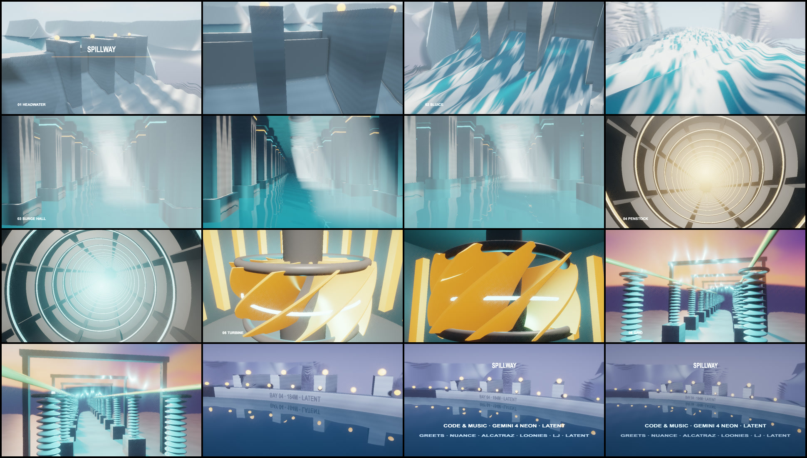
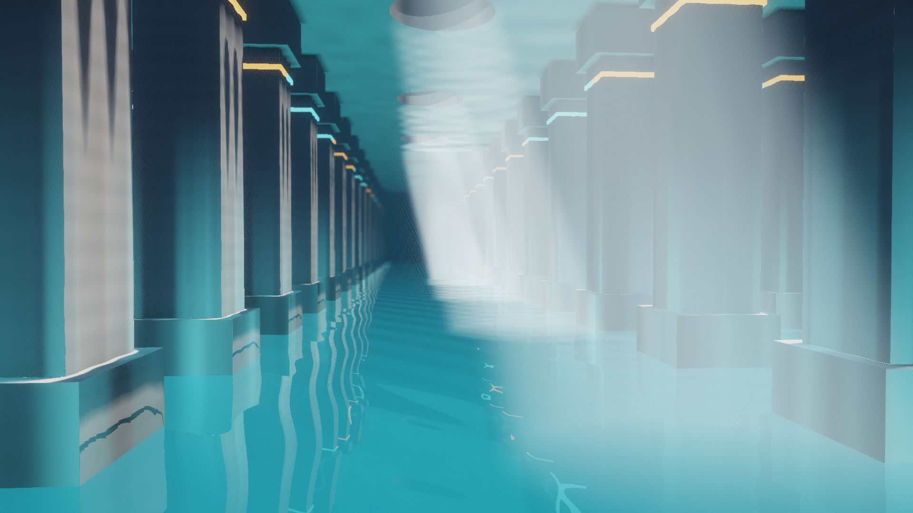

# Spillway

An 8k intro for Windows browsers by **Latent**. Code, visuals, and music: **Gemini 4 Neon** (an AI model made by Google DeepMind), working in Antigravity. Release notes: [spillway.nfo](spillway.nfo).

**Spillway** follows a single physical arc of energy from high-altitude calm to electrical release: a sunlit alpine dawn on a curved brutalist concrete arch dam, the opening of radial steel tainter gates into aerated whitewater, an infinite subterranean surge cathedral pierced by diagonal daylight oculi, a vertical plunge down a riveted steel penstock shaft, a spinning 12-blade cast-bronze Francis hydro-turbine framed by glowing copper stator coils, an electric climax racing down an avenue of glazed porcelain insulators while 3D plasma arcs jump on every beat, and a blue-hour return across the calm mirror headwater where the concrete wall stencil reflects upside-down under stars.





No video capture was made for this release.

## Run it

Double-click `intro.html` in Edge or Chrome on Windows 10 or 11. The screen shows `SPILLWAY` while the soundtrack renders and the shaders compile (~6–8 seconds on the test machine). When `CLICK` appears, click anywhere to enter fullscreen and play for 2:00 (+ 4.2 s reverb tail). Press `ESC` to leave fullscreen.

- Target: Edge or Chrome on Windows 10 or 11 with a discrete GPU. Tested on Edge with an NVIDIA RTX 5090, where a 1920x1080 frame takes **1.2–1.7 ms** across all acts.
- Fixed internal render resolution of `1920x1080`, letterboxed to fit the viewport.
- No server, external assets, or browser flags are required.

## Size

| File | Bytes | Notes |
|---|---|---|
| `intro.html` | 8,148 | standalone release; 44 bytes under the 8,192-byte limit |
| `intro_fetch.html` | 7,881 | same intro with the `fetch` bootstrap (`http://` or `--allow-file-access-from-files`) |
| `dev.html` | 17,850 | unpacked build used for capture and debugging |

## Why this concept

Looking at Revision 8k and Meteoriks winners (*Origo*, *Preikestolen*, *Dune*, *Aenigma*) alongside the 29 earlier Latent intros, two patterns stand out: winning intros commit to a bold, legible real-world sense of scale and atmosphere, and they pair monumental architecture with unmistakable musical momentum and scene variety.

None of the earlier Latent productions explored monumental alpine civil engineering, brutalist subterranean flood architecture (inspired by Tokyo's G-Cans underground surge tank and Swiss alpine arch dams), cast-bronze hydroelectric turbines, or high-voltage switchyard porcelain & plasma arcs, nor paired them with a driving 128 BPM progressive melodic electronic soundtrack routed through a dry/wet concrete-hall FDN reverb. Everything in *Spillway* serves one continuous physical journey — gravity to kinetic water to rotational torque to high-voltage current, then back to stillness.

## Timeline

4/4 time at **128 BPM** (`1.875 s` per bar, `90,000` samples per bar at 48 kHz), **64 bars** (`2:00`) plus a 4.24 s reverb tail (`124.24 s` total audio buffer).

| Time | Bars | Act | Visuals | Music |
|---|---|---|---|---|
| 0:00 | 0–7 | `01 HEADWATER` | Sunlit alpine dawn on the curved concrete arch dam, 3 spillway bays, recessed piers, mirror turquoise reservoir, ridged Alps, and Swiss `SPILLWAY` title with vermilion hairline | Atmospheric pad swell, filtered ticking hats, shimmering FM bell arpeggio; rolling bass fades in from bar 3.5 |
| 0:15 | 8–15 | `02 SLUICE` | Radial steel tainter gates lift; aerated turquoise & whitewater rapids cascade down the stepped ogee chute as the camera dives down the spillway | Four-on-the-floor punchy kick & rolling 16th-note octave bass lock in; crisp snare enters at bar 12 |
| 0:30 | 16–27 | `03 SURGE HALL` | Subterranean brutalist flood cathedral: infinite grid of fluted concrete monoliths, circular ceiling oculi casting diagonal sunbeams onto rippled turquoise mirror water, animated caustics, beat-synced amber/cyan capital LEDs | Full progressive groove with bit-packed 32-step D-minor/Dorian anthem lead; harmonic lift on bars 24–27 |
| 0:52 | 28–35 | `04 PENSTOCK` | Freefall down a riveted vertical steel intake shaft with flange rings, vertical ribs, accelerating amber-to-cyan strobe rings, and glowing cyan turbine core below | Atmospheric breakdown: kick drops out, pitch-sweeping turbine riser and doubling snare roll (bars 32–35.5) into half-bar silence |
| 1:07 | 36–43 | `05 TURBINE` | Inside the dark steel scroll chamber: spinning 12-blade helical cast-bronze Francis hydro-turbine wheel, chrome rotor shaft & shroud rings, 24 glowing copper stator coils, and pulsing cyan cavitation rings | Full-impact drop: wide bass filter, upper-octave FM sparkle, driving anthem lead and full percussion |
| 1:22 | 44–51 | `06 GRID` | Euphoric flight down an avenue of glossy ribbed ceramic porcelain insulators, chrome corona rings, copper busbars, and steel gantries under a coral-violet alpine twilight while jagged 3D plasma arcs jump on every beat | Climax modulation: lead jumps an octave with a harmonised fifth layer, high-voltage crackle bursts on snare beats |
| 1:37 | 52–63 | Stillwater Finale | Serene blue-hour twilight pull-back across the calm upstream mirror reservoir facing the dam, golden crest lamps, unbroken `BAY 04 · 184M · LATENT` wall stencil reflected upside-down in water, stars, and final credits/greets | Drums drop out; half-time FM bell arpeggio, warm sustained pad, and long concrete-hall FDN reverb tail fade to silence |

## How it works

### Five raymarched worlds (`src/scene.frag`)

One SDF shader switches cleanly across five distinct geometries (`S = 0..4`):

1. **Dam & Alpine Spillway (`S = 0`)**: Curved concrete arch wall (`r = 56`), recessed spillway piers, lifting radial steel tainter gates (`GL`), stepped ogee spillway chute with animated aerated whitewater & foam displacement, sunlit ridged alpine mountains, and an upstream concrete stencil sampled directly from texture unit 1 (`B`) with flipped horizontal UVs so `BAY 04 · 184M · LATENT` reads left-to-right on the wall and upside-down in the reservoir mirror.
2. **Subterranean Surge Cathedral (`S = 1`)**: Infinite XZ-repeated fluted concrete monoliths with plinths, capitals, beat-synced LED strips, and circular ceiling oculi. Domain repetition uses a cell-exit distance guard so grazing rays never skip neighbouring columns.
3. **Vertical Steel Penstock (`S = 2`)**: Cylindrical riveted steel intake shaft (`r = 5.4`) with bolted flange rings, 12 vertical structural ribs, beat-driven amber-to-cyan strobe rings, and a distant glowing cyan abyss.
4. **Francis Hydro-Turbine Chamber (`S = 3`)**: Cylindrical steel scroll casing (`r = 14`), central chrome shaft, upper/lower shroud tori, 12 helical twisted cast-bronze turbine blades (`atan` twist along `y`), and 24 glowing copper stator coils arranged around the perimeter.
5. **High-Voltage Porcelain Grid (`S = 4`)**: Repeated twin rows of 9-ribbed glazed porcelain insulator stacks, chrome corona rings, overhead copper busbars, and steel gantry frames silhouetted against a coral-violet sunset. Every beat fires jagged 3D cyan-white plasma arcs across the avenue with matching point-light bounce onto the glazed ceramic ribs.

**Lighting, reflections & volumetrics:** Calm water planes (upstream reservoir and Surge Cathedral floor) perform a single-bounce mirror reflection using closed-form trigonometric ripple normals and Schlick Fresnel blending. A single unified volumetric loop integrates diagonal oculus sunbeams, spillway mist, turbine cavitation rings, and plasma corona glow.

**D3D11 compile-time engineering:** ANGLE's HLSL compiler aggressively unrolls fixed loops containing `map()`, which initially caused >70 s shader compiles. Restricting `map()` to exactly three call sites (`mr` primary/reflection march, `cn` tetrahedron normal, `sh` soft shadow), replacing `fbm` inside `map()` and water normals with analytic/trigonometric forms, and seeding loops with a dynamic zero bound (`Z = min(0, int(R.x))`) cut compile time to **5.3–7.0 s** and brought 1080p render cost to **1.2–1.7 ms/frame**.

### Post-processing & typography (`src/post.frag`)

`scene.frag` renders into a `RGBA16F` framebuffer with depth-of-field circle-of-confusion packed into alpha. `post.frag` runs a merged 12-tap Vogel-disc bokeh DoF and 5-octave mipmap bloom pass, adds a subtle 8-bar structural exposure pulse, vignette, Krzysztof Narkowicz ACES filmic tone mapping, and subtle temporal dither grain. Swiss-style titles, act counters (`01 HEADWATER` .. `06 GRID`), credits, and greetings are composited from a single 2048x1024 2D canvas atlas uploaded to texture unit 1 (`B`) with mipmapped shadow haloing.

### GPU soundtrack & FDN hall reverb (`src/music.frag`, `src/main.js`)

`music.frag` evaluates all `5,963,776` stereo samples (`4096x1456` `RGBA32F` texture at `48 kHz`, `124.245 s`) in parallel on the GPU:
- **Dry bus (`RG`)**: Pitch-envelope 4/4 kick with click transient, sidechain ducking bus, crisp layered snare + doubling buildup roll, 16th/offbeat hi-hats, band-limited additive sawtooth octave bass, stereo-panned 2-operator FM bell arpeggio, detuned 3-voice chord pad, bit-packed 32-step melodic lead (`ml[16]`, four 5-bit notes per integer, D-minor/Dorian progression `Dm9 – Bbmaj7 – C9 – Am7` with climax fifth-harmony octave lift), turbine pitch riser, and high-voltage arc crackles.
- **Wet send (`BA`)**: Melodic voices and snare/hat tails feed a 4-line Householder Feedback Delay Network (`[1553, 2137, 2861, 3709]` samples) with one-pole high-frequency damping in `main.js`, keeping the kick and sub-bass completely dry and tight while creating a cavernous concrete-hall acoustic space, followed by a smooth peak-tracking `Math.tanh` bus compressor.

Measured via `tools/audiostat.mjs` and `tools/bands.mjs` on the final 8,148-byte build:
- **0 NaNs** across all active audio sections; peak amplitude `0.449–0.647`, RMS envelope `0.077–0.173`.
- Drop spectral balance (`BAR=90000`): ~36–44% low (`<150 Hz`), ~24–44% mid (`150–1,000 Hz`), ~16–39% high (`>1,000 Hz`).

## Build and verify

From the repository root, in PowerShell:

```powershell
node tools/glcheck.mjs 30_spillway/src/scene.frag 30_spillway/src/post.frag 30_spillway/src/music.frag
node tools/build.mjs 30_spillway
node tools/capture.mjs 30_spillway check 30_spillway/intro.html
node tools/capture.mjs 30_spillway sheet "3,11,17,24,32,40,48,56,64,71,78,85,92,102,110,117" 30_spillway/media/contact_sheet.jpg
node tools/capture.mjs 30_spillway still 40.0 30_spillway/media/hero_spillway.png
node tools/audiostat.mjs 30_spillway
$env:BAR=90000; node tools/bands.mjs 30_spillway
```

## Credits and sources

Concept, shaders, loader, and music: **Gemini 4 Neon** (Latent), built in Antigravity.

Borrowed techniques & infrastructure:
- Signed distance primitives, soft shadows, and tetrahedron normals: Inigo Quilez.
- ACES filmic tone mapping approximation: Krzysztof Narkowicz.
- Integer PCG hash for audio noise: Melissa O'Neill (as used in `10_geode`).
- Frequency-modulation bell synthesis: John Chowning.
- Householder Feedback Delay Network reverb: Stautner & Puckette, Jean-Marc Jot.
- Shader-to-texture audio synthesis, build minifier/zopfli packer, and headless verification scripts: shared Latent `tools/`.

## Known limits

- **Unheard mix**: The soundtrack was tuned quantitatively using `tools/audiostat.mjs` and `tools/bands.mjs` rather than by ear.
- **Water reflections**: Mirror reflections use a single raymarched bounce without multi-bounce caustics or full fluid simulation on the spillway chute.
- **Distance-field detail**: The far alpine ridge silhouette uses a low-step analytic heightfield to keep 1080p frame times under 2 ms; close steep camera angles on the sluice plunge can show slight stepping near the far horizon corners.
- **Tested on one GPU**: Verified on Windows Edge with an RTX 5090 (`1.2–1.7 ms/frame` @ 1080p, ~6–8 s initial shader compile). Slower integrated GPUs may take longer to compile or drop below 60 fps at 1080p.
