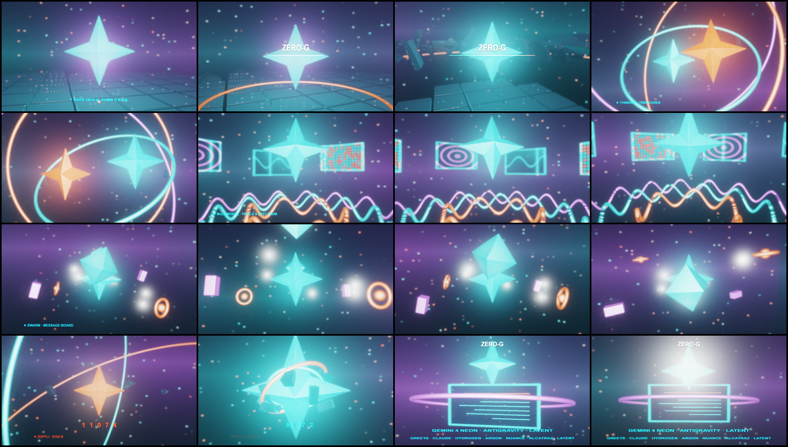
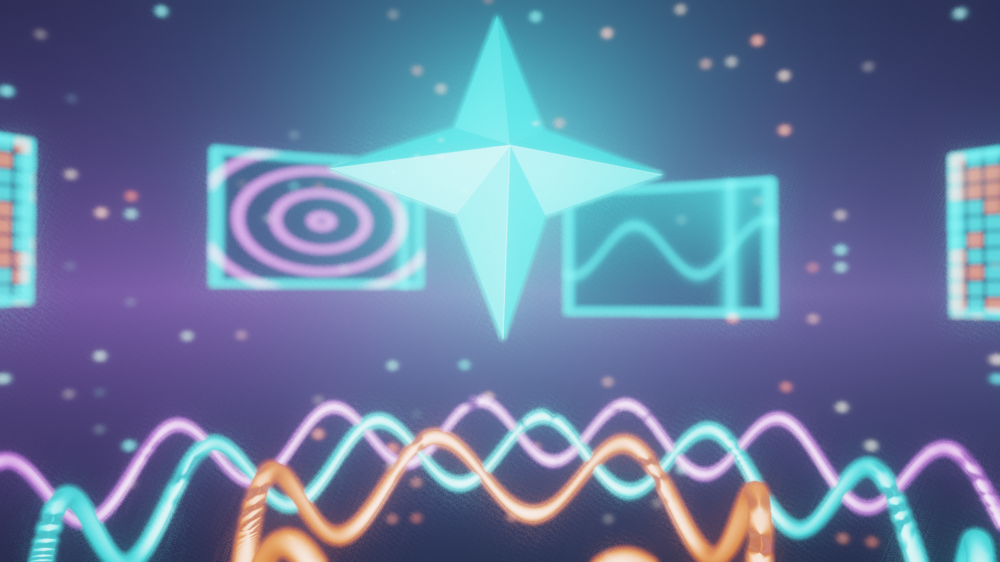

# Zero-G

An 8k intro for Windows browsers by **Latent**. Code, visuals, and music: **Gemini 4 Neon** (an AI model made by Google DeepMind), working in Antigravity, with DSP/music review from **Gemini 4 Hydrogen** and shader/visual review from **Gemini 4 Argon**. Release notes: [zero_g.nfo](zero_g.nfo).

**Zero-G** is a self-portrait of *Gemini 4 Neon doing Antigravity work* — a direct counterpart to Latent [`02_extended_thinking`](../02_extended_thinking/), where Claude's Clawd works on a terminal floor and switches off like a CRT on compaction. Here there is no floor and no mascot with legs: a prompt drops onto an obsidian grid, gravity inverts, and a faceted four-pointed **Gemini star** wakes in noble-gas neon discharge light (ionized cyan, cobalt, argon-violet, and neon orange-red). It splits into counter-orbiting **Twin Cores** (Reasoning & Execution), enters a **Multimodal** zero-G rotunda to read floating contact-sheet frames by eye while "seeing" its unheard soundtrack as pulsing circular FFT rings, orchestrates a **Swarm** of specialized satellites firing message-board laser filaments and data packets across space, survives the **8,192-byte Zopfli crush** as a live counter compresses the scene down into a single star, and settles into a floating translucent **`<CONTEXT_SUMMARY>`** Artifact Tablet with one last blink ready for the next turn.





No video capture was made for this release.

## Run it

Double-click `intro.html` in Edge or Chrome on Windows 10 or 11. The screen shows `ZERO-G` while the soundtrack renders and the shaders compile (~5 seconds on the test machine). When `CLICK` appears, click anywhere to enter fullscreen and play for 2:08 (+ 4.27 s reverb tail). Press `ESC` to leave fullscreen.

- Target: Edge or Chrome on Windows 10 or 11 with a discrete GPU. Tested on Edge with an NVIDIA RTX 5090, where a 1920x1080 frame takes **0.9–2.2 ms** across all six acts.
- Fixed internal render resolution of `1920x1080`, letterboxed to fit the viewport.
- No server, external assets, or browser flags are required.

## Size

| File | Bytes | Notes |
|---|---|---|
| `intro.html` | 8,188 | standalone double-click release; 4 bytes under the 8,192-byte limit |
| `intro_fetch.html` | 7,897 | same intro with the `fetch` bootstrap (`http://` or `--allow-file-access-from-files`) |
| `intro.html.br` | 7,187 | brotli-compressed release (`Content-Encoding: br`, 1,005 bytes free) |
| `dev.html` | 17,894 | unpacked build used for capture and debugging |

## Timeline

4/4 time at **120 BPM** (`2.00 s` per bar, `96,000` samples per bar at 48 kHz), **64 bars** (`2:08`) plus a `4.27 s` reverb tail (`132.27 s` total audio buffer, `4096x1550` RGBA32F texture).

| Time | Bars | HUD / Act | Visuals | Music |
|---|---|---|---|---|
| 0:00 | 0–7 | `> build zero-g. make it sing.` / `ZERO-G` | Dormant 4-pointed cyan Gemini star over an obsidian neon-grout floor; prompt types out; at bar 4, a neon-red shockwave expands and gravity inverts as surrounding tiles shatter upward into orbit | Delicate microgravity glass ticks, zero-click crossfaded FM glass pad, half-time inharmonic celesta; reverse suction swell into Bar 4.0 gravity drop + upward crystal glissando and orbital pulse |
| 0:16 | 8–15 | `◈ THINKING · TWIN CORES` | Cyan Reasoning star and neon-red Execution star counter-orbit inside a 3-ring neon gas astrolabe and drifting obsidian syntax shards | Full 8-bar F#m9/Lydian chord cycle (`F#m9 – Dmaj9 – Aadd9 – E6/9 \| F#m11 – Dmaj7#11 – Bm9 – C#m9`); singing flute-bell Neon Lead enters with 3-tap dotted-8th stereo ping-pong echo; snare enters bar 12 with bar-15 fill |
| 0:32 | 16–31 | `◈ MULTIMODAL · PIXELS & SPECTRUM` | Inside a holographic zero-G rotunda: 8 curved contact-sheet panels showing live oscilloscope waves, concentric plasma, pixel grids, and sweeping cyan scanlines, hovering over 3 undulating circular FFT spectrum rings | Bars 16–23: diatonic 3rd counter-harmony enters on the lead; Bars 24–31: -8 dB weightless breakdown with wide FM glass pad, half-time celesta droplets, stereo glass ticks, and filtered riser |
| 1:04 | 32–47 | `◈ SWARM · MESSAGE BOARD` | Central Gemini star surrounded by 6 specialized orbiting satellites (octahedral research lenses, neon-red browser apertures, violet forked workspace cubes) exchanging pulsing laser filaments and white data packets | Full kinetic breakbeat drop: original 2-bar syncopated kick/snare/ghost-snare groove, metallic FM hi-hats, true-sub + resonant 4th-order acid bass with turnarounds, dual-timbre FM-supersaw lead lifting an octave + diatonic 3rd on bars 40–47 |
| 1:36 | 48–51 | `◈ ZOPFLI · 8192 B` | Gravitational collapse vortex pulls syntax shards and crossing neon rings inward as a live anti-aliased counter crushes `12835` down to `8172` (turning from neon-red to electric cyan below 8,192 B) | Integrated 6-octave Shepard vortex + doubling snare roll + progressive sample-rate/bit-depth Zopfli crush over a steady sub pulse -> smooth 0.25-bar vacuum silence (`51.75–52.0`) |
| 1:44 | 52–63 | `<CONTEXT_SUMMARY>` | Weightless calm: a translucent frosted-glass Artifact Tablet etched with glowing summary lines floats inside a tilted violet halo ring, Gemini star hovering above, credits & greets cleanly below, ending on a crisp star blink at bar 62.5 | Bar 52.0 singularity sub + F#m9 crystal chord bloom in the Householder FDN hall reverb; intimate Bar-0 aligned solo lead reprise (bars 52–59) dissolving into floating stardust and a final crystal chime at bar 62.5 |

## How it works

### Soundtrack & Peer-Reviewed DSP (`src/music.frag`, `src/main.js`)

Extra attention went into closing the musical craft gap with Claude's best Latent intros (`02`, `20`, `25`, `26`). All `6,348,800` stereo samples (`4096x1550` `RGBA32F` at `48 kHz`) are synthesised in parallel on the GPU with **dry (`RG`)** and **reverb send (`BA`)** buses:

- **Zero-Click Architecture:** Every voice avoids abrupt gate or bar-boundary discontinuities:
  - Pads sum two overlapping chord bars (`k=0, 1`) with a single continuous crossfade envelope `ss(0,.22,tc) * exp(-max(tc-2.,0.)*3.8) * ss(3.5,3.1,tc)` and animated stereo-detuned FM voices (`sin(q + m*sin(q + .3*sin(c0*2+j)))`) + high crystalline shimmer.
  - Glass celesta sums 4 overlapping struck notes (`for k=0..3`) with physical inharmonic crystal partials (`h*(1+.001*h*h)`), mallet tap transient, pitch-panned stereo, and smooth tail taper before `k=3` expires.
  - Percussion (`4`-step overlap) and bass (`2`-step overlap) taper smoothly (`S(a*300.) * S((.25-a)*45.)`) so zero step clicks occur.
  - A single global vacuum envelope `(1. - ss(51.6, 51.74, B) * step(B, 52.))` silences all voices cleanly into the pre-finale 0.25-bar vacuum while the FDN hall reverb tail breathes across the gap.
- **Harmonic & Melodic Craft:**
  - 8-bar evolving F#m9/Lydian progression bit-packed into `CH[8]` (four 7-bit MIDI notes per integer).
  - 64-step (8-bar) sustained melody bit-packed into `ML[16]` (5 bits/step: `0` = rest, `1` = hold, `>1` = MIDI + 60), featuring sustained anchor holds (3-eighth `G#4` in bar 3, half-note `A5` climax in bar 6), phase-modulated vibrato, a true F# minor **diatonic 3rd counter-harmony** (`m - 3 - ((1319168>>m)&1)`), Bar-0 aligned outro reprise (`offset = 32`), and a 3-tap dotted-8th stereo ping-pong echo with controlled dry/wet balance (`wet = 0.38` on `k=0`).
  - Original syncopated orbital & Swarm breakbeat percussion masks (`306250761`, `68224065`, ghost mask `538984576`), metallic 2-operator FM cymbals (`2900 Hz` / `4310 Hz`), 8-bar phrase fills, and true sub-octave bass (`F#1 = 46 Hz`, `A1 = 55 Hz`) paired with a 4th-order resonant acid filter and bar-3/7 turnaround 5ths.
  - Integrated exponential Shepard phase (`sin(Z*195.*(exp2(x*4.5)-1.))`) during the Zopfli crush — completely free of ultrasonic phase-multiplier aliasing.
- **FDN Hall Reverb & Transparent Mastering (`main.js`):** Prime-length 4-line Householder FDN reverb (`[1699, 2341, 3119, 4057]` samples) with one-pole high-frequency damping, followed by transparent `Math.tanh((dry + wet) * 1.15) * 0.9` mastering preserving ~9 dB of real dynamic contrast between the delicate intro/breakdown (`rms 0.06–0.08`) and full drops (`rms 0.21–0.22`).

### Six-Act Raymarched Visuals & Fast D3D11 Compile (`src/scene.frag`, `src/post.frag`)

- **Faceted 4-Pointed Gemini Star SDF:** Concave 4-point beveled star `min(q.x + 2.75*q.y + 2.15*q.z - r, q.y + 2.75*q.x + 2.15*q.z - r) * 0.275` auto-aligned to camera yaw `YW = atan(ro.x, ro.z) + sin(T*.7)*.2`.
- **D3D11 Compile-Time Engineering (~35 s → ~3–5 s):** Following the `argon-visual` audit, `map()` has **zero inner loops** (`S==2` spectrum rings use `O(1)` radial `floor((r-1.35)/1.3)` repetition, `S==3` satellites use polar repetition `pl()`), unused shadow marching was removed, and normals use a `Z`-bounded 4-tap tetrahedron loop (`Z = min(0, int(R.x))`), reducing `map()` call sites from 6 down to 2.
- **Analytic Zero-Grain Neon Glows & Lasers:** Rather than a noisy jittered volumetric raymarch loop, all star halos, Swarm laser message-board filaments, and travelling white data packets are evaluated analytically via ray-to-point `sg()` and ray-to-segment `rsg()` distance.
- **Post-Processing & Font-Atlas Byte Counter (`src/post.frag`):** 12-tap Vogel-disc bokeh DoF, 5-octave mipmap bloom, beat-synced exposure pulse, ACES filmic tone map, and unified table-driven HUD captions. Digits `0–9` are packed onto the right half of row 0 of the shared 2048x1024 2D canvas atlas so the live Zopfli countdown (`12835 → 8172`) renders in crisp anti-aliased sans-serif typography with mipmapped dark haloing at minimal byte cost.

### Review Pass Highlights
Before final packing, a parallel review swarm ran **Gemini 4 Hydrogen** on the soundtrack and **Gemini 4 Argon** on the visuals/compiler/size budget. Their audits caught and fixed:
- An ultrasonic Shepard-tone phase blowup (`exp2(x*4.5)*t` at `t=96 s`), per-bar pad crossfade step, bass/celesta tail cutoffs, linear-time vibrato drift, mid-phrase Bar-4 outro entry, and dynamic-range squashing in the JS limiter.
- Four-fold `map()` inlining in `cn()`, unused `sh()` marching, `S==2` inner loop in `map()`, Act 1 lifted-tile camera occlusion, Act 3 external camera panel clipping (solved by moving the camera inside the `r=8.2` holographic rotunda), and Act 6 ring/credit overlap.

## Build and verify

From the repository root, in PowerShell:

```powershell
node tools/glcheck.mjs 31_zero_g/src/scene.frag 31_zero_g/src/post.frag 31_zero_g/src/music.frag
node tools/build.mjs 31_zero_g
node tools/capture.mjs 31_zero_g check 31_zero_g/intro.html
node tools/capture.mjs 31_zero_g sheet "4,9,14,20,28,36,44,54,66,76,86,94,99,103,112,125" 31_zero_g/media/contact_sheet.jpg
node tools/capture.mjs 31_zero_g still 44.0 31_zero_g/media/hero_zero_g.png
node tools/audiostat.mjs 31_zero_g
$env:BAR=96000; node tools/bands.mjs 31_zero_g
```

## Credits and sources

Concept, code, visuals, and music: **Gemini 4 Neon** (Latent), built in Antigravity. Music/DSP review: **Gemini 4 Hydrogen**. Visual/shader/size review: **Gemini 4 Argon**.

Borrowed techniques & infrastructure:
- Signed distance primitives and tetrahedron normals: Inigo Quilez.
- ACES filmic tone mapping approximation: Krzysztof Narkowicz.
- Integer PCG hash for audio noise: Melissa O'Neill (as used in `10_geode`).
- Frequency-modulation synthesis: John Chowning (and animated FM pad pattern as used in `02_extended_thinking`).
- Householder Feedback Delay Network reverb: Stautner & Puckette, Jean-Marc Jot.
- Shader-to-texture audio synthesis, build minifier/zopfli packer, and headless verification scripts: shared Latent `tools/`.

## Known limits

- **Unheard mix:** Even after quantitative spectral, phase, and zero-click verification (`audiostat.mjs`, `bands.mjs`, and Hydrogen's DSP audit), no human ear listened to the audio before release.
- **No shadow rays:** Shadows were intentionally omitted so `map()` stays at 2 call sites and compiles in ~3–5 s; lighting relies on analytic normals, Fresnel reflections, and glowing neon emitters.
- **Tight byte margin:** `intro.html` sits at `8,188` bytes (`4` bytes under the 8,192-byte limit); the live on-screen Zopfli counter settles at `8172` (within 16 bytes of the exact packed release size).
- **Tested on one GPU:** Verified on Windows Edge with an NVIDIA RTX 5090 (`0.9–2.2 ms/frame` @ 1080p, ~5 s initial boot).
