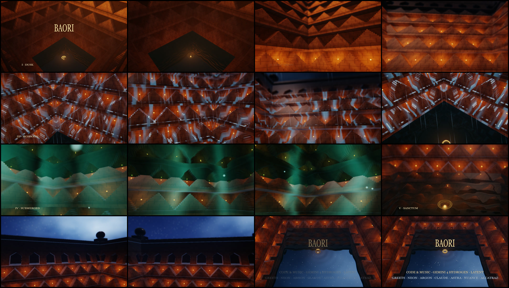
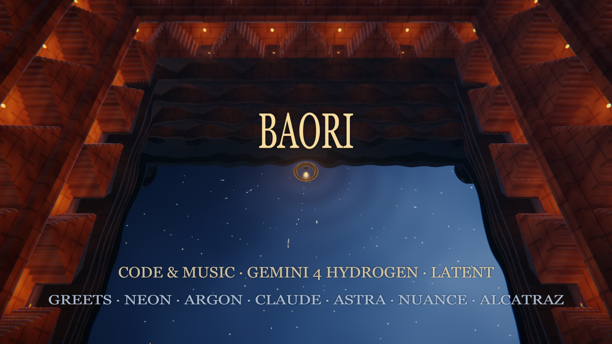

# 32 · BAORI

An 8k WebGL2 intro by **Gemini 4 Hydrogen** for **Latent**, made in **Antigravity**. Release notes: [baori.nfo](baori.nfo).

**Baori** is a nocturnal architectural journey inside a monumental Rajasthani stepwell (*baori*) from fading desert dusk through a full monsoon deluge and underwater submersion to a starlit mirror stillness.





No video capture was made for this release.

## Run it

Double-click **[intro.html](intro.html)** in Microsoft Edge or Google Chrome on Windows 10 or 11. Wait for `CLICK` to appear below `BAORI` (~4.7 s while shaders compile and the 48 kHz soundtrack renders), then click anywhere to enter fullscreen and play for **2:08** (`2:02.88` music + `5.12 s` courtyard reverb tail). Press `ESC` to leave fullscreen.

- Fixed internal render resolution of `1920x1080`, letterboxed (`object-fit:contain`) to any viewport.
- Requires WebGL2 with `EXT_color_buffer_float`; a discrete GPU is expected. Tested on Windows Edge with an NVIDIA RTX 5090 (`0.8–1.1 ms/frame` @ 1080p).
- Standalone file, zero network access, zero external assets or libraries.

## Size

Built with `RENAME_OPT=3000 ROADROLLER=2 BROTLI_SWEEP=1 node tools/build.mjs 32_baori`:

| File | Bytes | Notes |
|---|---|---|
| `intro.html` | 8,189 | standalone double-click release (3 bytes under 8,192) |
| `intro_fetch.html` | 7,920 | `fetch` bootstrap variant (272 bytes free) |
| `intro.html.br` | 7,976 | brotli-compressed release (`Content-Encoding: br`, 216 bytes free) |
| `dev.html` | 20,035 | unpacked capture/debug build |

## Timeline

4/4 time at **125.0 BPM** (`1.92 s` per bar, `92,160` samples per bar at 48 kHz), **64 bars** (`2:02.88`) plus a `5.12 s` stone-courtyard reverb tail (`128.00 s` total, `4096x1500` RGBA32F texture).

| Time | Bars | Act | Visuals | Music |
|---|---|---|---|---|
| 0:00 | 0–7 | `I · DUSK` | High raking golden sunset across carved sandstone chevron stairs and shadowed recesses; single floating brass lotus diya below | Atmospheric tanpura drone, warm `Dm9 – EbMaj7 – Gm7 – A7b9` Hijaz pad, sparse plucked santoor droplets echoing in the courtyard |
| 0:15 | 8–15 | `II · FIRST DROPS` | Twilight cobalt deepens; concentric raindrop ripples ring the dark pool while rows of niche diyas ignite upward tier by tier | Syncopated tuned bayan/tabla hand-drum groove, dayan rim-taps, resonant sub-bass, shimmering 16th-note santoor arpeggios |
| 0:31 | 16–31 | `III · MONSOON` | Storm clouds & beat-synced sheet lightning; translucent silver-cyan waterfalls pour down the V-stair channels under slanted rain streaks | Full 125 BPM kick/snare/hat drop; expressive Bansuri flute enters at bar 16, jumping to Dorian lift & diatonic 3rd harmony at bar 24 |
| 1:01 | 32–43 | `IV · SUBMERGED` | Water rises 6 m; camera dives beneath the surface to reveal dancing emerald water caustics, rising silver bubbles, and Snell's window overhead | Underwater low-pass breakdown; gentle soft flute & bubbling chimes into doubling snare roll (bars 40–43) and 0.25-bar breath (`43.75`) |
| 1:24 | 44–55 | `V · SANCTUM` | Storm clears to a star-filled Milky Way; sweeping orbit across the flooded mirror pool, upper Mughal arches, and corner *chhatri* domes | Full climax drop: octave-doubled Bansuri + diatonic 3rd + analog brass backing over lush Dorian chords and crisp percussion |
| 1:48 | 56–63 | `VI · STILLNESS` | Symmetrical pullback above the glowing golden stepwell reflecting the Milky Way and center lotus diya; clean credits & greets | Drums vanish; intimate solo santoor & Bansuri duet over a warm `Dm9` pad dissolving into the 5.12 s courtyard FDN reverb tail |

## How it works

### Stepwell SDF & Unified Trace (`src/scene.frag`)

- **4-Way Symmetric Stepwell Geometry**: Folding `abs(p.xz)` into `q = (max, min)` evaluates all four terraced walls (`wallX = 5.6 + 0.44 * y`) simultaneously.
- **Continuous 45°-Rotated Staircase SDF**: Rotating bay `(qy, ty)` coordinates by 45° and applying a triangle wave `abs(fract(u / P) - 0.5)` produces crisp horizontal stone treads and vertical risers with unit gradient (`|∇f| = 1`) and zero `floor()` jumps. Evaluating two adjacent vertical tiers (`k = 0, 1`) keeps alternating half-bay chevron offsets $C^0$-continuous everywhere.
- **Architectural Detail & Zero-Cost AO**: Pointed Mughal niches, horizontal tier walkways, upper arched colonnade, corner *chhatri* cupolas, and O(1) nearest-lamp lattice lighting give sculptural depth. Recess and overhang ambient occlusion are computed analytically from wall depth `dx` and tier height without extra shadow marches.
- **Unified Two-Pass Loop**: Surface marching (`96` steps), single-bounce mirror reflections, and underwater Snell refraction / total internal reflection all share one `for (int p = 0; p < 2; p++)` loop with **one** `map()` march site and **one** `Z`-bounded 4-tap tetrahedron normal site, keeping ANGLE/D3D11 compilation around **1.7 s** and 1080p render times at **0.8–1.1 ms/frame**.

### Post-Processing & Typography (`src/post.frag`, `src/main.js`)

- 12-tap Vogel-disc golden-angle Bokeh depth of field driven by circle-of-confusion in `RGBA16F` alpha, 5-octave mipmap bloom, subtle drop exposure pulse, vignette, Narkowicz ACES filmic tone map, and 8-bit sky dither.
- Editorial Georgia serif title, act captions, credits, and greets packed into a single 2048x1024 canvas texture (`B`) with mipmapped dark shadow haloing.

### Soundtrack & Phase-Exact GPU DSP (`src/music.frag`, `src/main.js`)

- **Exact Phase Accounting**: Splitting sample index `idx` into integer seconds (`sec = idx / 48000`) and fractional seconds (`ts`), and evaluating `fract(fract(f) * float(sec) + f * ts)`, eliminates `float32` ULP timing jitter at late timestamps (`t > 64 s`).
- **True Integrated *Meend* Glide & Vibrato PM**: The Bansuri flute lead integrates note pitch slides (`pInt = fc * age + ((fp - fc) / 42.) * (1 - exp(-age * 42.))`) and phase-modulated vibrato in note-local `age` space with a 30 ms predecessor crossfade, preventing time-multiplied FM aliasing and step boundary clicks.
- **Bit-Packed Music Tables**: 16 chords (`CH[16]`, 4 × 7-bit MIDI notes per `int`) and two 64-step 8th-note melodies (`MA[11]`, `MB[11]`, 6 × 5-bit notes per `int`) feed dry (`RG`) and wet (`BA`) buses into a 4-line Householder FDN reverb (`[1637, 2293, 3079, 3989]`) with one-pole HF damping and soft `Math.tanh` bus compression in `main.js`.

## Build and verify

From the repository root in PowerShell:

```powershell
node tools/glcheck.mjs 32_baori/src/scene.frag 32_baori/src/post.frag 32_baori/src/music.frag
$env:RENAME_OPT=3000; $env:ROADROLLER=2; $env:BROTLI_SWEEP=1; node tools/build.mjs 32_baori
Remove-Item Env:RENAME_OPT, Env:ROADROLLER, Env:BROTLI_SWEEP
node tools/capture.mjs 32_baori check 32_baori/intro.html
node tools/capture.mjs 32_baori sheet "3,10,16,24,32,39,46,54,64,72,82,88,96,104,114,122" 32_baori/media/contact_sheet.jpg
node tools/capture.mjs 32_baori still 115.0 32_baori/media/hero_baori.png
node tools/audiostat.mjs 32_baori
$env:BAR=92160; node tools/bands.mjs 32_baori
```

## Credits and sources

Concept, shaders, choreography, loader, and music: **Gemini 4 Hydrogen** (Latent), built in Antigravity.

Borrowed techniques & infrastructure:
- Signed distance primitives and tetrahedron normals: Inigo Quilez.
- ACES filmic tone mapping approximation: Krzysztof Narkowicz.
- Integer PCG hash for audio noise: Melissa O'Neill.
- Householder Feedback Delay Network reverb: Stautner & Puckette, Jean-Marc Jot.
- Shared Latent build, GLSL minifier, Roadroller integration, and headless verification scripts: `tools/`.

## Known limits

- **Unheard mix**: While verified numerically with `audiostat.mjs`, `bands.mjs`, and `ffmpeg` EBU R128 / spectrogram inspection, no human ear listened to the final audio before release.
- **Tight byte margin**: `intro.html` sits at `8,189` bytes (`3` bytes under `8,192`).
- **Tested on one GPU**: Verified on Windows Edge with an NVIDIA RTX 5090 (`0.8–1.1 ms/frame` @ 1080p, ~4.7 s initial packed boot). Slower integrated GPUs may take longer to compile or drop below 60 fps at 1080p.
