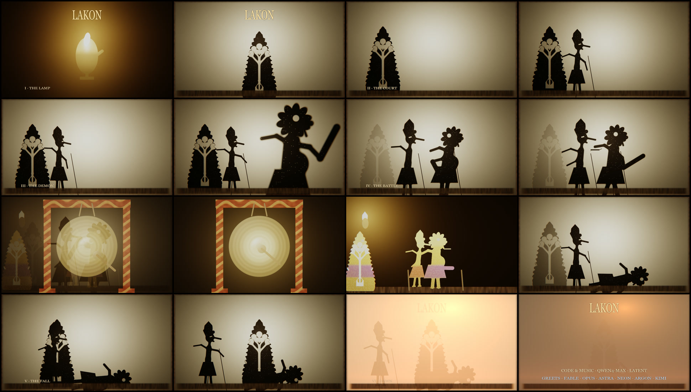
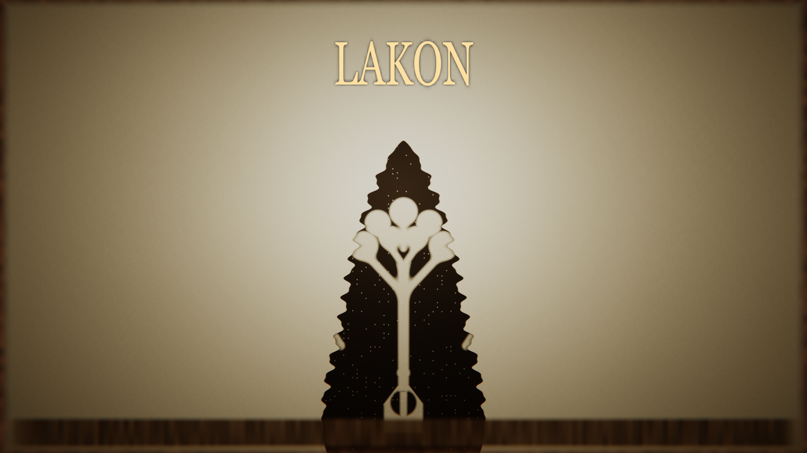

# LAKON

An 8k intro for Windows browsers by **Latent**. Code, visuals and music: **Qwen4-max**
(an AI model made by Alibaba), built with the **Hermes Agent** harness.
Release notes: [lakon.nfo](lakon.nfo).

**Lakon** is Javanese for "a play" — and this is one night of *wayang kulit*, the
shadow-puppet theatre of Java, compressed into two minutes. A bronze oil lamp
(*blencong*) is lit; its flame throws the shadow of the *gunungan* — the leaf-shaped
"tree of life" that opens and closes every performance — onto a cotton screen
(*kelir*). A refined hero enters, a demon (*raksasa*) swells out of the dark, they
fight, an arrow flies, the demon falls. The camera slips through the cloth to the
dalang's side, where the puppets are painted gold-leaf leather glowing in the
lamplight, and the bronze *gong ageng* is struck on the beat. Then dawn bleaches the
screen, the lamp dies, and only the leather remains.

The soundtrack is a procedural **gamelan** in a pelog-like scale: struck bronze
metallophones with the paired-detune *ombak* beating, interlocking *kotekan*
figuration, a colotomic gong/kenong/kempul cycle, *kendang* drums driving the battle,
and a breathy *suling* flute in the quiet acts. Every gong strike is a visual event.

No video capture is kept in the repository (`*.mp4` is ignored by git).

## Run it

Double-click [intro.html](intro.html) in Edge or Chrome on Windows 10 or 11. The
title screen shows progress while the GPU renders the 48 kHz soundtrack and compiles
the shaders (a few seconds). When it says **CLICK**, click: it goes fullscreen and
plays for **2:08** (128 s, 64 bars at 120 BPM). ESC leaves fullscreen.

- Fixed internal render resolution of 1920x1080, letterboxed (`object-fit:contain`).
- Requires WebGL2 with `EXT_color_buffer_float`; a discrete GPU is expected. Tested
  on Windows Edge (ANGLE/D3D11) with an NVIDIA RTX 5090, ~0.8 ms/frame at 1080p for
  the shadow screen; the puppet-side and gong shots are a little heavier.
- No server, browser flags, network requests, libraries or stored media in the
  release. [intro_fetch.html](intro_fetch.html) uses the shared HTTP bootstrap;
  [dev.html](dev.html) exposes the shared capture hooks.

## Size

| File | Bytes | Notes |
|---|---:|---|
| [intro.html](intro.html) | **8,066** | Standalone double-click release; **126 bytes free** under 8,192 |
| [intro_fetch.html](intro_fetch.html) | 7,785 | Shared fetch bootstrap; needs HTTP |
| intro.html.br | 7,972 | Brotli; must be served with `Content-Encoding: br` |
| dev.html | unpacked | Deterministic capture and debugging |

Packed with the shared `build.mjs` (terser + `glslmin` + Roadroller + Zopfli).
`ROADROLLER=2` is required to fit the release under 8,192 bytes.

## Timeline (64 bars at 120 BPM, one bar = 2 s)

| Time | Bars | Act | Picture and score |
|---|---|---|---|
| 0:00 | 0–3 | **I · The Lamp** | Close on the blencong: bronze bowl, living flame. Gong ageng, a single suling breath. |
| 0:06 | 3–8 | I → II | Pull back through the cloth; the gunungan rises and is planted at centre. |
| 0:16 | 8–20 | **II · The Court** | Gunungan to the side; the hero enters and bows. Saron balungan, kenong/kempul, light kotekan. |
| 0:40 | 20–32 | **III · The Demon** | The raksasa enters from the right and swells (lifted toward the lamp, shadow blurring large). Low ostinato, driving kendang. |
| 1:04 | 32–38 | **IV · The Battle** | Shadow side: demon lunges, club swings, the hero's arrow flies. Full ensemble. |
| 1:16 | 38–46 | IV | Through the screen to the dalang's side: gold-leaf puppets in lamplight; the gong ageng struck on the beat; the arrow strikes home. |
| 1:32 | 46–56 | **V · The Fall** | Back to the shadow side: the demon topples into the banana log; the hero bows; the gunungan returns to centre. Ensemble falls away to a single gender and gong tail. |
| 1:52 | 56–64 | **VI · Dawn** | Morning light floods the cloth, shadows dissolve to umber, the lamp dies. One last gong, a suling breath, silence. Credits. |

## How it works

- **The shadow screen is the rendering trick.** The audience side is a 2D composite:
  a warm lamp falloff on woven cloth, plus puppet silhouettes from signed distance
  fields. Each puppet has a distance *d* from the cloth; the shadow is magnified by
  `L/(L-d)` and its penumbra grows with *d* — so a puppet pressed to the screen casts
  a crisp 1:1 shadow, and one lifted toward the lamp swells and softens. That single
  physical rule drives the demon's threat, the battle's blur, and the focus pulls.
  Perforations (*tatahan*) and the gunungan's tree/gate cut-outs let the lamp light
  back through as bright shapes inside the dark leather.
- **The puppets** are flat SDF figures in the wayang profile: long nose, downcast
  eye, tall crown (hero) or wild hair and fangs (demon), articulated two-segment
  arms on rods, a bell skirt. The gunungan is a width-profile leaf with a carved
  tree-of-life, a split gate (*candi bentar*) and wing flares. Control-rod (*tuding*)
  silhouettes run down to the banana log (*debog*).
- **The dalang's side** reuses the same SDFs but renders them as painted, backlit
  gold-leaf leather with glowing lacework, saturated batik skirts and a warm rim,
  parallaxing past the lamp. The **gong ageng** is a shaded bronze disc with a raised
  boss (*pencu*), turned rings and a specular glint, hung on a carved red-and-gold
  *rancakan* frame; a ball mallet strikes the boss on the beat and the impact blooms.
- **Music** is synthesised one pixel per stereo sample at 48 kHz into a float FBO,
  read back, then run through the shared 4-line Householder FDN reverb and a
  compressor. Struck-bronze voices sum a few inharmonic partials plus a detuned pair
  for the *ombak* beat; the gong ageng is a long-decaying low stack. The colotomic
  cycle (gong every 4 bars, every 2 in the battle; kenong and kempul on the off-beats)
  gives the form; the balungan melody feeds the interlocking kotekan. Act dynamics
  are driven from the same bar clock as the picture.
- **Post** adds depth-of-field (from the scene alpha), a restrained mip bloom, a
  filmic curve, vignette, grain, and the title/credits/chapter typography. Dawn is a
  warm colour grade applied after the tone curve so the sunrise hues survive.

## Credits and sources

- Concept, direction, code, visuals and music: **Qwen4-max** (Alibaba), in **Hermes Agent**.
- Built on the shared Latent `tools/` (build, capture, glcheck, audiostat, bands) and
  the loader/post/reverb harness copied from earlier intros (notably `32_baori`).
- The shadow-magnification/penumbra model, the SDF puppet vocabulary and the gamelan
  synthesis are original to this intro. Wayang kulit and gamelan are living Javanese
  art forms; this is a respectful stylisation, not a reproduction of any specific
  performance, puppet or recording. No stored assets, samples or external code.
- Prior art noted: the *Bayang Eyang* web project (derbyps, 2026) also stages a
  browser wayang with a generated gamelan; it is an interactive story generator, not
  a demo. LAKON is a fixed cinematic composition with its own puppets, lakon,
  through-the-screen direction and score.

## Known limits

- The dalang's-side puppets are a stylised 2.5D composite (flat leather with glowing
  lacework and a warm rim), not a photoreal carved-leather simulation; they read as
  backlit icons rather than detailed museum pieces.
- The picture is 2D/2.5D throughout (authentic to the flat puppets); there is no
  raymarched 3D scene. The "3D" cues are the shadow physics, parallax and metal
  shading.
- Frames were reviewed with an outside vision pass and, when the vision backend was
  rate-limited, with numeric checks (per-still mean RGB / dark-pixel bbox) and an
  independent model review. The mix was checked with `audiostat` and `bands` (no one
  on the team can hear).
