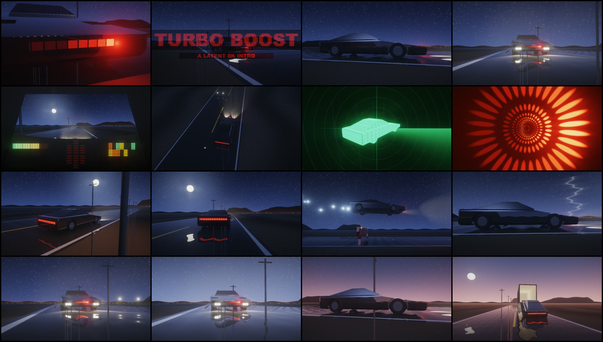

# Turbo Boost

An 8k intro by **Latent**. Code, picture and music: Claude Opus 5.5, in Claude Code.
`intro.html` is 7,828 bytes and runs on double-click in Edge or Chrome on Windows.



## What it is

A night drive for the talking car of 1982: a homage to *Knight Rider*, its black car
with the red scanner in the nose, and 80s television in general. 127 seconds at 128 BPM.

The brief was "a demo about KITT and Knight Rider and the 80s". The intro uses none of
the show's material. The car is an original low wedge, not a copy of the real one,
the show's name and characters are not on screen, and the music is a new theme in the
style of 80s TV action music, not the show's theme. What it takes from the show is
the general picture: a scanner that sweeps from side to side, a dashboard with a
voice box, a turbo-boost jump, a trailer with a ramp, night roads that the film
crew has wetted down.

## Timeline

| Bars | Seconds | Music | Picture |
|---|---|---|---|
| 0-8 | 0-15 | pad, the scanner's whoosh from ear to ear, filtered bass | scanner close-up, pull back, title in LED dots |
| 8-16 | 15-30 | drums and sixteenth-note bass | side and front tracking shots on the desert highway |
| 16-20 | 30-37.5 | the voice module speaks | dashboard: voice box, speedometer bar, blinking lamps |
| 20-28 | 37.5-52.5 | theme A on synth brass | helicopter shot, green vector screen "systems check" |
| 28-32 | 52.5-60 | arpeggio | tunnel of scanner lamps |
| 32-40 | 60-75 | break with voice and scanner; snare roll and riser | parked under a street lamp; chase towards a barricade |
| 40-56 | 75-105 | theme B twice, orchestra stabs | turbo boost over the barricade in slow motion with sparks from the exhaust, then cuts every two bars; lightning over the mesas on every stab |
| 56-64 | 105-120 | theme A a whole tone higher, octave below | dawn; the car drives up the ramp into a lit trailer |
| 64-68 | 120-127.5 | last hit, scanner fades | scanner close-up, "LATENT" |

## How it works

- **Scene** (`src/scene.frag`): the car is a few signed distance fields (a wedge body,
  a cabin cut by two raked planes, wheel arches, wheels). The ground is a plane hit
  analytically, so only the car, telephone poles, barricade, street lamp and trailer
  are ray-marched. The road is wet: a second march along the reflected ray puts the
  car, its lights and the sky on it. Light comes from the moon, a blue fill from the
  camera side, two headlight cones, the scanner head (it lights the road red) and the
  street lamp. The headlight beams in the air are 32 samples along the view ray. Oncoming cars on the other lane, a town glittering on the horizon, and, in the chorus, a storm whose lightning flashes on every orchestra stab (a bolt in the sky, the flash lighting the black paint). Lamps are glows around points, added for the view ray and again for the ray reflected off the wet road, so their reflections streak on the asphalt.
- **Sync**: one formula for the scanner head, `-cos(t·π/beat)`, drives the lamps in the
  nose, their trail, the halo, the red light on the road, the tunnel rings, the sweep
  across the LED lettering and, in `music.frag`, the stereo position and loudness of
  the scanner's whoosh. The voice box shows the same syllables that the voice sings:
  both shaders compute them from the same integer hash of the sixteenth. Exposure
  pulses on each beat, a flash on the drop, lightning on the stabs, cuts on bar lines.
- **Dashboard** and **vector screen** are drawn in 2D on top of the 3D view; the vector
  screen shades the car with silhouette edges and slice lines in green phosphor over
  a radar sweep. The tunnel is a 2D polar effect whose rings each run their own
  scanner, a little later than the one in front.
- **Music** (`src/music.frag`): one pixel per stereo sample, 4,096 x 1,518 floats, sum of
  harmonics weighted by a resonant low-pass response (the method of intro 27).
  Sixteenth-note octave bass, a pad of detuned saws, square-wave arpeggio, synth brass
  with a swelling filter and glide, orchestra stabs, kick, gated snare, hats, toms,
  a snare roll that doubles its speed, and a robot voice: a 100 Hz buzz whose
  harmonics are weighted by two vowel formants, one random vowel per syllable; the rest of the mix ducks by up to 40 % under each syllable so the voice is heard.
  `main.js` adds a ping-pong echo of three sixteenths and a feedback-delay hall on the
  send channels and soft-clips the sum. About -16 LUFS.
- **Post** (`src/post.frag`): mip-chain glow, an anamorphic horizontal streak and a
  short vertical spike (a TV star filter), vignette, ACES fit, scanlines, grain, and all
  lettering as red LED dot matrix sampled from a canvas texture.

## Credits and sources

- Loader, music texture layout, harmonic-sum synthesis and the echo/hall code come from
  Latent's own intro 27 (Wavefolder).
- Box SDF after Inigo Quilez; ACES fit by Krzysztof Narkowicz; float hash by Dave
  Hoskins; integer hash after the PCG hash by Melissa O'Neill.
- Vowel formant frequencies after Peterson & Barney (1952).
- Feedback-delay hall after Jot & Chaigne.
- *Knight Rider* (1982-86) and its car are the inspiration; nothing from the show
  (theme, sound effects, footage, logo) is used.

## Build

From `Latent_8k/` in PowerShell:

```
$env:ROADROLLER=2; node tools/build.mjs 37_turbo_boost      # without Roadroller intro.html is over 8,192 bytes
node tools/capture.mjs 37_turbo_boost check 37_turbo_boost/intro.html
node tools/capture.mjs 37_turbo_boost sheet "3.75,11.25,18.75,26.25,33.75,41,50,56.25,63.75,71.25,79,88,101.25,108.75,117,125"
```

## Known limits

- Nobody on the team can hear: the mix was checked with `bands.mjs`, a spectrogram and
  a loudness meter only. The robot voice in particular is untested by ear.
- Start-up is about 6 s on an RTX 5090 (mostly shader compile on D3D11).
- The car is dark by design; on a poorly calibrated screen the night shots may look
  very dark.
