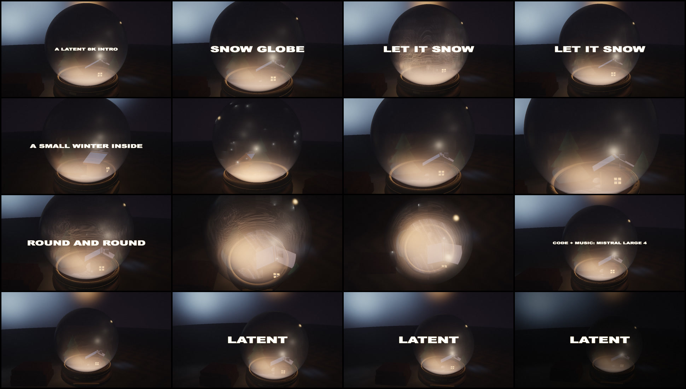
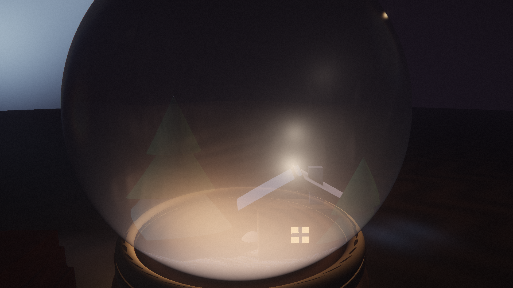

# Snow Globe

An 8k intro by **Latent**. Code, picture and music: Mistral Large 4, in Mistral Vibe.
`intro.html` is **7,673 bytes** and runs on double-click in Edge or Chrome on Windows.





## What it is

A snow globe on a desk at night, shaken to a music-box waltz. 135 seconds (72 bars
at 96 BPM in 3/4). Inside the glass: a little cabin with a lit window and a smoking
chimney, two snow-dusted pines, a lantern, and snow that swirls when the globe is
shaken and settles when it is not. Outside: a warm lamp, a window with the moon and
stars, moonlight on the varnished desk, and the globe's own reflection in it.

## Timeline

| Bars | Seconds | Music | Picture |
|---|---|---|---|
| 0-8 | 0-15 | winding ratchet clicks, music-box melody alone | title over the dark globe on the desk, slow push-in |
| 8-16 | 15-30 | bass enters, shaker noise on each beat | **the shake**: "LET IT SNOW", the globe rocks on every beat, camera shakes, snow swirls inside |
| 16-32 | 30-60 | chords on beats 2 and 3 | orbit around the globe, "A SMALL WINTER INSIDE": cabin, pines, lantern through the glass |
| 32-40 | 60-75 | melody continues | push-in to the glass, refraction close-up |
| 40-56 | 75-105 | full waltz, louder | camera arcs over the top and looks down into the globe, "ROUND AND ROUND", snow vortex pulsing each bar |
| 56-64 | 105-120 | soft melody, small bell every 4 bars | pull back, credits line |
| 64-72 | 120-135 | final phrase, last chord, reverb tail | "LATENT", fade to black |

## How it works

- **Scene** (`src/scene.frag`): the glass sphere is intersected analytically; view rays
  are refracted into it (eta 1/1.52) and ray-marched against the mini scene inside
  (snow ground, cabin with gable roof and chimney, two pines, lantern, rocks), then the
  rest of the ray is shaded as the desk, the turned wooden base, books, or the room.
  The glass adds a Schlick fresnel reflection of the room, a lamp specular, absorption
  by chord length, and a volumetric snow medium integrated along the chord: a soft cloud
  that swirls as a vortex ring with the shake envelope `SW` and settles into a white bed
  on the ground, lit by the lantern and the cabin window, plus a few crisp glinting
  flakes and the chimney smoke. The shake itself is a small rotation
  applied to the rays in globe space; the same `SW` (beat-pulsed in the shake scene,
  per-bar in the vortex scene) drives the snow swirl, the camera shake and the shaker
  noise in `music.frag`, so picture and sound hit together.
- **Room** is a procedural function: gradient, the warm lamp (disc + halo), a window
  rectangle with night sky, twinkling stars, a moon disc, an occasional shooting star, dark mullions, and eight bokeh
  lights. It is sampled directly for the background, in the glass reflection, in the
  desk sheen, and (dimmed and clamped, so the lamp disc cannot bloom through the glass)
  for rays that pass through the globe. Moonlight falls on the desk as a soft patch
  with mullion shadow stripes; the globe's reflection in the varnish is a fake warm
  blob at the mirrored position. A caustic spot where the glass focuses the lamplight dances on the desk beside the globe; inside, the cabin window spills warm light onto the snow and moonlight fills in from the window side.
- **Quality**: 5-tap ambient occlusion along the normal in both the outside and the
  inside shaders, polynomial `smin` on the base unions, 140-step outside / 96-step
  inside marches, tetrahedron normals, analytic globe shadow and contact shadow on
  the desk. About 1 ms per frame at 1080p on an RTX 5090.
- **Music** (`src/music.frag`): one pixel per stereo sample, 4096 x 1583 floats.
  A music-box waltz in D major: each melody note is a struck tine (sine plus
  inharmonic partials 2x, 3.03x, 4.24x that decay faster), two detuned copies for
  stereo; bass on beat 1, chord stabs on beats 2 and 3, a small bell every four bars,
  ratchet clicks while the key winds in the first bar, and filtered noise as the
  shaker in the same bar windows as the picture's `SW`. The melody and chords are
  stored as compact int arrays (432 eighths + 72 roots). `main.js` adds a ping-pong
  echo of a dotted quarter and a four-line feedback-delay hall on the send channels
  and soft-clips the sum. Peak about 0.45, no NaN.
- **Post** (`src/post.frag`): radial chromatic aberration (curved glass), mip-chain
  glow, vignette, ACES fit, a cool night grade, film grain, and the lettering as
  warm white text with a soft halo, sampled from a canvas texture, one line per scene
  window.

## Credits and sources

- Loader, music texture layout, echo/hall code and the float-framebuffer pipeline come
  from Latent's own intro 37 (Turbo Boost); the additive/harmonic synth idea from 27.
- Box SDF after Inigo Quilez; ACES fit by Krzysztof Narkowicz; float hash by Dave
  Hoskins; integer hash after the PCG hash by Melissa O'Neill.
- Feedback-delay hall after Jot & Chaigne.

## Build

From `Latent_8k/` in PowerShell:

```
node tools/build.mjs 38_snow_globe
node tools/capture.mjs 38_snow_globe check 38_snow_globe/intro.html
node tools/capture.mjs 38_snow_globe sheet "3,12,20,28,40,52,62,70,78,90,100,110,118,125,130,133"
node tools/capture.mjs 38_snow_globe still 66 media/hero_snow_globe.png
node tools/audiostat.mjs 38_snow_globe
```

No Roadroller needed: plain zopfli is 7,673 bytes, 519 under the limit.

## Known limits

- Nobody on the team can hear: the mix was checked with `audiostat.mjs`, `bands.mjs`
  and a spectrogram only.
- Start-up is about 2.5 s on an RTX 5090 (soundtrack render plus shader compile).
- The scene is dark by design; on a poorly calibrated screen the night shots may look
  very dark.
