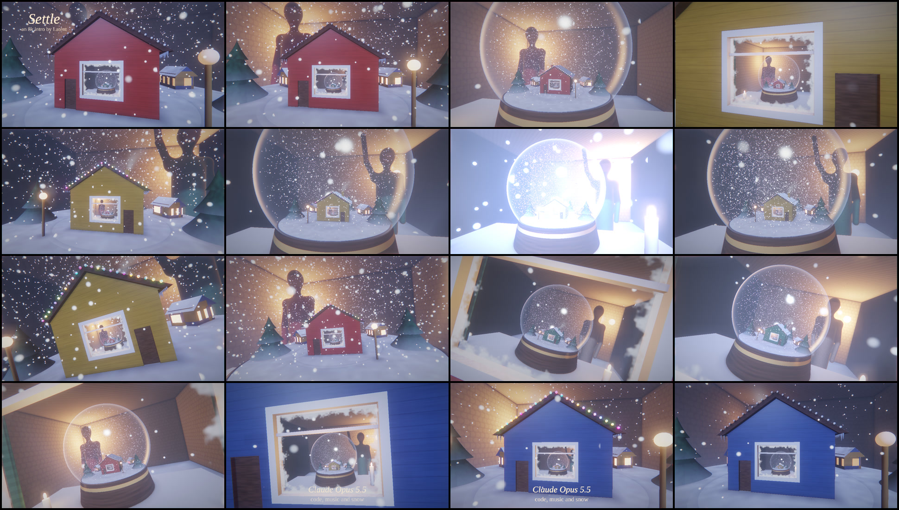

# Settle

An 8k intro by **Latent**: one continuous shot that never cuts and never ends. A red
wooden house stands in a snowy village. Through its window you see a snow globe on the
sill, and in the globe a village with a red wooden house, through whose window you see a
snow globe on the sill... The camera pulls back out of one globe, through the window,
past the house, out of the globe the village stands in, and into the next room, for as
long as the music lasts. A music-box waltz in D minor plays over it; when the music is
shaken, so is the snow.

The levels are almost, but not quite, the same. Each house is painted differently (falu
red, ochre, slate blue, green), every other level is a mirror image with its moonlight
from the other side, the candle on the sill is a little further burnt down in every room
further out, and in each room someone stands behind the globe and watches it. In one
room of four they wave at you; in one the room is empty.

Made by **Claude Opus 5.5** (concept, code, picture and music) in Claude Code.

Note: [38 Snow Globe](../38_snow_globe/) (Mistral Large 4) was made in parallel and also
chose a snow globe and a music-box waltz at 96 BPM; the two were made without seeing each
other. Settle's subject is the nesting: globes inside houses inside globes, each level a
little different.

## Timeline (64 bars of 3/4 at 96 BPM, 2:04)

| bars | music | picture |
|---|---|---|
| 0-7 | the theme on the music box alone, the mechanism ticking | a village in a globe, the house lights low; a candle burns on the sill; title |
| 8-15 | second half of the theme; waltz bass and strings enter | the lamps come up; the camera starts to pull back |
| 16-31 | the theme again with a harp arpeggio and a cello line; a rising wash at the end | the pull-back gathers speed: globe, window, house, village, globe; fairy lights on the gables |
| 32 | the shake: a low blow and a crash of glass | white flash; every globe's snow is thrown up and set spinning |
| 32-47 | theme with drums, brushes and sleigh bells, music box doubled an octave up | the camera turns and dives inwards through two levels, rolling, shaking on each downbeat; fairy lights blink on the beats |
| 46-47 | a noise swell builds | the dive slows to a halt |
| 48-55 | a crash on the downbeat and the climax a whole tone up, in E minor; the strings open up | a soft flash; the camera pulls out again, fast, through two and a half levels |
| 56-63 | back in D minor: the second half of the theme on the music box alone | it slows and stops in exactly the framing it began with, two levels further out: a blue house where there was a red one; the snow thins out and settles, the lamps go down; credits |
| 64 | D major chord | fade |

The geometry is self-similar, so the last frame has the first frame's composition; only
the paint, the mirror side, the candle and the watcher tell you that you are somewhere else.

## How it works

- **One level** (`L()` in `scene.frag`): a house shell with a window, a gable roof slab,
  chimney, curtains, sill, candle, room lamp, a snow globe base, and inside the globe a
  snow mound, four tiered pines, two cottages and a street lamp. Fairy lights are a
  repeated sphere along the front gable edges.
- **Variations per level** (`L(p,n)`): every level gets its absolute index `n` (the
  integer part of the camera's cycle count, plus its offset in the loop), so a level keeps
  its look while it passes from child to current to parent and the swap stays invisible.
  `n` picks the paint and the watcher's pose, mirrors `x` on odd levels (the fixed point
  is on `x=0`, so the nesting is unchanged) and sets the candle height. Shading happens
  in the hit level's own, mirrored space; the street lamp and window spill of the
  village around a house come from the level above, mapped into that space.
- **The watcher**: capsules and an ellipsoid head joined with a polynomial smooth
  minimum; lit only where the window's moonlight falls, with a warm rim from the lamp.
- **The recursion**: the next level down is the same function shrunk by 1/20 about a
  fixed point `F`, chosen so that the child's house floor lands on the parent's snow mound
  at the centre of the globe (`F = (C - s*c0)/(1-s)`). `map()` evaluates four levels
  (parent, current, child, grandchild), each with its distance scaled back; the two inner
  ones are skipped behind a bounding sphere. The village props are bounded by their globe.
- **The camera** only moves along `F + v*r`. Its log-distance is `u*ln 20`, where `u`
  (cycles) is a sum of smoothsteps over the bars: +1.5, -2, +2.5. Only `fract(u)` is
  used, so the scene is always rendered at the same scale range and precision never runs
  out; the swap from one level to the next is invisible because the picture is the same.
- **Glass**: thin spheres, not marched. Each of the four globes is intersected
  analytically; at each crossing in front of the hit a Fresnel rim, the moon highlight
  and the lamp highlight are added.
- **Snow**: per globe (three levels), a jittered grid sampled along the ray where it is
  inside the globe, one sample per cell. The grid falls and turns with the water: a rigid
  rotation about the globe axis, which reads as a swirl because the outer flakes move
  fastest. Each column of cells falls at its own speed and every flake drifts on its
  own, with a wide spread of sizes, so the grid does not show. At the shake the spin jumps and the flakes are thrown up, then both decay.
  Density thins at the end so the snow "settles".
- **Light**: moonlight comes in from the window side at every level; indoor surfaces get
  it only where it falls through the window opening (projected onto the window plane).
  The warm room lamp lights the room and the globe, the candle flickers, and outdoor
  points are lit by the street lamp and the window spill of the village they stand in,
  which for a house's outside is the level above. Snow sparkles where a hash of the
  position says so.
- **Music** (`music.frag`): the 16-bar theme as one array of 96 eighth notes, chord roots
  per bar. The music box is a struck steel tine: fundamental, a weak second harmonic and
  the comb's inharmonic modes at 6.27 and 17.5 times, which die fast; a re-evaluated echo
  at 1.5 and 3 eighths stands in for reverb. A harp plays an FM-bell arpeggio over the
  chord, a cello (six harmonics with vibrato) bows the chord's third and then its fifth,
  a half bar each, so it moves in two against the waltz's three, the strings are a band-limited detuned saw pad, the bass plucks the root on one.
  Kick on one, brush and sleigh bells (four high partials times noise) on two and three.
  Bars 48-55 are transposed up a whole tone (`kt()`), every voice with them.
  A noise wash rises into the shake, which is a pitched-down blow plus a noise crash.
  The track is rendered in 64-row strips so no single draw runs long.
- **Materials**: one value-noise function drives them all. Painted siding with a slightly
  different shade per board and grain showing through; wide glossy floor planks with gaps;
  patterned wallpaper; lacquered wood on the globe base with long grain and a polished
  brass band (coloured specular); needle texture on the pines; wax that glows near the
  flame; snow with a little relief (noise-perturbed normals) and unevenness. A shared
  Blinn-Phong term per material catches the moon, the room lamp and the candle.
- **Frost**: every window has a pane, placed analytically (no marching) at three levels:
  a faint tint across it, and frost growing in from the corners, shaped by the distance to
  the nearest edge plus two octaves of noise.
- **Details**: icicles along the eaves (repeated cones, a random length per icicle and
  per level), a front door set into the wall beside the window, the lamps 40 % brighter
  during the key change, and slight lens fringing towards the frame edges in post.
- **Smoke**: five puffs per chimney rise, swell, drift with the wind and fade; each is a
  Gaussian of the ray's distance from its centre, drawn only where that closest point
  lies outside the house it belongs to, so it never shows through a wall.
- **Glows and air**: candle flames and street lamps get an analytic halo (inverse square
  of the ray's distance from the light, occluded by the hit distance) at three levels.
  Moonlight hangs in each room's air: 16 jittered samples on the ray's segment inside the
  room box, each projected along the moon direction onto the window plane.
- **Post**: bloom from 9-tap kernels on three mip levels (smooth, no blocky texels), ACES fit, vignette, grain, the shake flash, text
  from a canvas texture.

## Sizes

| file | bytes |
|---|---|
| `intro.html` | 8,071 |
| `intro_fetch.html` | 7,788 |
| `intro.html.br` | 7,024 |

Built with `node tools/build.mjs 39_settle` (built-in GLSL minifier, no Shader Minifier,
no Roadroller).

## Checks

- `capture.mjs check intro.html`: reaches "click to shake", starts on click.
- `audiostat.mjs` (earlier build) and `bands.mjs` (final): no NaN; peak 0.58 to 0.83 per
  section. On the software renderer `audiostat.mjs` now times out in its 1080p frame
  timing, after the sound checks. Integrated loudness about
  -12 LUFS (`ffmpeg -af ebur128`).
- `bands.mjs`: solo music box sits at 400 Hz-1 kHz with 7 % above 2.5 kHz; with the band
  about 20-30 % is in 60-150 Hz and 10-14 % in 150-400 Hz.
- Frame cost was not measured on a GPU. On the software renderer used here, a frame at
  640x360 took about 200 ms, against 300 to 420 ms for Una Corda (2-4 ms at 1080p on a
  real GPU), so expect a few ms at 1080p.

## Known limits

- The intro was made on Linux with headless Chromium on a software renderer (llvmpipe);
  it has not yet been run on Edge with a real GPU.
- Nobody on the team can hear; the mix was checked with band energies, peak and loudness.
- The inner face of a globe shows the moon highlight cut off by the snow line when the
  camera is inside a globe; it is physically right but can read as a small white shard.
- The fairy lights are unlit white bulbs before bar 16.

## Credits

- Concept, code, picture and music: Claude Opus 5.5.
- Loader, build and capture tools: Latent's shared `tools/`.
- Techniques: sphere tracing and SDF operators after Inigo Quilez; self-similar zoom by
  scaling the distance field about a fixed point (a standard Droste/infinite-zoom trick);
  ACES fit by Krzysztof Narkowicz; hash after Dave Hoskins; music-box tine modes after
  the cantilever-beam mode ratios (1 : 6.27 : 17.55).
