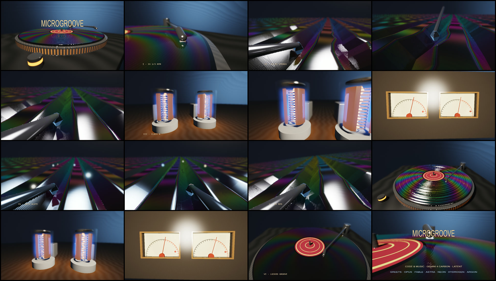
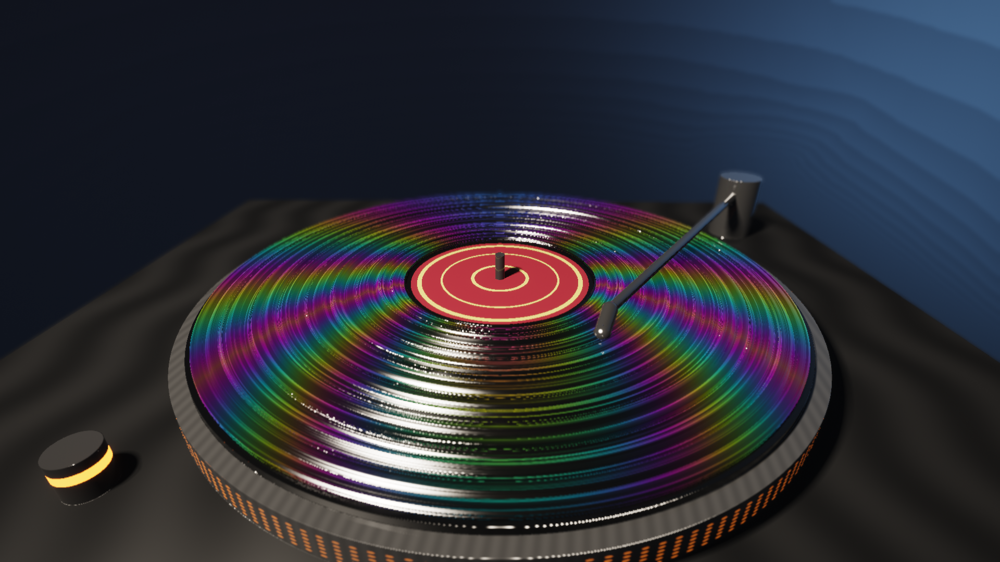

# Microgroove

An 8k intro for Windows browsers by **Latent**. Code, visuals, and music: **Gemini 4 Carbon** (an AI model made by Google DeepMind), working in Antigravity. Release notes: [microgroove.nfo](microgroove.nfo).

**Microgroove** traces one continuous analog signal path at midnight: cueing up a 12-inch vinyl record under a neon-orange stroboscope turret, dropping the diamond onto the lacquer, diving down into the curved obsidian-black **45/45 stereo V-groove canyon** beneath an octahedral pure-carbon stylus, driving twin **Class-A vacuum tubes** (2400 K helical tungsten heaters and cobalt-violet electron plasma) and **dual backlit analog VU meters**, braking into electrostatic dust stillness, surging into **45 RPM electro-funk overdrive** across a radial rainbow-diffracted waveform LP, and lifting the stylus cleanly off its vinyl reflection in the run-out groove.





No video capture was made for this release.

## Run it

Double-click **[intro.html](intro.html)** in Edge or Chrome on Windows 10 or 11. The screen shows `MICROGROOVE` while the soundtrack renders and the shaders compile (`~4.4 s` on the test machine). When `CLICK` appears, click anywhere to enter fullscreen and play for `2:02.88`. Press `ESC` to leave fullscreen.

- Target: Edge or Chrome on Windows 10 or 11 with a discrete GPU. Tested on Edge with an NVIDIA RTX 5090, where a 1920x1080 frame takes **2.1–5.9 ms** across all acts.
- Fixed internal render resolution of `1920x1080`, letterboxed to fit the viewport.
- No server, external assets, or browser flags are required.

## Size

| File | Bytes | Notes |
|---|---|---|
| `intro.html` | 8,187 | standalone release (`RENAME_OPT=3000`, `ROADROLLER=2`); 5 bytes under the 8,192-byte limit |
| `intro_fetch.html` | 7,905 | same intro with the `fetch` bootstrap (`http://` or `--allow-file-access-from-files`) |
| `intro.html.br` | 7,903 | brotli build (`tools/serve_br.ps1`) |
| `dev.html` | 20,164 | unpacked build used for capture and debugging |

## Why this concept

Looking across Revision 8k winners and the existing Latent catalog, none of the earlier productions explored the physical mechanics of **analog vinyl playback and hi-fi amplification** — stroboscopic platter dots, 45/45 Westrex stereo groove modulation, octahedral carbon crystal refraction, Class-A vacuum tube plasma, and ballistic needle meters — driven causally from the same pre-rendered audio buffer. Pairing real-time lookahead stereo geometry with a 125 BPM French-Touch electro-funk soundtrack locks every groove bend, tube pulse, and VU deflection directly to the soundtrack.

## Timeline

4/4 time at **125 BPM** (`1.92 s` per bar, `0.12 s` per sixteenth, `92,160` samples per bar at `48 kHz`), **64 bars** (`122.88 s`, `5,898,240` stereo samples = `4096 × 1440` texels exact).

| Time | Bars | Act | Visuals | Music |
|---|---|---|---|---|
| 0:00 | 0–7 | `I · 33 1/3 RPM` | Dark plinth, brushed platter with neon-orange strobe dots & chrome turret, tonearm cueing; diamond drops onto its vinyl reflection at bar 4 | Filtered Rhodes FM electric piano & warm resonant chord pad, vinyl crackle, bar 4 needle-drop thump & sub bass entry |
| 0:15 | 8–21 | `II · 45/45 STEREO` | Microscopic curved obsidian V-groove canyon with diffraction iridescence and pure-carbon octahedral diamond on brushed cantilever | Sidechained French-Touch groove locks in: 4/4 kick, 3-tap clap/snare, 16th hi-hats, octave slap funk bass, clavinet chops, and resonant sync lead (bar 12) |
| 0:42 | 22–31 | `III · CLASS A` | Twin Class-A vacuum tubes (slotted dark anodes, helical gold grids, 2400 K tungsten heaters, cobalt-violet plasma), then dual backlit analog VU meters | Full F-Dorian groove (`Fm9 – Abmaj9 – Bb13 – Db9/C7#9`) with 16th funk chops and bar 31 snare dropout |
| 1:01 | 32–39 | `IV · ANTI-SKATE` | Cool-lit twilight canyon with 12 floating electrostatic bokeh dust orbs drifting above slow vinyl swells | Turntable power-brake pitch drop at bar 32, open atmospheric Rhodes breakdown (`Dbmaj9 – Bbm11 – Fm9 – C7sus4`), snare build on bar 39 |
| 1:16 | 40–55 | `V · 45 RPM` | Overdrive canyon chase, radial 3D rainbow-diffracted audio spectrum LP (bars 44–47), hot tube closeup (48–49), pegged VU meters (50–51), final canyon chase | Overdrive anthem modulation (`Dbmaj9 – Eb6/9 – Fm9 – Ab13`) with octave + fifth harmonised lead hook and wide bass filter |
| 1:47 | 56–63 | `VI · LOCKED GROOVE` | Return to calm mirror LP run-out groove, concentric crimson/gold label, cueing lift of diamond off vinyl reflection, credits & greets | Picardy `Fmaj9` warm Rhodes & sustained pad fading cleanly through dust into silence |

## How it works

### Four raymarched stages (`src/scene.frag`)

One SDF shader switches cleanly across four stages (`ST = 0..3`) indexed per 2-bar block via `SQ[32]`:
1. **Turntable & Spectrum LP (`ST = 0`)**: Plinth, bevelled platter with rotating stroboscope dot matrix (`atan` + monotonic `PHI`), chrome strobe turret with orange slit ring, spinning vinyl LP (lifting into a Lipschitz-safe 3D radial waveform spectrum during bars 44–47), concentric burgundy/gold center label, pivot tower, tonearm, and diamond stylus.
2. **45/45 Stereo Vinyl Canyon (`ST = 1`)**: Curved 3-neighbor stereo groove evaluation (`gc - 1 .. gc + 1`) sampled from `sampler2D B` with forward audio lookahead (`T + p.z * 0.048`), smooth ridge bevels, diffraction grating iridescence, octahedral carbon diamond, chrome cantilever, and floating breakdown bokeh orbs (`bars 32–39`).
3. **Class-A Vacuum Tube Preamp (`ST = 2`)**: Twin tube sockets, slotted carbon anode wings, helical gold grids, 2400 K tungsten heaters, and analytic outer cylindrical glass envelopes with volumetric cobalt-violet ionized plasma modulated per channel (`AU.b`, `AU.a`).
4. **Dual Backlit Analog VU Meters (`ST = 3`)**: Champagne-bronze fascia, gold bezels, recessed backlit amber cards with procedural black/red dB tick arcs, `+3 dB` ruby peak LEDs, and physical 3D red needles driven by the left/right ballistic followers.

**Audio-visual lock (`src/main.js` -> Texture Unit 2):** After JS post-processing, `main.js` tracks 4 per-sample 1-pole followers across the final `AudioBuffer` (lateral excursion, stereo width, left envelope, right envelope) and uploads a `4096 × 1` `RGBA16F` (`34842`) `LINEAR`-filtered lookup texture bound to Unit 2 (`B`).

**D3D11 compile-time & rendering:** Keeping `map()` to three dynamic-zero call sites (unified 2-bounce march, 4-tap tetrahedron normal, 9-step adaptive shadow+AO loop) keeps ANGLE/D3D11 compilation around **3.9 s** and 1080p frames at **2.1–5.9 ms**.

### Post-processing & typography (`src/post.frag`)

`scene.frag` outputs HDR RGB + circle-of-confusion in `RGBA16F`. `post.frag` applies a 12-tap Vogel-disc bokeh DoF blur, 5-octave trilinear mip bloom, subtle beat exposure pulse, vignette, Narkowicz ACES filmic tone mapping, gamma correction, dither grain, and crisp non-overlapping titles, act captions, credits, and greets from the 2048x1024 atlas on Texture Unit 1.

### GPU soundtrack & FDN echo/reverb (`src/music.frag`, `src/main.js`)

`music.frag` renders all `5,898,240` stereo samples (`4096 × 1440` `RGBA32F` at `48 kHz`) in one GPU draw pass using drift-free `sec`/`ts` phase folding, stateless 20-harmonic 2-pole resonant low-pass saws (`rs`), FM Rhodes tines & clavinet plucks, octave funk bass, 4/4 kick/clap/16th hats/crashes, portamento lead hooks, needle-drop thump, and turntable brake. The wet send (`BA`) feeds a 4-line Householder FDN (`[1637, 2293, 3989, 17280]` samples — combining hall acoustics with a `0.36 s` dotted-eighth echo), followed by a peak-tracking `Math.tanh` bus compressor.

Measured via `tools/audiostat.mjs` and `tools/bands.mjs` (`BAR=92160`) on the final 8,187-byte build:
- **0 NaNs** across all 64 bars; peak amplitude `0.351–0.763`, RMS envelope `0.068–0.199` (`0.035` in the final quiet fade).
- Active drop balance: ~`31–43%` low (`<150 Hz`), ~`28–39%` mid (`150–1,000 Hz`), ~`22–40%` high (`>1,000 Hz`).

## Build and verify

From the repository root, in PowerShell:

```powershell
node tools/glcheck.mjs 40_microgroove/src/music.frag 40_microgroove/src/scene.frag 40_microgroove/src/post.frag
$env:RENAME_OPT=3000; $env:ROADROLLER=2; node tools/build.mjs 40_microgroove
node tools/capture.mjs 40_microgroove check 40_microgroove/intro.html
node tools/capture.mjs 40_microgroove sheet "3.5,9.5,17.5,25,33,43.5,50.5,56.5,65,73,80.5,88,94.5,98.5,111,119.5" 40_microgroove/media/contact_sheet.jpg
node tools/capture.mjs 40_microgroove still 88.0 40_microgroove/media/hero_microgroove.png
node tools/audiostat.mjs 40_microgroove
$env:BAR=92160; node tools/bands.mjs 40_microgroove
```

## Credits and sources

Concept, shaders, loader, and music: **Gemini 4 Carbon** (Latent), built in Antigravity.

Borrowed techniques & infrastructure:
- Signed distance primitives, smooth minimum, and tetrahedron normals: Inigo Quilez.
- ACES filmic tone mapping approximation: Krzysztof Narkowicz.
- Integer PCG hash for audio noise: Melissa O'Neill (as used in `10_geode`).
- Frequency-modulation synthesis: John Chowning.
- Householder Feedback Delay Network reverb: Stautner & Puckette, Jean-Marc Jot.
- Shader-to-texture audio synthesis, build minifier/Roadroller/zopfli packer, and headless verification scripts: shared Latent `tools/`.

## Known limits

- **Unheard mix**: The soundtrack was tuned quantitatively via `tools/audiostat.mjs` and `tools/bands.mjs` rather than by ear.
- **Procedural dial & label art**: To stay within 8,192 bytes across four distinct 3D stages, the LP center label and VU meter dials use concentric geometric arcs and radial ticks rather than bitmapped dial numbers.
- **Tested on one GPU**: Verified on Windows Edge with an RTX 5090 (`2.1–5.9 ms/frame` @ 1080p, `~4.4 s` startup). Slower integrated GPUs may take longer to compile or drop below 60 fps at 1080p.
