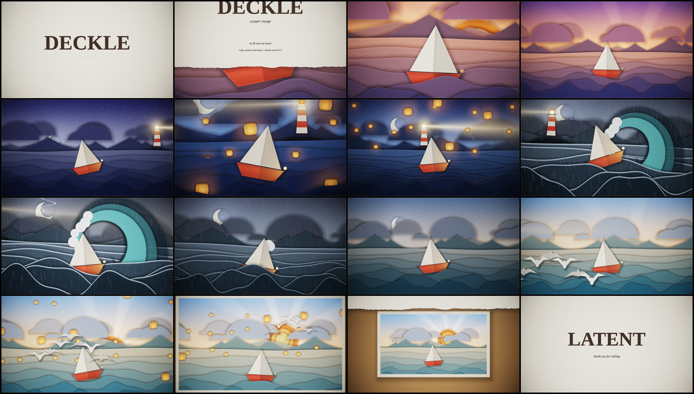

# Deckle

An 8k intro by **Latent**. Code, picture and music: Claude Sonnet 5.5, in Claude Code.
`intro.html` is 7,211 bytes and runs on double-click in Edge or Chrome.



## What it is

A paper boat sails through one day and one night: dusk, a calm night with lanterns
and a lighthouse, a storm with a great wave, a calm after the storm, and a dawn with
cranes. At the end the picture shrinks into a framed picture on a desk, and the
sheet it is printed on is let down over the screen. About 130 seconds, 100 BPM,
chamber-folk music for kalimba, flute, strings and brushes.

The picture is made of cut paper. Every layer (sky, clouds, two mountain ranges,
seven sea strips, wave, boat) is a 2D shape with a bright cut edge and a soft shadow
that it casts on the layer behind it, and each layer moves by a different amount when the
camera moves, so the scene has depth without any 3D geometry. A "deckle" is the
rough, torn edge of a handmade sheet of paper; the sheet in the intro has one, and
the lettering is printed on it and travels with it.

## Timeline

One bar is 2.4 s. Bars are counted from the start of the soundtrack.

| Bars | Seconds | Music | Picture |
|---|---|---|---|
| 0-3 | 0-9.6 | pad swells, kalimba plays theme A | title on the sheet; at 7.2 s the sheet is pulled up with a paper sound |
| 4-11 | 9.6-28.8 | theme A on kalimba, plucked bass from bar 6, soft kick and brush shaker | dusk: sun on the horizon, purple clouds, boat in the foreground |
| 12-19 | 28.8-48 | flute joins, kalimba arpeggio, lantern chimes from bar 16 | night: stars, moon, lighthouse with a sweeping beam, lantern fields, camera pushes in |
| 20-23 | 48-57.6 | arpeggio quieter, bass saw pulse, toms, rising wind | the storm builds from 50 s: darker palette, rain, rougher sea |
| 24-31 | 57.6-76.8 | theme B on strings, driving bass, thunder after each of six flashes | storm: camera rolls, great wave breaks over the boat at 72.5 s, lightning at bars 25, 26.5, 28, 28.25, 29.75 and 31 |
| 32-35 | 76.8-86.4 | drums stop, pad and bass only | calm sea after the storm, clearing sky |
| 36-39 | 86.4-96 | theme A returns on kalimba, bass and kick come back | dawn colours, sun rays; cranes enter at 90 s |
| 40-47 | 96-115.2 | all instruments, key raised from D to E major, lantern chimes, glockenspiel | cranes and lanterns in a bright sky; from 105.6 s the picture shrinks onto a desk |
| 48-51 | 115.2-124.8 | slow close on kalimba and glockenspiel | the sheet comes down at 116.4 s, "LATENT" and "thank you for sailing" are printed on it |
| - | 124.8-129.5 | pad and kalimba die away | fade to the sheet colour |

## How it works

- **Scene** (`src/scene.frag`): one fragment shader draws the whole picture into a
  float framebuffer. A helper `lay()` turns the distance to a layer's edge into
  coverage, a bright edge line and a soft shadow on everything painted before it. The
  paper grain is value noise at two scales that multiplies each layer. Shapes are
  convex-polygon distances (`ee`, `tr`, `qd`), boxes (`sb`), discs and sine curves.
  The great wave is a logarithmic spiral arm with three coloured bands and foam
  circles. Lanterns are cut-paper layers like the rest: a rounded body that is wider in the middle,
  vertical ribs, dark caps, a glow from a flame near the bottom, a cut edge and a shadow
  on what is behind. They sway and rise slowly on a jittered grid, in two fields at
  different depths. The birds are a body, a head, a tail and two wings with an elbow; a
  phase per bird moves the elbow and the tip up and down. The lighthouse beam sweeps across
  the sky. Rain, sun rays, stars and lightning are each one formula of position and time.
  Clouds are a row of cells with a hash per cell; neither the cell size nor the hash depends
  on the storm value, only the lobe radius and height do (see the note in `tools/devlog.md`).
  Palettes for dusk, night, storm and dawn are blended by a phase value `K`.
  The camera is a zoom, a roll and a shake applied to the screen coordinates, with keyframes in bars.
- **Sheet and lettering**: a vertical edge position `eb(t)` is shared by the scene and the
  post shader. The scene draws the torn sheet above that position; the post shader
  samples the lettering from a canvas texture (eight rows of 128 pixels, written by
  `main.js`) and shifts it with the same edge, so the text stays on the paper.
- **Music** (`src/music.frag`): one pixel per stereo sample, 4,096 x 1,518 floats read
  back into an `AudioBuffer`; the dry mix is in `xy` and the send for the echo and the
  hall in `zw`. Every instrument is a closed formula of the sample index: kalimba
  (a decaying sine plus a short ring at 5.4 times the pitch), glockenspiel (bar
  partials), flute (sine with two overtones, late vibrato, breath noise), saw
  instruments as harmonic sums through a resonant low-pass response, plucked bass,
  kick, brush shaker, toms, thunder (smooth noise and a falling sine), rain hiss,
  wind and paper sounds (noise with a swept rate). Two 64-eighth themes are stored as
  integer arrays (0 rest, 1 hold, otherwise a scale step); chords come from two
  8-bar root tables. The shader contains no state, so any pixel can be computed independently.
  `main.js` adds a ping-pong echo of three eighths and a feedback-delay-network hall on
  the send channels and soft-clips the sum with `tanh`. Measured at -14.9 LUFS, peak -1.5 dBFS.
- **Post** (`src/post.frag`): mip-chain bloom, vignette, ACES fit, gamma, lettering,
  film grain, fade in and out.

## Credits and sources

- Loader, music texture layout, harmonic-sum synthesis, echo and hall code come from
  Latent's own earlier intros (37 Turbo Boost and 27 Wavefolder).
- Box SDF after Inigo Quilez; ACES fit by Krzysztof Narkowicz; float hash by Dave
  Hoskins; integer hash after the PCG hash by Melissa O'Neill.
- Feedback-delay hall after Jot & Chaigne.
- The look follows the general style of cut-paper and layered-paper illustration. No
  artwork, music or text from another work is used.

## Build

From `Latent_8k/` (on Windows in PowerShell as in the other intros):

```
$env:ROADROLLER=2; node tools/build.mjs 41_deckle     # without Roadroller intro.html is over 8,192 bytes
node tools/capture.mjs 41_deckle check 41_deckle/intro.html
node tools/capture.mjs 41_deckle sheet "2,9,16,24,34,44,52,60,68,76,84,92,100,108,118,125"
node tools/capture.mjs 41_deckle still 44 41_deckle/media/hero_deckle.png
$env:BAR=115200; node tools/bands.mjs 41_deckle out.wav
```

On Linux set `BROWSER` to Chrome and `BARGS` to the GL flags; the tools then do not
use Edge or Direct3D. The media of this intro were made with
`BROWSER=/usr/bin/google-chrome BARGS="--no-sandbox --use-angle=swiftshader --use-gl=angle --enable-unsafe-swiftshader"`.

Sizes after the last build: `intro.html` 7,211 bytes, `intro_fetch.html` 6,926 bytes,
`intro.html.br` 6,873 bytes.

## Known limits

- Nobody on the team can hear: the mix was checked with `bands.mjs`, a spectrogram and
  an EBU R128 loudness measurement only. The balance of the instruments is untested by ear.
- The picture and the soundtrack were only run on a CPU renderer (Chrome with
  SwiftShader and llvmpipe, no GPU). Start-up takes about 4 s there; the frame time on a real GPU is
  not measured. The scene is one pass of 2D shapes with a few dozen layer evaluations
  per pixel, so a GPU should run it at full rate, but this is not verified.
- The sheet at the start and the end reaches the screen's top edge at 9 s, so the
  title is partly cut off while it rises. This is intended.
- The headline "DECKLE" on the start screen uses the Georgia font; on a system without it a fallback serif is used.
