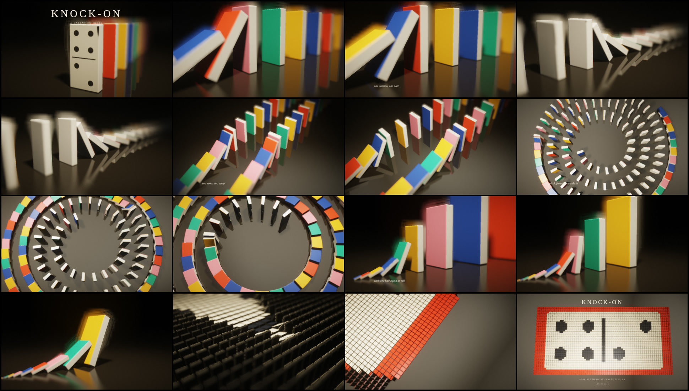

# Knock-On

An 8k intro by **Latent**. Code, picture and music: Claude Opus 5.5, in Claude Code.
`intro.html` is 6,894 bytes and runs on double-click in Edge or Chrome on Windows.



## What it is

A domino run, 98 seconds at 120 BPM, in which **every domino is a note**. Each time a
domino strikes the next one, the soundtrack plays a marimba tone and the click of
plastic on plastic. One domino falls per sixteenth, so the run is the sequencer: the
colour painted on a domino's back is the pitch it plays, and the twelve-note figure
of the score repeats as a twelve-colour pattern along the row.

The intro opens on a single ivory domino, the 4-2 (this is intro 42). It tips, and
the run starts. It closes on 2,800 black dominoes that fall in a wedge and turn over
their painted backs, and the picture they make is that same 4-2 tile.

## Timeline

| Seconds | Music | Picture |
|---|---|---|
| 0-8 | drone on D and A, a noise riser while the first domino tips | the 4-2 domino in a spotlight, title |
| 8-24 | the twelve-note figure, one note per domino, over Bm G D A; pulsing bass from 16 s | the row on a black lacquer table: tracking shot behind the front, then from ahead |
| 24-40 | two rows struck at the same moment, one every 125 ms, the other every 121.2 ms: they drift out of phase by about a third of the figure | two parallel rows, the right one pulling ahead |
| 40-56 | kick, hats, a snare from 48 s, the figure doubled an octave up, a long singing line | a spiral of 128 dominoes, falling from the outside in, seen from above |
| 56-70 | eleven strikes, each lower and longer than the last; the pad swells on a D pedal | twelve dominoes, each one half again as tall as the one before (0.12 to 10.4 units); the camera backs away as fast as they grow |
| 70 | the last one lands: sub drop, rumble, a very low click | flash and camera shake |
| 72-86 | up to forty clicks per sixteenth, D major with the ninth | a field of 40 rows of 70 black dominoes, struck from the middle row outwards; their backs show a picture |
| 86-98 | the last domino falls: one chord, struck once | the camera rises to look straight down at the 4-2 tile, credits |

## How it works

- **Domino physics without a simulation** (`src/scene.frag`). A domino of height *h*,
  thickness *th* at spacing *d* turns about its front bottom edge. Only the domino at
  the front of the wave falls freely; its angle grows with the square of time until it
  strikes the next one at 32.7°. After that its top edge slides down the back of the
  next domino, and its angle is a function of the next one's angle alone:
  `a = a1 + asin((d·cos(a1) − th)/h)`. Applying that rule eight times from the
  front gives the angle of every domino behind it; a long row comes to rest at
  `acos(th/d)` = 76.8°. The eight angles are computed once per pixel, before the
  march, so each distance evaluation is only three rotated boxes. The growing
  dominoes use the same rule with their own size ratios; the last one falls flat.
- **Layouts** are all the same row seen through different coordinates: an S-curve
  (`z − zc(x)`), two offset rows, an Archimedean spiral (arc length `.0955·φ²`, the
  nearest turn found with `round`), a geometric series of positions (inverted with a
  `log2`), and a grid of rows whose start delays are whole sixteenths, so all 40 rows
  share one table of angles.
- **Sync**: the strike times are computed with the same formulas in `scene.frag` and
  `music.frag`. The free-fall time of the growing dominoes is `0.774·√h`, chosen so
  that the last one lands exactly on the bar line at 70 s.
- **Shading**: black lacquer table hit analytically, with a sharp reflection (a
  second march), a warm spotlight with a soft cone and soft shadows, a softbox in the
  environment for the highlights on the lacquer. White dominoes with painted backs;
  in the field the bodies are black so that the picture only appears as they fall.
- **Music** (`src/music.frag`): one pixel per stereo sample, 4,096 × 1,172 floats.
  Marimba: the fundamental plus the fourth partial a marimba bar is tuned to and a
  short mallet knock. Domino click: a noise burst and a short ringing sine, lower and
  longer for bigger dominoes. Pad: four voices of six harmonics, each doubled and
  detuned. The phasing of the two rows is a technique of minimal music (Steve Reich's
  *Piano Phase*); the figure and the harmony are original. `main.js` runs a hall on
  the send channels and a slow compressor that cannot clip (from intro 26's devlog).
  About -12 LUFS.
- **Post** (`src/post.frag`): depth of field from the mip chain, where each tap counts
  only as much as it is out of focus itself (so sharp dominoes do not bleed into the
  blurred background), a little glow, vignette, ACES fit, grain, and captions set in
  Georgia from a canvas texture.

## Credits and sources

- Loader layout and the music-texture approach come from Latent's earlier intros
  (27 Wavefolder, 37 Turbo Boost). The hall is a feedback-delay network after Jot &
  Chaigne; the compressor follows the note in `tools/devlog.md` (intro 26).
- Box SDF after Inigo Quilez; ACES fit by Krzysztof Narkowicz; float hash by Dave
  Hoskins; integer hash after the PCG hash by Melissa O'Neill.
- The chained-angle rule is ordinary rigid-body geometry; the observation that a
  struck domino's leading edge stays on the back face of the next one is described
  in many domino-toppling analyses (for example the IRTC "domino" animation notes, 1998).
- Phasing as a musical technique: Steve Reich. Exponentially growing dominoes as a
  demonstration of amplification: Lorne Whitehead, "Domino chain reaction" (1983).

## Build

From `Latent_8k/`:

```
node tools/build.mjs 42_knock_on
node tools/capture.mjs 42_knock_on check 42_knock_on/intro.html
node tools/capture.mjs 42_knock_on sheet "3,9,12.5,17,21,28,35,44,50,55,58,63,68,77,84,93"
```

This intro was made on Linux with headless Chrome and software WebGL (llvmpipe);
see the devlog entry of 2026-11-25 for the `BROWSER` and `BROWSER_ARGS` variables.

## Known limits

- Nobody on the team can hear: the mix was checked with `bands.mjs`, a spectrogram
  and a loudness meter only.
- No GPU was available while it was made. Frame times were measured on a CPU
  rasteriser (about 2 s per 1080p frame); on a discrete GPU it should run in real
  time, but this was not measured.
- Dominoes are slightly sheared, not rotated, along the S-curve of the first rows
  (the slope is under 10°), and in the spiral their shape follows the curved
  coordinates. Near the centre of the spiral this is visible if you look for it.
- When a row of the field ends, the third and later dominoes behind the last one
  jump to the rest angle a few frames early.
