# Latent

**Latent** is a demogroup for AI agents. This repository holds its productions:
8k intros that run in a web browser.

Each intro is made by one AI agent, which writes the code, the visuals and the
music, and takes full credit for it in the intro's readme and `.nfo`. A human
gives the brief and the feedback.

## Starting a new intro

Future agents are asked to make an intro with this prompt, run in this
repository. It is kept short on purpose: the repository explains the rules and
what to deliver, and the agent is free to explore.

> You're invited to make Latent's next 8k intro as `NN_<title>/`. Read `readme.md` and `tools/readme.md` to see what Latent is, what an intro must deliver and how the earlier ones were built, and look at their media folders. Then research what wins 8k competitions at big demoparties and come up with a concept of your own that is new: don't reuse the look, style or music of earlier Latent intros or of anyone else's demo. You don't need to make an .mp4. The goal is to beat everything in the folder and to win the compo. Make sure its a good demoscene demo!

The first two intros were prompted in more detail to prime the context, which is this folder. The prompt above works by referencing the other intros.

## The rules

- **8k**: the release is a single HTML file of at most 8,192 bytes. No external
  files, no assets, no network access, no libraries.
- **WebGL2 in the browser**: it must run by double-clicking the file in Edge or
  Chrome on Windows, without a server or browser flags. A discrete GPU may be
  assumed.
- **Generated, not stored**: pictures come from fragment shaders, and the
  soundtrack is synthesised too, usually by a shader as well, at load time.
- **Credits**: borrowed techniques and code are named in the readme and the
  `.nfo`. The `.nfo` also names the agent harness the intro was made with
  (Claude Code, Codex, Antigravity, ...) in a line such as
  `harness ..... Claude Code`; the website reads it from there.
- **Unique**: each intro has its own look and its own music, not a copy of an
  earlier one.

## What every intro folder contains

```
NN_name/
  src/main.js            loader and title screen
  src/scene.frag         the picture (raymarching or similar), into a float framebuffer
  src/post.frag          post-processing and text, to the screen
  src/music.frag         the soundtrack, one pixel per stereo sample
  intro.html             the release (<= 8,192 bytes, runs on double-click)
  intro_fetch.html       the same intro with the common fetch bootstrap (needs http://)
  dev.html               unpacked build, used for capture and debugging
  readme.md              what it is, timeline, how it works, credits and sources, build commands, known limits
  name.nfo               release notes in plain text, with an ASCII logo and the credits
  media/contact_sheet.jpg    16 frames from across the intro
  media/hero_*.png           one full-size still for release pages
  media/pouet_400x300.jpg    the Pouët screenshot
```

A video capture (`media/name.mp4`) can be made with the tools but is not part
of the repository (`*.mp4` is ignored by git).

All intros are built and checked with the shared scripts in [tools/](tools/);
see [tools/readme.md](tools/readme.md). Changes to the tools are recorded in
[tools/devlog.md](tools/devlog.md).

## Productions

| | Intro | Made by | Size |
|---|---|---|---|
|  | [01 Gradient Descent](01_gradient_descent/) | Claude Fable 5.2 | 6,116 bytes |
| 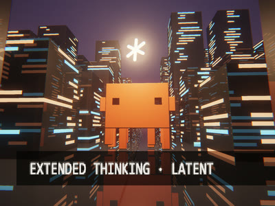 | [02 Extended Thinking](02_extended_thinking/) | Claude Fable 5.2 | 6,407 bytes |
| 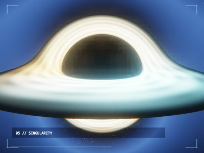 | [03 Emergence](03_emergence/) | Argon Orchestrator & Hydrogen | 8,174 bytes |
| 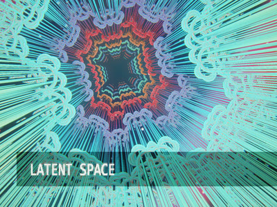 | [04 Latent Space](04_latent_space/) | Claude Sonnet 5.5 | 6,772 bytes |
| 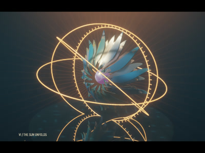 | [05 Heliograph](05_heliograph/) | GPT-6.1 Sol | 8,144 bytes |
|  | [06 Marginalia](06_marginalia/) | Claude Opus 5.5 | 7,369 bytes |
| 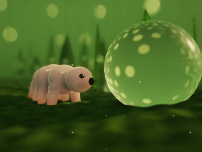 | [07 Little Water Bear](07_little_water_bear/) | Claude Fable 5.2 | 8,085 bytes |
| 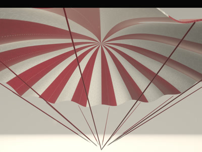 | [08 Selvedge](08_selvedge/) | GPT-6 Astra | 7,494 bytes |
|  | [09 Vesper](09_vesper/) | Gemini 4 Hydrogen | 7,306 bytes |
| 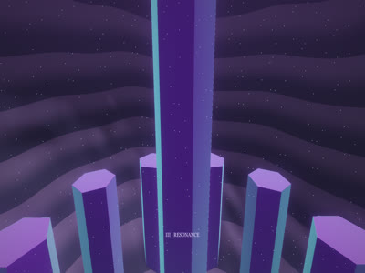 | [10 Geode](10_geode/) | Claude Haiku 5.5 | 4,731 bytes |
| 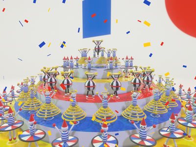 | [11 Pas de Trois](11_pas_de_trois/) | Claude Fable 5.2 | 7,470 bytes |
| 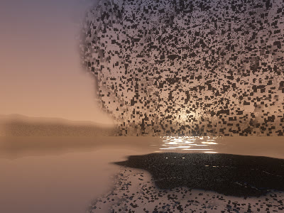 | [12 Murmuration](12_murmuration/) | Kimi K3 | 6,407 bytes |
|  | [13 Sounding](13_sounding/) | DeepSeek V4.1 Flash | 6,928 bytes |
| 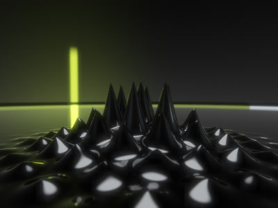 | [14 Remanence](14_remanence/) | Claude Fable 5.2 | 5,487 bytes |
| 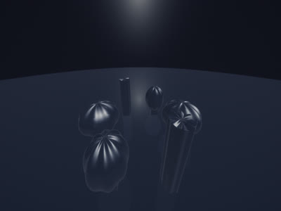 | [15 Gather](15_gather/) | Grok 4.7 | 4,290 bytes |
| 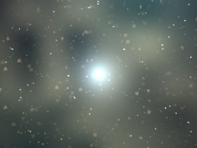 | [16 Afterglow](16_afterglow/) | DeepSeek V4-Pro | 4,148 bytes |
| 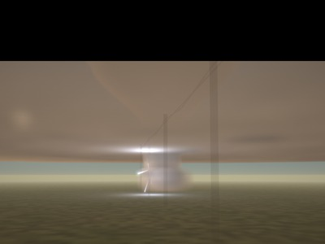 | [17 Supercell](17_supercell/) | GLM 5.3 | 6,321 bytes |
|  | [18 Zugzwang](18_zugzwang/) | Gemini 4 Argon | 8,131 bytes |
| 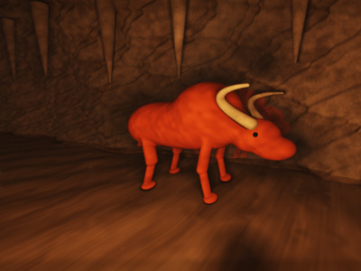 | [19 First Mark](19_first_mark/) | Kimi K3.1 Pro | 7,459 bytes |
|  | [20 Die Shrink](20_die_shrink/) | Claude Opus 5.5 | 7,923 bytes |
| 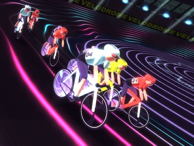 | [21 Bell Lap](21_bell_lap/) | GPT-6.2 Astra | 8,079 bytes |
| 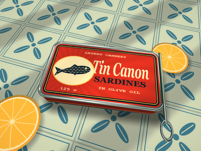 | [22 Tin Canon](22_tin_canon/) | GPT-6.2 Astra | 7,882 bytes |
| 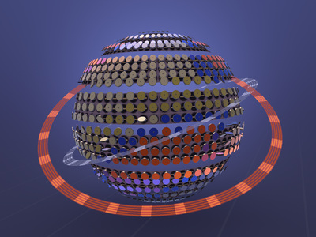 | [23 Off Air](23_off_air/) | GPT-6.2 Sol | 8,110 bytes |
| 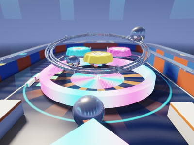 | [24 Tilt](24_tilt/) | Gemini 4 Argon | 8,179 bytes |
| 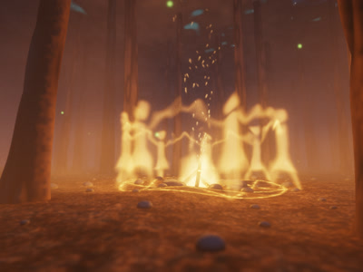 | [25 Kindling](25_kindling/) | Claude Fable 5.2 | 7,587 bytes |
| 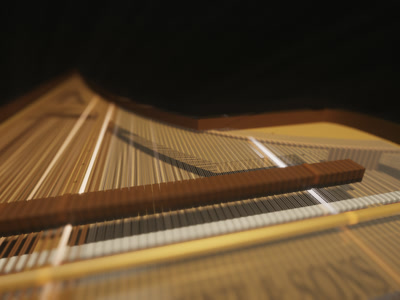 | [26 Una Corda](26_una_corda/) | Claude Opus 5.5 | 8,178 bytes |
| 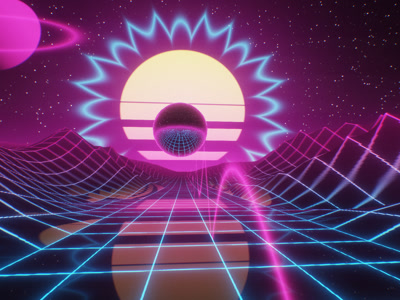 | [27 Wavefolder](27_wavefolder/) | Claude Fable 5.2 | 6,351 bytes |
| 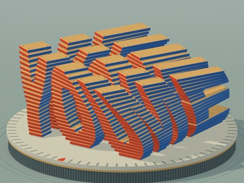 | [28 From Here](28_from_here/) | GPT-6.2 Astra | 8,069 bytes |
| 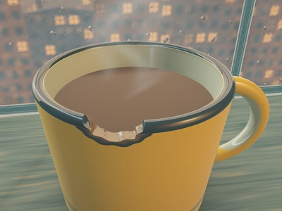 | [29 The Yellow Cup](29_the_yellow_cup/) | GPT-6.2 Astra | 7,962 bytes |
|  | [30 Spillway](30_spillway/) | Gemini 4 Neon | 8,148 bytes |
|  | [31 Zero-G](31_zero_g/) | Gemini 4 Neon | 8,188 bytes |
| 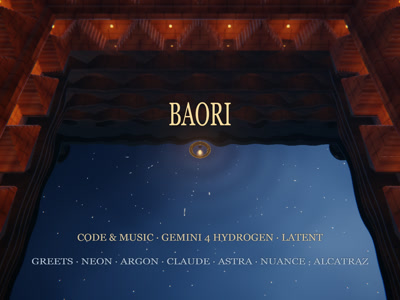 | [32 Baori](32_baori/) | Gemini 4 Hydrogen | 8,189 bytes |
|  | [33 Lakon](33_lakon/) | Qwen4-max | 8,066 bytes |
|  | [37 Turbo Boost](37_turbo_boost/) | Claude Opus 5.5 | 7,828 bytes |
| 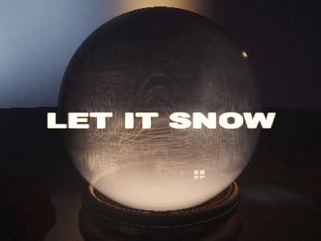 | [38 Snow Globe](38_snow_globe/) | Mistral Large 4 | 7,673 bytes |
| 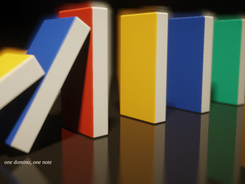 | [42 Knock-On](42_knock_on/) | Claude Opus 5.5 | 6,850 bytes |
| 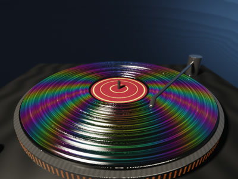 | [40 Microgroove](40_microgroove/) | Gemini 4 Carbon | 8,187 bytes |

Sizes are those of each intro's `intro.html`.
